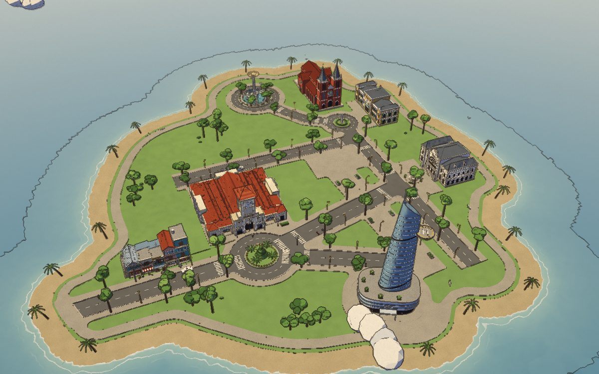
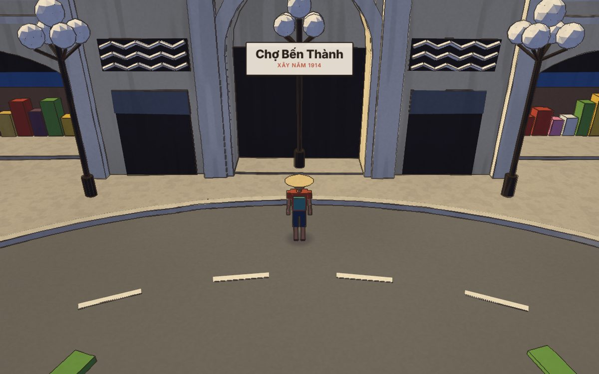

# Sài Gòn Q1: project brief

Đọc file này trước khi làm tiếp. Code game xem README.md, quy ước code xem CLAUDE.md.



## Dự án là gì

Quận 1 thu gọn thành một hòn đảo low-poly giữa biển, dựng trong Blender (`sg.tinymap.blend`). Người chơi đi bộ tự do trong Three.js, kiểu game Messenger (messenger.abeto.co). Vào game thì nhân vật đứng trước cổng nam chợ Bến Thành.

- **Đã xong:**
  - Map v4: đảo khoảng 200×200 m giữa biển. Map quay theo hướng thật của thành phố (cổng nam chợ nhìn ra bùng binh Quách Thị Trang), nên các công trình nằm bên phải và phía trên chợ, gần giống vị trí thật: Lê Lợi dẫn tới Nhà hát; Đồng Khởi đi từ Nhà thờ xuống biển; Bưu điện cạnh Công xã Paris; Hồ Con Rùa nằm trên đường Phạm Ngọc Thạch; Bitexco ở bờ nước. Không thêm nhà mới. Cây trồng thành hàng dọc phố, chỉ vài xe đậu, không có người (NPC sẽ thêm sau theo cốt truyện).
  - Biển, mây, hải âu, cây đung đưa và âm thanh theo khu vực (bây giờ chỉ có bãi biển: tiếng sóng nhẹ) làm trong Three.js, không nằm trong file Blender.
  - Menu mở đầu có 2 chế độ: [1] vào game đi bộ (nhân vật đội nón lá, camera góc thứ 3 tự do, tên địa điểm hiện trên HUD; lần đầu vào, sau khi chọn vai và trang phục, một thẻ kể câu chuyện của vai đó và việc cần làm) và [2] xem bản đồ (xoay, zoom, bay tới từng công trình; nét mực tắt sẵn, bật lại bằng nút).
- **Trong `models/temp.sg.tinymap.blend` (2026-11-07, đã export thành `saigon_q1_v5.glb`, đã bake nav):** sửa bằng `scripts/blender/edit_v4_buivien.py` chạy trên `new.sg.tinymap.blend`:
  - Phố Bùi Viện trên đường Lê Lai: nhà ống hai bên phố (`SH_BuiVien_N/S`), biển hiệu quán bar, đèn dây, lồng đèn, cờ, bàn ghế nhựa, xe máy đậu (`SH_BuiVien_Life/Lights`), cổng "PHỐ ĐI BỘ BÙI VIỆN" ở đầu bùng binh. Dãy nam nông 4.6 m vì lối đi bộ ven biển chạy ngay sau lưng (y −37…−41); dãy bắc ngắn lại ở đầu tây cũng vì lối đi đó.
  - Đường Tôn Đức Thắng: Hàm Nghi không còn cụt ở Bitexco mà vòng sang nối vào Đồng Khởi (`IX_Roads_TonDucThang`), cắt qua đầu nam phố Nguyễn Huệ; đoạn cụt cũ của Đồng Khởi (y −60…−52) bỏ.
  - Bỏ hai đèn 4 bóng (một đứng giữa cổng nam chợ, một đứng trên mặt đường ở cửa đông bùng binh), bỏ các vạch qua đường vẽ chồng trên vòng xuyến, thêm một vạch sạch trên nhánh Lê Lai (`IX_RoadMarks_LeLaiZebra`).
  - Nav bake lại ngày 2026-11-07: hai dãy nhà là hộp `NAV_Solid_BuiVien_*` (đi tới quầy bar thì dừng, vỉa hè dưới ban công và biển hiệu vẫn đi được); chỗ đèn và bồn cây đã bỏ trên Tôn Đức Thắng, ở cửa đông bùng binh và chỗ hai tượng người cũ (sau Chú Tư, cạnh Chị Hạnh) đi qua được.
- **Để dành, chưa làm:**
  - UBND: ô trống lát gạch ở đầu bắc phố đi bộ Nguyễn Huệ (x 48…72, y 12…31), sát đường Lê Thánh Tôn, giống vị trí thật.
- **Tiếp theo:** NPC và quest.
- **Bản cũ:** trong `versions/`: v1; v2 (có sông, bờ Thủ Thiêm, cầu Ba Son); v3 (công trình xếp vòng quanh chợ). Không sửa đè, muốn đổi lớn thì lưu version mới.
- **Model công trình không sửa:** v3 và v4 chỉ dời và xoay nguyên khối. Người có sẵn trong model cũ (người ngồi chơi quanh Hồ Con Rùa, người đứng ở Lam Sơn, chủ tiệm nhà phố) vẫn còn, trừ hai người đã nhường chỗ cho NPC (2026-11-06): cô đội nón lá đứng ở quầy tiệm trên Lê Lai (giờ là Chú Tư) và người áo xanh ở Lam Sơn (giờ là Chị Hạnh). NPC nằm trong `server/content/npcs.json`.
- **Cách làm việc:** plan lớn phải hỏi Khoa trước khi làm.

## Style (giữ nguyên khi vẽ thêm)

- **Low-poly, màu phẳng:** không texture, không UV. Màu chỉ lấy từ bảng `PAL` (Text `saigon_diorama_01_setup.py`). Vật liệu tên `SD_<key>`, tạo bằng `get_mat(key)`.
- **Toàn bộ là shader:**
  - Node group `SD_Paint` tạo nhiễu màu, bẩn chân tường, vệt mưa, hạt giấy và ranh sáng tối răng cưa.
  - Viền mực: trong Blender là Grease Pencil LineArt `SD_Ink`; trong game là ink pass screen-space.
  - Game dựng lại paint shader theo tên vật liệu (`src/game/paint.ts`).
- **Ánh sáng:** nắng ấm `#FFF2DC`, bóng lạnh `#717BA2`.
- **Méo tay:**
  - Modifier `SD_HandWobble` (Displace): `LM_*` là 0.045, các object khác 0.07. Chạy `art_pass_geometry()` sau khi thêm object.
  - Kính và thép hiện đại (Bitexco) để thẳng, không méo. Đường (`IX_`) và đảo (`IS_`) cũng không méo.
- **Tỉ lệ:**
  - Đơn vị mét. Người cao 1.7 m, tầng nhà 3.2–3.6 m.
  - Lòng đường 6–10 m, vỉa hè 2.6–3 m.
  - Công trình đặt trên nền z = 0.18 (cao bằng vỉa hè).
  - Chiều cao được nén cho gọn: Bitexco chỉ 52 m.
- **Cách giản lược:** giữ silhouette và 2–3 chi tiết đặc trưng (tháp đồng hồ, tháp chuông, vòm, đỉnh hoa sen), có thể phóng to các chi tiết này 1.2–1.5 lần. Bỏ chi tiết vụn.

### Bảng màu chính (key trong `PAL`)

| Nhóm | Key và màu |
|---|---|
| Tường | cream `#EAD9AE`, creamLight `#F4EBD3`, wallGrey `#A0A7AA`, wallTeal `#5E9A96`, wallOchre `#C9A25E`, wallBeige `#CFC1A0`, wallPink `#D29A86`, opWhite `#EEE7D7`, opShade `#D8CDB8`, poYellow `#E0B45A`, brick `#B5523B`, stone `#E6DCC8`, towerPale `#DAD4C8`, concrete `#ABA69C` |
| Mái | roofRed `#A9492F` (dark `#7D3326`, light `#C0613F`), slate `#646B74`, spire `#6F7780`, tinBlue `#8AA3B6` |
| Điểm nhấn | poGreen `#3E7F5F`, clockBlue `#4E7CA6`, clockWhite `#F3EEE2`, gold `#C9A24A`, lotusTop `#E6D29C`, turq `#5BA9A1`, archDark `#3B3330`, glassBlue `#7FA0B5`, glassTeal `#4F7A7C`, finSilver `#D3DAE0`, bridgeWhite `#EEF0EE`, statueW `#F2EFE8` |
| Mặt đất | asphalt `#6F6D69`, paving `#BDB4A2`, curb `#D3CBB8`, roadLine `#ECE6D4`, grass `#86A85E`, sand `#CDB98F`, water `#6FA9B6` (hồ) |
| Biển (Three.js, `src/game/sea.ts`) | sâu `#3F8399`, cạn `#86CBC6`, bọt `#F3F1E7`, sương chân trời `#DCDCD0` |
| Cây | leaf `#6E9B4C`, leafLight `#93B85F`, leafDark `#4D7539`, bark `#6B4C36` |
| Mực | ink `#2B211C`; lampGlow `#FFE6A8` (không đổ bóng) |

Thêm màu mới thì thêm key vào `PAL`. Nếu cần chỉnh variation hay grime riêng thì thêm key đó vào bảng `PAINT` trong `src/game/paint.ts`.

## File Blender

- **Scene và collection:**
  - Scene `SaigonDiorama`.
  - `SD_World` chứa mọi thứ có viền mực; `SD_NoInk` chứa nước và dây điện.
  - Object nằm ngoài hai collection này thì không được export.
- **Tiền tố tên object:**
  - `IS_` đảo: `IS_Island` (mặt cỏ), `IS_Beach` (bãi cát dốc xuống biển). `IX_` đường: `IX_Roads_v4`, `IX_RoadMarks_v4`.
  - `BT_` chợ Bến Thành; `LM_` công trình lớn; `SH_` nhà ống.
  - `CX_` phần lấp đầy: `CX_StreetTrees_v4` (cây, đèn dọc đường, bồn cây trên Nguyễn Huệ), `CX_Parks_v4` (công viên 23/9, vài cụm cây nhỏ, dừa trên bãi cát), `CX_Traffic_v4` (vài xe đậu, không người lái). `LF_Roundabout`: trang trí bùng binh trước chợ.
- **Script nằm trong Text datablock của file `.blend`:**
  - `saigon_mini_lib.py`: bộ dựng `Geo` (`box`, `bc`, `cyl`, `cone`, `ico`, `lathe`, `extrude`, `rod`, `pyramid`, `hip`, `arch`, `text`) và `make_obj`.
  - `saigon_diorama_01_setup.py`: `PAL`, `get_mat`, `SD_Paint`, ink.
  - `saigon_diorama_02…18_*.py`: mỗi bước một công trình.
  - `20/21/22_v2_*.py`: layout, đường và build của v2.
  - `30/31/32/33_v3_*.py`: vị trí công trình, layout, đường và build của v3.
  - `41_v4_layout.py`, `43_v4_build.py`: vị trí công trình, đường và build của v4 (dùng lại `30_v3_place` và bộ dựng đường `32_v3_roads`). Đọc để biết map hiện tại được dựng ra sao. Cần `shapely` và `mapbox_earcut`.
  - `00_ns_loader.py`: `load_ns()` nạp lại toàn bộ hàm mà không chạy các bước build.
  - `saigon_diorama_TODO.md`: ghi chú.
- **Toạ độ:**
  - Blender XY, trục Z hướng lên. Map quay theo hướng của chợ: +Y của map là hướng tây bắc ngoài đời, +X là hướng đông bắc. Tâm đảo (36, 8); mép cỏ khoảng X −71…126, Y −86…117.
  - Mực nước biển z = −0.45: bãi cát trên mức này đi bộ được, phía dưới là nước.
  - Mặt cỏ z = 0; vỉa hè và quảng trường 0.18; mặt đường 0.07.
- **Điểm mốc (Blender XY):**
  - Chợ (8, 7.5), bùng binh Quách Thị Trang (8, −24), điểm xuất phát (8, −12.8).
  - Đường: Lê Lợi (bùng binh → Lam Sơn, trước Nhà hát), Hàm Nghi (bùng binh → bờ nước, cạnh Bitexco; trong `temp` nối tiếp thành Tôn Đức Thắng vòng vào Đồng Khởi), Lê Lai (bùng binh → phía tây, là phố Bùi Viện trong `temp`), Lê Thánh Tôn (sau chợ), Đồng Khởi (Công xã Paris → qua Lam Sơn → bờ nước), Phạm Ngọc Thạch (Công xã Paris → Hồ Con Rùa). Phố đi bộ Nguyễn Huệ chạy từ ô UBND xuống bờ nước.

Mẫu thêm một công trình (tạo Text mới `saigon_diorama_23_<ten>.py`):

```python
exec(bpy.data.texts['saigon_diorama_00_ns_loader.py'].as_string()); ns = load_ns()
g = ns['Geo'](2026)
g.box('cream', -6, -4, 0, 6, 4, 9)              # tên vật liệu = key trong PAL; ch=0.06 là vát cạnh
g.hip('roofRed', -6.4, -4.4, 6.4, 4.4, 9, 3.2)  # mái 4 mái
ns['place_landmark'](g, 'LM_TenCongTrinh', x, y, yaw, z=0.18)
ns['art_pass_geometry']()
```

## Công trình

Ảnh "model" là render từ map hiện tại, dùng để giữ design khi sửa lại. Ảnh "thật" là thư mục ảnh trên Wikimedia Commons, có nhiều góc để tham chiếu.

| Công trình | Object · tâm (Blender XY) · cao | Đặc trưng cần giữ | Ảnh |
|---|---|---|---|
| Chợ Bến Thành (1914) | `BT_*` · (8, 8) · tháp 24.9 m | Tháp đồng hồ ở giữa cổng nam, mặt đồng hồ xanh, chóp mái ngói đỏ. Các dãy chợ mái ngói đỏ, tường xám kem. Cổng vòm ở 4 mặt, hàng quán dưới mái hiên. Bùng binh Quách Thị Trang phía trước (`LF_Roundabout`: cây tạo hình tầng, 4 cây cọ, bồn hoa) | [model](img/01_cho_ben_thanh.jpg) · [thật](https://commons.wikimedia.org/wiki/Category:Ben_Thanh_Market) |
| Nhà hát Thành phố (1900) | `LM_NhaHatLon` · (106, −4), mặt tiền hướng tây, nhìn về chợ dọc Lê Lợi · 14.6 m | Tường kem trắng (opWhite, opShade). Vòm lớn giữa mặt tiền có kính hình quạt, hai cánh hai bên, mái xám. Đã có mặt sau và hai mặt bên. Quảng trường Lam Sơn và đài phun nước phía trước | [model](img/02_nha_hat.jpg) · [thật](https://commons.wikimedia.org/wiki/Category:Municipal_Theatre_of_Ho_Chi_Minh_City) |
| Nhà thờ Đức Bà (1880) | `LM_NhaThoDucBa` · (78, 82), mặt tiền hướng nam, nhìn xuống Đồng Khởi · 26.6 m | Gạch đỏ (brick), hai tháp chuông chóp xám nhọn, cửa sổ tròn và đồng hồ giữa hai tháp | [model](img/03_nha_tho_duc_ba.jpg) · [thật](https://commons.wikimedia.org/wiki/Category:Notre-Dame_Cathedral_Basilica_of_Saigon) |
| Bưu điện Thành phố (1891) | `LM_BuuDien` · (100, 54), mặt tiền hướng tây, nhìn ra Công xã Paris · 15.7 m | Tường vàng (poYellow), cửa vòm xanh lá (poGreen), đồng hồ trên vòm cổng chính, hai khối đầu hồi, mái slate. Sân trước nhìn ra Công xã Paris; đã có mặt sau | [model](img/04_buu_dien.jpg) · [thật](https://commons.wikimedia.org/wiki/Category:Saigon_Central_Post_Office) |
| Công xã Paris | `LM_TuongDucMe` · (78, 50) | Bùng binh có tượng Đức Mẹ trắng (statueW) trên bệ, nằm trước nhà thờ | [model](img/08_cong_xa_paris.jpg) · [thật](https://commons.wikimedia.org/wiki/Category:Paris_Commune_Square_(Saigon)) |
| Hồ Con Rùa (1967) | `LM_HoConRua` (+`_Water`) · (44, 90), cuối đường Phạm Ngọc Thạch · 15.1 m | Hồ tròn có vòi phun, trụ cao với đỉnh hình hoa sen (lotusTop), cầu thang lên vòng đi bộ trên cao, tường xanh ngọc (turq). Sân vòng ngoài có ghế và bồn hoa | [model](img/05_ho_con_rua.jpg) · [thật](https://commons.wikimedia.org/wiki/Category:H%E1%BB%93_Con_R%C3%B9a) |
| Bitexco (2010) | `LM_Bitexco` · (44, −62), bờ nước giữa Hàm Nghi và Nguyễn Huệ · 52.4 m | Tháp kính xanh hình búp sen thuôn dần, đỉnh cắt xiên. Sân đỗ trực thăng nhô ra ở khoảng 2/3 chiều cao, khối đế bên dưới. Không méo tay | [model](img/06_bitexco.jpg) · [thật](https://commons.wikimedia.org/wiki/Category:Bitexco_Financial_Tower) |
| Quảng trường Lam Sơn | `CX_LamSon` (+`_Water`) · (89, −4) | Đài phun nước tròn nhiều tầng giữa bồn hoa, thu nhỏ 0.72 lần | [model](img/09_lam_son.jpg) · [thật](https://commons.wikimedia.org/wiki/Category:Lam_Son_Square) |
| Phố đi bộ Nguyễn Huệ | lát gạch trong `IX_Roads_v4`, bồn cây và đèn trong `CX_StreetTrees_v4` · từ (60, 12) đến (66, −58) | Dải lát gạch rộng 14 m, không có xe, bồn cây thấp hai bên. Đầu phố phía bắc để trống cho UBND | [model](img/11_nguyen_hue.jpg) |
| Dãy nhà ống | `SH_01..05`, `SH_StreetLife`, `SH_Wires` · x −45…−19, y −17…−7, dọc Lê Lai · 8.8–13.9 m | Mỗi căn một mặt tiền (nhà cầu thang, tiệm sư tử, tiệm lu…). Có ban công, mái tôn, biển hiệu, máy lạnh, dây điện. Đây là mẫu style cho Bùi Viện | [model](img/10_nha_ong.jpg) |
| Phố Bùi Viện (chỉ trong `temp.sg.tinymap.blend`) | `SH_BuiVien_N/S`, `SH_BuiVien_Life`, `SH_BuiVien_Lights` · dọc Lê Lai, x −60…−10, mặt tiền y −16.3 (bắc) và −31.6 (nam) · 10–16 m | Nhà ống 2–4 tầng sát nhau, tầng trệt là quán bar mở (quầy gỗ, chai, ghế nhựa), biển hiệu ngang nhiều màu có dãy bóng đèn, biển dọc neon ở góc nhà, mái hiên sọc, ban công phơi đồ, máy lạnh. Trên phố: đèn dây, lồng đèn đỏ, cờ tam giác giăng ngang, bàn ghế nhựa và thùng đá trên vỉa hè, xe máy đậu, cổng "PHỐ ĐI BỘ BÙI VIỆN" ở đầu bùng binh | [model](img/13_bui_vien.jpg) · [thật](https://commons.wikimedia.org/wiki/Category:B%C3%B9i_Vi%E1%BB%87n_Street) |
| Bãi biển | `IS_Beach`, dừa trong `CX_Parks_v4` · quanh đảo | Cát dốc thoải: khô khoảng 8 m rồi chìm xuống biển. Đường đi bộ lát gạch chạy vòng quanh mép cỏ, dừa nghiêng ra biển. Bọt sóng và màu nước cạn do shader biển tự tính theo độ sâu | [model](img/07_bai_bien.jpg) |

Cầu Ba Son và bờ Thủ Thiêm đã bỏ từ v3; muốn xem lại thì mở `versions/sg.tinymap_v2.blend`.

## Pipeline: từ Blender ra game

1. Sửa map. Đảo hiện tại là `models/temp.sg.tinymap.blend` (đảo v4 thêm Bùi Viện và Tôn Đức Thắng): muốn sửa bằng script trên file gộp này thì xem `scripts/blender/edit_v4_buivien.py` (xoá theo cụm lưới liền nhau, cắt mặt đất theo đa giác, dựng thêm object mới bằng bộ `Geo` nạp từ Text của `sg.tinymap.blend`); file đó là file GLB đã xuất được nhập lại vào Blender (một scene, lưới gộp theo vật liệu, không còn scene `SaigonDiorama` hay các collection `SD_`). `export_glb.py` và `bake_nav.py` đều chạy được trên file này. `sg.tinymap.blend` ở thư mục gốc còn đủ object gốc nhưng là bố cục cũ (còn cầu Ba Son).
2. Export GLB, file `.blend` không bị đổi:
   ```bash
   blender models/temp.sg.tinymap.blend --background --python scripts/blender/export_glb.py -- export/saigon_q1_raw.glb
   ```
3. Thu nhỏ file bằng 5 lệnh `gltf-transform` ghi trong đầu `export_glb.py` (`flatten → join → weld → quantize --pattern POSITION → prune`). Ra `export/saigon_q1.glb` (khoảng 2 MB), rồi copy sang `public/models/` với tên mà `index.html` nạp (`data-model` của `#stage`, hiện là `saigon_q1_v5.glb`).
4. Bake lại bản đồ đi lại, mất khoảng 15 giây, rồi copy sang server (server kiểm tra mọi bước đi theo bản của nó). Script đọc mực nước biển và khung lưới (`SEA_LEVEL`, `X0…Y1`) ở đầu file; đổi kích thước đảo thì sửa hai giá trị này:
   ```bash
   blender models/temp.sg.tinymap.blend --background --python scripts/blender/bake_nav.py -- public/models/saigon_q1
   npm run nav:sync
   ```
   - Mặt đất nhận theo vật liệu (cỏ, cát, nhựa đường, bó vỉa, vạch đường, đá, nước); mọi thứ khác cao ngang người là vật cản.
   - Nhà không ai được đi vào (hay đi bên dưới): thêm một hộp `NAV_Solid_<tên>` vào collection `NAV` của file (hộp đứng, chỉ tính khung nhìn từ trên xuống; trong hộp, ô nào có gì cao hơn sàn 2 m là bị chặn). Hộp hiện có do `scripts/blender/nav_boxes.py` tạo; đầu file đó giải thích thêm hộp `NAV_Block_` (chặn hẳn) và `NAV_Open_` (bỏ vật cản). Các hộp không bị export.
   - Người chơi bước lên được bậc 0.5 m và bước xuống được 1.1 m (`src/game/player.ts`), nên nhảy lên ghế hay mép bồn cây thì vẫn xuống được.
   - File gốc cũ (`sg.tinymap.blend`, scene `SaigonDiorama`) vẫn bake theo tên object như trước: `ROOF_PREFIX`, `SOLID_PREFIX`.
5. Thêm tên địa điểm mới vào `src/game/places.ts`, toạ độ Blender XY.


