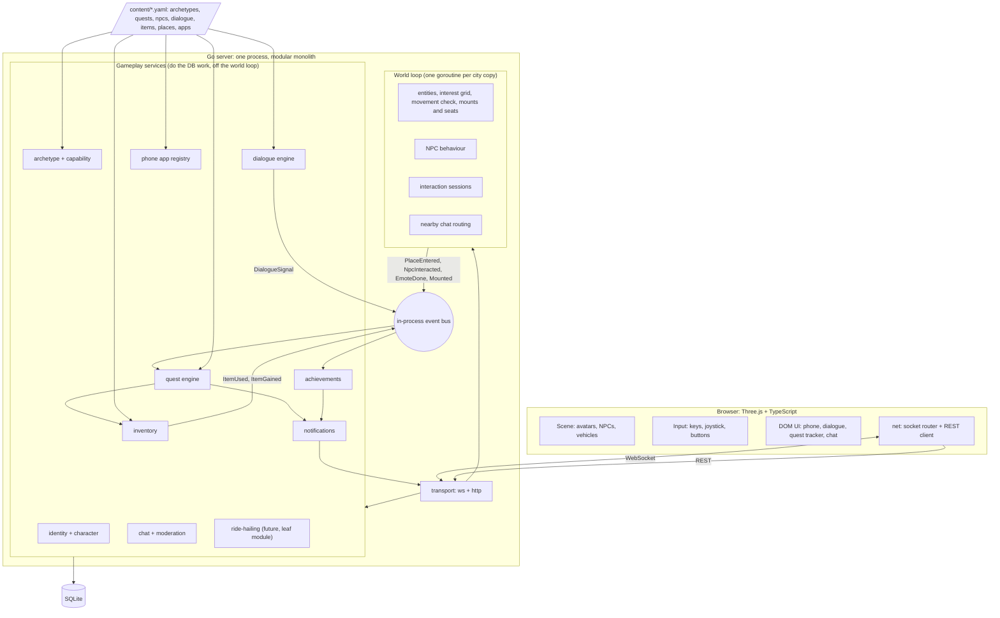
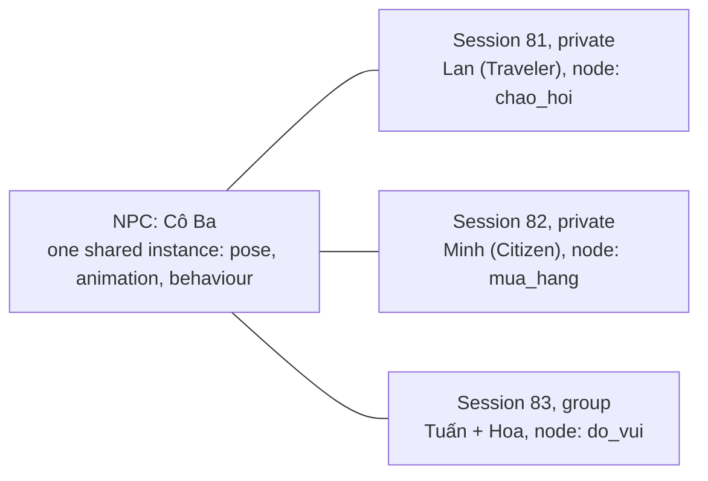
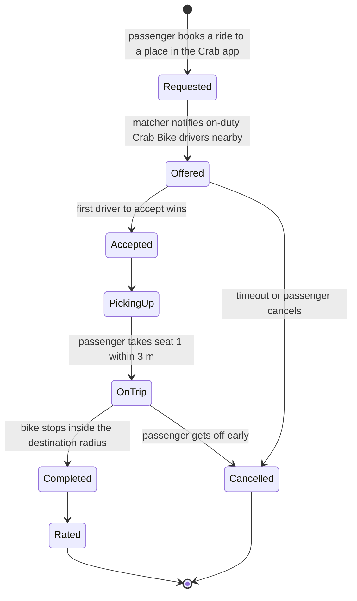
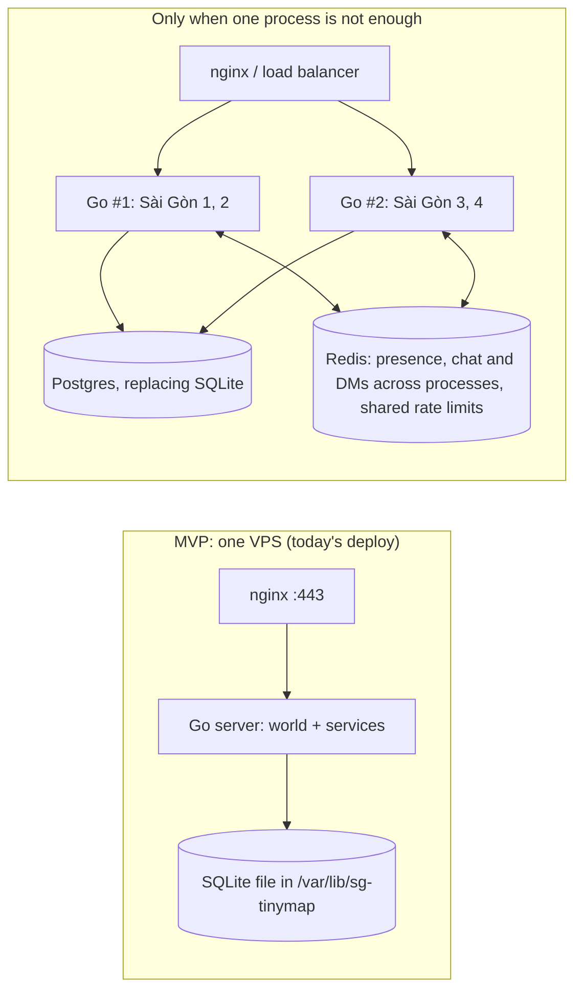

# System architecture

One Go process, organized as modules inside a single program. The world loop owns everything real-time; gameplay services own everything durable.

## Module map



## How the modules talk

- **The world loop never touches the database.** It publishes facts to the in-process event bus, e.g. "Lan entered Nhà thờ Đức Bà".
- **Gameplay services handle those events in per-character workers.** Each character always maps to the same worker goroutine. One character's updates happen in order, with no lost writes, while different characters run in parallel.
- **Messages back to a player go through the world loop.** That keeps today's rule that one goroutine owns the connection queues (`server/internal/hub/hub.go:2`).
- **Nothing in the core depends on archetype modules.** `ridehail` may import world, inventory and notify; none of them import it.
- **Systems check capabilities and tags, never the archetype id.** That's what keeps `switch archetype` out of the code (see [03-domain-model.md](03-domain-model.md)).

## One NPC, many conversations



The three interaction modes:

- **Private:** only that player sees the dialogue.
- **Public:** the NPC's lines also appear as speech bubbles and in nearby chat, e.g. a vendor calling out.
- **Group:** several players share one position in the dialogue. Choices are made by the session leader, or by vote later.

The NPC turns toward whoever spoke last; that's visual only. NPC behaviour (standing, wandering, walking a route) runs in the world loop. The dialogue engine is a separate service, so an AI dialogue provider can replace scripted dialogue later without touching behaviour.

## How a quest step completes, with the server in charge

```mermaid
sequenceDiagram
  participant C as Client (Traveler)
  participant W as World loop
  participant B as Event bus
  participant Q as Quest engine (character worker)
  participant DB as SQLite
  C->>W: state {x,y,z,h,s} at 10 Hz
  W->>W: check speed, walkability, height on the nav grid
  W->>B: PlaceEntered(char, nha_tho_duc_ba) after a 2 s stay
  B->>Q: route to this character's worker
  Q->>Q: any active objective listening to place.entered?
  Q->>DB: one transaction: progress + rewards + reward_grants (unique key)
  DB-->>Q: commit
  Q-->>W: deliver quest.updated / reward
  W-->>C: quest.updated
  Note over C,Q: the client never says "objective done"; it only moves, talks, picks choices and uses items
```

## Ride-hailing (future): how it plugs in

The detailed plan, decided after phase 2, is [08-ride-hailing.md](08-ride-hailing.md): the trip states there replace the sketch below, and the core gains a few generic pieces (seat 1, carried players, view pins, a module hook, the wallet) rather than none.



It only needs pieces the MVP already builds:

- **Vehicle and seat entities.** The passenger's place is just seat 1 on the motorbike.
- **The `ridehail.drive` capability** lets a character go on duty; being on duty is a toggle in the Crab Driver app.
- **A phone notification type** routed to the Crab Driver app.
- **A `trip.completed` event** that quest objectives can listen for.

None of this changes the Player, movement sync, chat or the quest engine. "First driver wins" is a conditional update (see [04-backend.md](04-backend.md#transactions)).

## Runtime layout, now and later



**Scaling plan:**

- Run several copies of the whole city ("Sài Gòn 1", "Sài Gòn 2") rather than splitting the 200 m map into zones.
- One process can host several copies: one world loop goroutine each, no Redis.
- The move to Postgres and Redis comes together, when a second process is needed.
