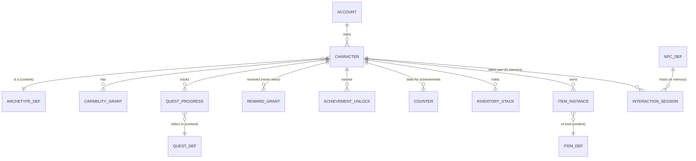

# Domain model

**Definitions are content** (YAML loaded into memory at startup), **player state is durable** (SQLite), and **live sessions exist only in memory** (positions, interactions, NPC behaviour).



## Core Go types

These are shapes, not final code.

### Identity: one character model for every archetype

```go
type Character struct {
    ID          CharacterID   // ULID; the wire keeps small uint32 entity ids
    AccountID   AccountID
    Name        string
    ArchetypeID archetype.ID  // data, never switched on
    Appearance  Appearance    // body/outfit/hat (+ later parts); unlockables checked against owned items
    TitleID     string
    Locale      string        // player setting (vi/en), independent of archetype
    LastPose    Pose          // saved every 30 s and on leave
}
```

### Archetype: a bundle of grants, loaded from content

```go
type Archetype struct {
    ID          ID            // "traveler" | "citizen" | "driver"
    Name        i18n.Text     // "Tài xế Crab Bike": the brand lives here, not in code
    Tags        []string      // used by dialogue variants and quest availability
    SpawnPlace  string        // place id from content/places.yaml
    Grants      Grants        // capabilities, starter items, questlines
    StarterLook Appearance
    Track       string        // progression track id
}
```

### Capability: the only thing systems check

```go
type CapabilityID string // "vehicle.motorbike.ride", "traveler.guide_app", "driver.app", "local.certified"

type Grant struct {
    Capability CapabilityID
    Source     string     // "archetype:driver", "item:<instance id>", "quest:traveler.final"
    ExpiresAt  *time.Time // event or temporary grants
}

type CapSet map[CapabilityID]struct{}

func (s CapSet) Has(id CapabilityID) bool { _, ok := s[id]; return ok }
```

The core features everyone has (walking, chat, the phone) are plain systems, not capabilities. Capabilities exist only for differences and unlocks.

The motorbike is an **item** that grants `vehicle.motorbike.ride`. The driver archetype only gives a starter bike, so a Citizen who later buys a bike can ride too, with no code change.

### Quest: generic definitions plus pluggable objective types

```go
type QuestDef struct {
    ID, Questline string
    Version       int
    Category      Category      // main, archetype, daily, side, exploration, social, event, npc
    Availability  Availability  // tags_any, capabilities, requires_completed, time window
    Giver         string        // npc id, or "" to auto-offer
    Flow          Flow          // sequence | all | any
    Objectives    []ObjectiveDef
    Rewards       []RewardDef
    Repeat        Repeat        // once | daily | weekly
}

type ObjectiveDef struct {
    ID    string  // stable id: progress survives content edits
    Type  string  // key into the objective registry
    Count int
    match Matcher // built and checked when content loads
}

// THE extension point: a new objective type is one Go file in quest/objectives that registers itself.
type ObjectiveType interface {
    Kind() string // "reach_place", "talk_npc", "dialogue_signal", "use_item", "occupy_seat",
                  // "emote_at", "meet_player", "ride_through", later "complete_trip"
    Compile(params yaml.Node, refs content.Refs) (Matcher, error) // rejects unknown place/npc/item ids
}

type Matcher interface {
    Listens() []events.Kind
    Advance(ev events.Event, who Actor, p *ObjectiveProgress) bool
}

type QuestProgress struct {
    CharacterID CharacterID
    QuestID     string
    Cycle       string  // "" for once-only, "2026-11-06" for a daily
    DefVersion  int
    State       State   // available, active, completed, claimed, failed, expired
    Objectives  map[string]ObjectiveProgress // keyed by objective id, stored as JSON
}

type ObjectiveProgress struct {
    N    int
    Done bool
    Seen []string // distinct places or partners, so the same friend can't be farmed
}
```

### Achievement: a passive quest on the same engine

```go
type AchievementDef struct {
    ID       string
    Title    i18n.Text
    Hidden   bool
    Criteria ObjectiveDef // same objective types, often over counters
    Rewards  []RewardDef
}
```

### NPC: one shared entity per city copy, many sessions

```go
type NPCDef struct {
    ID       string
    Name     i18n.Text
    Look     Appearance
    Home     string      // place / anchor id
    Behavior BehaviorDef // stand | wander(radius) | route(points) | stall
    Dialogue string      // dialogue graph id
    Modes    []Mode      // private, public, group
    Reach    float64     // interaction radius (m)
}

type Session struct {
    ID      SessionID
    NPCID   string
    Mode    Mode
    Members []CharacterID
    Node    dialogue.NodeID // per session; a group shares one
    Started time.Time
}
```

### Phone: apps are content filtered by capabilities

The player model never changes when an app is added.

```go
type AppDef struct {
    ID       string          // "profile", "quests", "map", "chat", "notices", "achievements", "guide", "crab_driver", "crab"
    Name     i18n.Text
    Requires []CapabilityID  // empty = everyone
    Notifies []string        // notification kinds routed to this app
}
```

### Inventory

```go
type ItemDef struct {
    ID     string
    Kind   ItemKind          // consumable, outfit, collectible, key, vehicle
    Stack  int               // 0 = unique (an item instance with its own attributes)
    Grants []CapabilityID    // while owned
}
```

## Content examples

All of these are YAML; adding one needs no Go change.

```yaml
# content/archetypes/driver.yaml
id: driver
name: { vi: "Tài xế Crab Bike", en: "Crab Bike driver" }
tags: [driver]
spawn_place: duong_ham_nghi
starter_look: { outfit: crab, hat: helmet }   # the yellow Crab Bike uniform (new ids)
grants:
  capabilities: [driver.app]
  items: [{ id: xe_so_110 }]                  # the item grants vehicle.motorbike.ride
  questlines: [driver_routes]
track: tay_lai
```

```yaml
# content/quests/traveler/ca_phe_sua_da.yaml
id: traveler.ca_phe_sua_da
version: 1
category: archetype
questline: saigon_local
availability: { tags_any: [traveler], requires_completed: [traveler.chao_sai_gon] }
giver: chu_tu_cafe
flow: sequence
objectives:
  - { id: order, type: dialogue_signal, params: { npc: chu_tu_cafe, signal: order_ca_phe_sua_da } }
  - { id: sit,   type: occupy_seat,     params: { seat_group: ghe_nhua_le_lai, seconds: 5 } }
  - { id: drink, type: use_item,        params: { item: ca_phe_sua_da } }
rewards: [{ stamp: ca_phe_sua_da }]
```

```yaml
# content/dialogue/co_ba.yaml: dialogue sends signals; it never hands out rewards
id: co_ba
start: greet
nodes:
  greet:
    say:
      default:  { vi: "Mua gì đó con?" }
      traveler: { vi: "Chào con! Mới tới Sài Gòn hả?", en: "Hi! New to Saigon?" }
    choices:
      - text: { vi: "Dạ, con muốn học chào hỏi" }
        if: { quest_active: traveler.chao_sai_gon }
        emit: learn_greetings
        goto: lesson
      - { text: { vi: "Dạ thôi, con đi dạo" }, goto: end }
```

```yaml
# content/apps.yaml (excerpt)
- { id: quests,      name: { vi: "Nhiệm vụ" } }
- { id: guide,       name: { vi: "Cẩm nang" },    requires: [traveler.guide_app] }
- { id: crab_driver, name: { vi: "Crab Driver" }, requires: [driver.app], notifies: [ride.offer] }
```

## SQLite schema (player state only)

This is the target schema. Migrations grow into it one phase at a time. Phase 0's `server/internal/store/migrations/0001_identity.sql` creates `accounts`, `auth_tokens` and a smaller `characters` table (id, account, name, appearance, created and updated times); the other columns and tables arrive with the phases that use them.

Conventions:

- `STRICT` tables.
- Ids are ULIDs (`TEXT`).
- Times are unix milliseconds (`INTEGER`), like `at` in the protocol.
- JSON columns are `TEXT` checked with `json_valid`.
- `foreign_keys` is turned on per connection.

```sql
create table accounts (
  id           text primary key,
  created_at   integer not null,
  banned_until integer
) strict;

create table auth_tokens (
  token_hash blob primary key,           -- sha-256 of the token; the token itself is never stored
  account_id text not null references accounts(id),
  created_at integer not null,
  last_seen  integer
) strict;

create table characters (
  id           text primary key,
  account_id   text not null references accounts(id),
  name         text not null,
  archetype_id text not null,
  appearance   text not null check (json_valid(appearance)),
  title_id     text,
  locale       text not null default 'vi',
  last_pose    text check (last_pose is null or json_valid(last_pose)),
  created_at   integer not null
) strict;
create index characters_by_account on characters(account_id);

create table capability_grants (
  character_id text not null references characters(id),
  capability   text not null,
  source       text not null,
  expires_at   integer,
  primary key (character_id, capability, source)
) strict;

create table quest_progress (
  character_id text not null references characters(id),
  quest_id     text not null,
  cycle        text not null default '',
  def_version  integer not null,
  state        text not null,
  objectives   text not null default '{}' check (json_valid(objectives)),
  started_at   integer,
  completed_at integer,
  primary key (character_id, quest_id, cycle)
) strict;

create table reward_grants (               -- a retry can never pay out twice
  character_id text not null references characters(id),
  source       text not null,             -- e.g. "quest:traveler.final:" (quest id + cycle)
  granted_at   integer not null,
  primary key (character_id, source)
) strict;

create table achievement_unlocks (
  character_id   text not null references characters(id),
  achievement_id text not null,
  unlocked_at    integer not null,
  primary key (character_id, achievement_id)
) strict;

create table counters (                    -- "landmarks.visited", "players.greeted", "ride.metres"
  character_id text not null references characters(id),
  key          text not null,
  value        integer not null default 0,
  primary key (character_id, key)
) strict;

create table inventory_stacks (
  character_id text not null references characters(id),
  item_id      text not null,
  qty          integer not null check (qty >= 0),
  primary key (character_id, item_id)
) strict;

create table item_instances (              -- unique items: a motorbike with its colour and plate
  id         text primary key,
  owner_id   text references characters(id),
  item_id    text not null,
  attrs      text not null default '{}' check (json_valid(attrs)),
  created_at integer not null
) strict;

create table chat_reports (
  id         integer primary key,
  reporter   text not null,
  target     text not null,
  context    text not null check (json_valid(context)),   -- the last 20 lines
  created_at integer not null
) strict;

-- future, with ride-hailing:
-- create table rides (
--   id text primary key, passenger_id text not null, driver_id text, dest_place text not null,
--   state text not null, fare integer, rating integer, requested_at integer not null, completed_at integer
-- ) strict;
```

The schema uses only types and constructs that carry over to Postgres (`text`, `integer`, JSON as text, composite primary keys). Moving later is a matter of swapping the store package, not redesigning the schema.
