# Ride-hailing: booking a Crab Bike

A player books a Crab Bike on their phone, a Crab Bike driver accepts, rides over, picks them up, and drops them at the destination, as in real life. Written 2026-11-06 as the plan for after phase 4 (decision D13); **built 2026-11-06, not deployed yet**. What changed while building it is under [As built](#as-built). It builds on what phase 2 made: the motorbike with its seats (`server/internal/world/vehicle.go`), server-checked movement (`move.go`), the interest grid (`view.go`), and mounting in the game (`src/game/riding.ts`).

Decided (see the [decision log](README.md#decisions)):

- **D11:** trips cost money: a simple wallet in **xu**. Every character has a balance; the fare moves from passenger to driver.
- **D12:** a request goes to **every on-duty driver nearby at once; the first to accept wins**.
- **D13:** built after phase 4 (quests), as the roadmap orders it; it reuses phase 4's character workers for the money.

## What players do

**Passenger** (the **Crab** app, on every phone):

1. Pick a destination: a landmark from the list, or a tap on the map (the nearest place). The app shows the distance and the fare. **Đặt xe**.
2. "Đang tìm tài xế…" with **Huỷ**. The fare is held from the balance now. No driver within 60 s: "Không có tài xế gần bạn", and the fare comes back.
3. Matched: a card with the driver's name, badge, rating and trips, the distance and an arrow; their dot moves on the map, even from the far side of the island. A private chat with the driver opens.
4. The bike stops within 3 m: **Lên xe**. The passenger sits behind the driver; the camera follows the ride. **Xuống xe** gets off early (the fare is still charged, as in real life).
5. The driver stops at the destination and completes the trip: the passenger gets off beside the bike, the driver is paid, and a sheet asks for 1–5 stars and a tip (0 / 5.000 / 10.000 xu).

**Driver** (the **Crab Driver** app, for characters with `ridehail.drive`):

1. On their bike, **Bật nhận cuốc** (on duty). Getting off the bike, or the phone's toggle, goes off duty.
2. An offer pops up as a banner even with the phone closed: passenger, how far to the pickup, destination, fare, and a 15 s ring with **Nhận**. Taken by someone else: "Đã có tài xế khác nhận".
3. An arrow and a map marker lead to the passenger. Within 3 m and stopped: "Chờ khách lên xe".
4. An arrow leads to the destination. Stopped inside it: **Hoàn thành**. The earnings show, then the rating.
5. The app keeps today's trips and earnings, the average rating, and the history.

## The trip

```mermaid
stateDiagram-v2
  [*] --> Requested: ride_request; the fare is held
  Requested --> Accepted: the first ride_accept from an offered driver
  Requested --> Expired: no accept within 60 s (refund)
  Requested --> Cancelled: the passenger cancels (refund)
  Accepted --> OnTrip: ride_board (bike within 3 m, stopped)
  Accepted --> Requested: the driver cancels or leaves; offered again to the others
  Accepted --> Cancelled: the passenger cancels, or 5 min without pickup (refund)
  OnTrip --> Completed: ride_complete (bike stopped inside the destination); the driver is paid
  OnTrip --> Completed: the passenger gets off early (full fare)
  OnTrip --> Ended: someone disconnects (see below)
  Completed --> [*]: a rating within 2 min, optional
  Expired --> [*]
  Cancelled --> [*]
  Ended --> [*]
```



| Situation | What happens to the money |
|---|---|
| Expired, or cancelled before pickup (by either side, or by the 5 min timeout) | The hold goes back to the passenger |
| The driver cancels after accepting | The trip goes back to Requested for the time left; no penalty in v1, counted on the driver |
| Completed, or the passenger got off early | The driver gets the fare minus the platform's cut |
| The passenger disconnects on the trip | Ends where the bike is; the fare is charged in proportion to the distance covered (at least the base fare), so quitting near the end is not a free ride |
| The driver disconnects on the trip | The passenger is put down beside the bike and refunded in full |

One active trip per player, in either role. A driver cannot accept their own request.

## Money (D11)

Amounts are content (`server/content/ridehail.json`, shared with the game so the app can show the same estimate the server charges):

| Setting | First value | Why |
|---|---|---|
| Start balance | 100.000 xu | 5–7 trips |
| Daily top-up ("lì xì") | back up to 50.000 xu once a day, at the first visit | a faucet: nobody is stuck without a ride |
| Fare | 10.000 xu + 60 xu per metre of straight line from the pickup to the destination, rounded to 1.000 | 13.000–22.000 xu on this island, close to a real short GrabBike trip |
| Platform cut | 20 % of the fare | the sink; it also makes moving xu between two of your own accounts a loss |
| Tip | 0, 5.000 or 10.000 xu, at rating time | |
| Pair limit | a driver is not offered the same passenger more than 5 times a day | slows trip farming for quests and earnings |

Storage (one migration, additive like the others):

```sql
create table wallets (
  character_id text primary key references characters(id) on delete cascade,
  balance      integer not null check (balance >= 0),
  topped_up_on text,                                  -- the day (UTC+7) of the last lì xì
  updated_at   integer not null
) strict;

create table ledger (                                  -- every change to a balance, for audit and support
  id           text primary key,
  character_id text not null references characters(id) on delete cascade,
  delta        integer not null,
  reason       text not null,                         -- start, topup, ride_hold, ride_refund, ride_earn, ride_tip_out, ride_tip_in
  ride_id      text,
  created_at   integer not null,
  unique (ride_id, reason, character_id)               -- a retried step never pays twice
) strict;

create table rides (
  id           text primary key,
  passenger_id text not null references characters(id),
  driver_id    text references characters(id),
  dest_place   text not null,
  pickup_x     real not null, pickup_z real not null,
  fare         integer not null,
  state        text not null,                         -- requested, accepted, on_trip, completed, cancelled, expired, ended
  end_reason   text,
  paid         integer,                               -- what the driver got
  stars        integer check (stars between 1 and 5),
  tip          integer,
  requested_at integer not null, accepted_at integer, boarded_at integer, finished_at integer
) strict;
create index rides_by_driver on rides(driver_id, finished_at);
```

Every money step is one transaction on the passenger's character worker (phase 4): the hold is `update wallets set balance = balance - ? where character_id = ? and balance >= ?` (one row changed, or "Không đủ xu"), plus its ledger line. The payout credits the driver and writes the ride row in the same transaction. The `ledger` unique key makes retries safe. Guests without an account cannot book or drive (no wallet); the app says to keep playing in this browser to get one.

## Server

The ride logic lives in a new package, `server/internal/ridehail`, run by the world goroutine through a small module hook, so the world knows nothing about rides:

```go
// world: something that runs inside the world loop (ride-hailing now, NPC sessions later)
type Module interface {
    Handle(m Member, msg protocol.ClientMsg) bool // its message types; true when handled
    Tick(now time.Time)                           // timeouts, arrival checks (from the snapshot tick)
    Left(m Member)                                // a player left or was replaced
}

// what a module may ask of the world
type Member interface {
    ID() uint32; Character() string; Name() string; Caps() capability.Set
    Pose() protocol.Pose; Speed() float64          // from the last accepted moves
    Riding() (vehicleID uint32, seat int)
}
type Host interface {
    Member(id uint32) (Member, bool)
    Seat(passenger, vehicle uint32, seat int) error   // seat 1 behind the rider
    Unseat(passenger uint32) protocol.Pose            // puts them down beside the bike, sends their correct
    Pin(a, b uint32, on bool)                         // a and b always in each other's view
    Send(id uint32, msg []byte)
    Do(character string, job func(ctx context.Context) error, done func(error)) // runs on the character worker, done back in the loop
}
```

- **Matching (D12):** on a request, after the hold succeeds, every member who is on duty, riding their own bike, not on a trip, within 150 m (all of today's island) and under the pair limit gets `ride_offer`. Drivers who go on duty during the 60 s get it too. The world loop handles one event at a time, so the first `ride_accept` it reads wins, with no lock. With several server processes later, it becomes the conditional update in [04-backend.md](04-backend.md#transactions).
- **Pickup:** `ride_board` is accepted when the driver's bike is within 3 m of the passenger and moved less than 0.5 m/s over its last reports.
- **Arrival:** `ride_complete` is accepted when the bike is inside the destination place's reach (`r` in `places.json`) and stopped.
- **Timeouts** run from `Tick`: offers 15 s, a request 60 s, a pickup 5 min, the rating 2 min.
- **Rate limits** (in `ws`, like the others): one request per 10 s, offers expire on their own.
- **Events for phase 4:** `trip.completed {driver, passenger, metres, fare, stars}` feeds the quest "Chuyến đầu tiên", counters (`ride.trips`, `ride.metres`, `ride.earned`) and achievements.

### Generic pieces the core gains

The roadmap's goal was ride-hailing "without editing any core package". That is not quite possible: the passenger seat, the view, and money are core. The rule instead: **the core gains generic pieces with no ride-specific code**, and everything about rides stays in `ridehail` and the Crab apps.

| Piece | Where | What |
|---|---|---|
| Seat 1 | `world/vehicle.go` | `seats [2]*member` instead of `rider`; a passenger sits in seat 1 while someone rides seat 0. The `vehicle` message gets `seats: [rider, passenger]`. |
| Carried players | `world/move.go` | A seated passenger's own states are ignored; their pose follows the bike on every accepted move of the rider, and their rows are marked moved. Getting off sends them a `correct` (bumping `k`) to a free spot beside the bike, with a full movement allowance. |
| Seat flag | `protocol` | State flag bit 2, `FLAG_SEAT1`, so others draw a passenger behind the rider. |
| View pins | `world/view.go` | Pinned pairs are always in each other's view, past the radius and the cap of 40, so the passenger watches the driver come from anywhere. |
| Module hook | `world/world.go` | `Module`, `Member`, `Host` above; messages of unknown type go to the modules. |
| Wallet | `store`, a `wallet` package | Balance, ledger, the daily top-up; `wallet {balance}` in the welcome and after every change. |
| Character workers | phase 4 | Where the money transactions run, in order per character. |

## Protocol

Client to server (flat `{"t":…}` as today):

| Message | Who | |
|---|---|---|
| `{"t":"duty","on":true}` | driver | needs `ridehail.drive` and riding their own bike |
| `{"t":"ride_request","dest":"cho_ben_thanh"}` | anyone with an account | a place id from `places.json`; holds the fare |
| `{"t":"ride_cancel"}` | either | before pickup |
| `{"t":"ride_accept","offer":"…"}` | offered driver | |
| `{"t":"ride_board"}` | passenger | |
| `{"t":"ride_alight"}` | passenger | gets off early, full fare |
| `{"t":"ride_complete"}` | driver | |
| `{"t":"ride_rate","stars":5,"tip":5000}` | passenger | once, within 2 min |

Server to client:

| Message | |
|---|---|
| `{"t":"wallet","balance":86000}` | in the welcome and after every change |
| `{"t":"ride","id":"…","state":"accepted","role":"passenger","dest":"cho_ben_thanh","fare":16000,"passenger":{"id":7,"name":"Lan"},"driver":{"id":9,"name":"Tài","stars":4.8,"trips":31},"deadline":1730790060000}` | to both parties on every change; `end` on the last one (`completed`, `cancelled_by_passenger`, `no_driver`, …) with `paid` |
| `{"t":"ride_offer","offer":"…","dest":"…","fare":16000,"passenger":{"id":7,"name":"Lan"},"pickup":[x,z],"expires":…}` | to each driver offered |
| `{"t":"ride_offer_gone","offer":"…","why":"taken"}` | `taken`, `cancelled`, `expired` |
| `{"t":"ride_error","code":"balance"}` | `balance`, `busy`, `no_account`, `unknown_place`, `no_bike`, `too_far`, `not_stopped`, `not_there` |

## Game

- **Crab app** (new, `apps.json` with no `requires`, yellow): destination list with distance and fare from `ridehail.json`, the booking states, the driver card, the rating sheet, and the balance.
- **Crab Driver app** (today a placeholder): the duty toggle, today's trips and earnings, average stars, history, and the open offer.
- **Offer banner:** outside the phone, top centre, with a 15 s ring and **Nhận**. Offers are urgent, and the phone may be closed.
- **Guidance:** a small HUD compass arrow with the distance, to the pickup, then to the destination, plus markers on the phone map. Movement only reads the nav grid, so this is a straight-line arrow, not a route.
- **Passenger mode** (`src/game/player.ts`): while seated, the local player is carried. Each frame its position, heading and lean come from the driver's avatar as drawn (`RemotePlayer`, 230 ms behind, already smooth), the joystick does nothing, the camera follows, and the action button reads **Xuống xe**. A `correct` from the server ends it at the spot beside the bike.
- **Poses** (`src/game/character.ts`): `ridePose` gains the seat. Seat 1 sits 0.45 m further back and a little higher, hands on the knees or the driver's waist.
- **The bike model** (`src/game/motorbike.ts`): the yellow top box sits where the passenger goes. Move a smaller box onto a rear rack behind seat 1, or hide it while seat 1 is taken. The Crab mark stays on the jacket and helmet.
- **Remote players:** a row with `FLAG_SEAT1` is drawn in the seat-1 pose on the bike its rider is on.

## Abuse and fairness

- Moving xu between two of your own accounts loses the 20 % cut each trip, and the pair limit caps it.
- Quest and achievement credit from trips (phase 4) counts distinct partners per day, like the other social objectives.
- Quitting at the end of a trip charges in proportion to the distance; the driver is never left unpaid by a passenger's disconnect.
- A driver who accepts and never comes: the passenger cancels for free, the trip is offered again, and accepted-then-cancelled trips are counted for later moderation.
- Fares are computed on the server; the app's estimate is for display only.

## Building it

| Step | What | Rough effort |
|---|---|---|
| 1 | Wallet: migration, `wallet` package, the daily top-up, `wallet` message, the balance in the Hồ sơ app | 1–2 days |
| 2 | Core pieces: seat 1, carried players, `FLAG_SEAT1`, view pins, the module hook (with tests on their own) | 2–3 days |
| 3 | `ridehail`: the state machine, matching, timeouts, money steps on the workers, the `rides` table; Go tests for every path | 3–4 days |
| 4 | Game: protocol, the Crab app, Crab Driver, the offer banner, the compass, passenger mode, seat-1 pose, the bike model | 3–4 days |
| 5 | A two-browser run (a traveller books, a driver picks them up and drops them off) and a load run with bot passengers and drivers | 1 day |

About **2 weeks** for one developer, after phase 4.

**Done when:**

- A traveller books, a driver on the far side of the island gets the offer, picks them up, and drops them at Chợ Bến Thành. The fare leaves one balance and 80 % of it arrives in the other, and the rating shows on the driver's profile.
- Three drivers accepting the same offer at once: exactly one gets it.
- Every cancel and timeout path returns the hold, checked in Go tests against the ledger.
- A passenger cannot move themselves while seated; a tampered client gains nothing.
- The ride logic is all in `ridehail` and the Crab apps; the core only has the generic pieces above.

## As built

Built 2026-11-06 as planned above, with these differences (the code is `server/internal/ridehail`, `server/internal/store/wallets.go`, `src/game/rides.ts` and `src/game/phone/crabApps.ts`):

- **Duty needs the bike** (proposed D15): a driver is on duty only while riding their own bike; getting off ends duty and withdraws their offers.
- **No cancellation fee** in v1, either side (proposed D15).
- **Getting off early** with Xuống xe, or leaving the seat any other way (a respawn), charges the whole fare. A dropped connection on the trip charges the way covered (at least the base fare); the driver leaving or getting off refunds the passenger.
- **No trip to where you are:** booking a place you stand in, or boarding once you walked into the destination, is refused (`here`). A trip still going after 5 minutes (`trip_seconds`) ends with a refund.
- **The booking gap** (one request per 10 s per character) is kept by the ride service, which answers `too_soon`, rather than by `ws`, which only caps the ride messages at a few per second.
- **Money that cannot be written is tried again:** a settlement that fails (a busy database) is retried from the tick with backoff, and both sides hear how the trip ended only once it is written; until then neither can start another trip. The store moves money only for a ride still open and never more than its fare, so a retry, or a refund for a hold that never happened, moves nothing. Each money job has a 10 s timeout.
- **A restart refunds open trips:** trips live in the world's memory, so the server gives back the fare of every ride left open when it starts (`ReturnOpenHolds`, end reason `server_stopped`). A settlement still failing when the server stops is refunded the same way.
- **Accepting a ride drops the driver's other offers** (`ride_offer_gone` with `busy`).
- **Passengers are drawn where their rider is drawn**, on every screen: their own snapshots run 230 ms late, so a passenger drawn from them trails the bike. The seat-1 pose sits further back and higher than the rider; the top box comes off while seat 1 is taken.
- **Guidance** reuses the quest tracker: while a trip goes on it shows the trip's next step and points at the passenger to pick up or the destination.
- **A driver mid-trip** presses E twice within 3 s to get off (the first press warns that it cancels the trip).
- **Not built yet:** the load run with bot passengers and drivers, the rating shown on the driver's profile (the stars show on the driver card the passenger sees), NPC passengers.

Verified with Go tests for every path against the ledger (three drivers accepting at once, every cancel and timeout, failed settlements, the store's guards), and two headless browsers: a traveller books at Chợ Bến Thành, a driver accepts from the banner, picks them up and drops them at Nhà hát Thành phố; 16.000 xu leaves one wallet, 12.800 arrives in the other, the 5.000 tip follows, and both Crab quests complete.

## Open questions

- The amounts: start balance, lì xì top-up, the cut, the tips. They are content, so easy to tune after a playtest.
- NPC passengers after phase 3: when no player books, an NPC at a landmark asks for a ride, paid by the game, so drivers have work with few players online.
- On a 200 m island a trip is 10–15 s at 22 m/s ([07-tradeoffs.md](07-tradeoffs.md)). The chat, the rating and the tip are the point until the map grows (D10).
