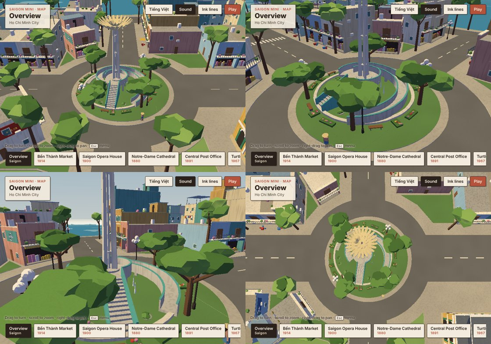
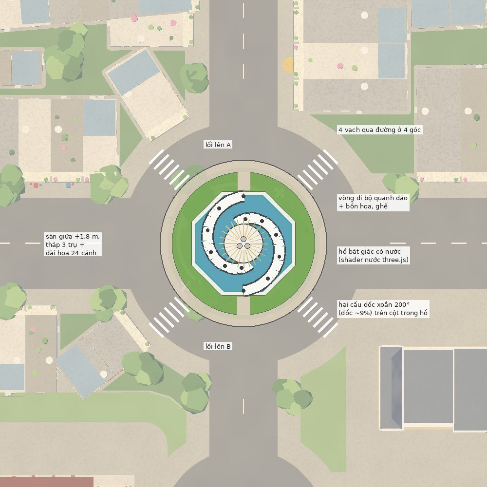
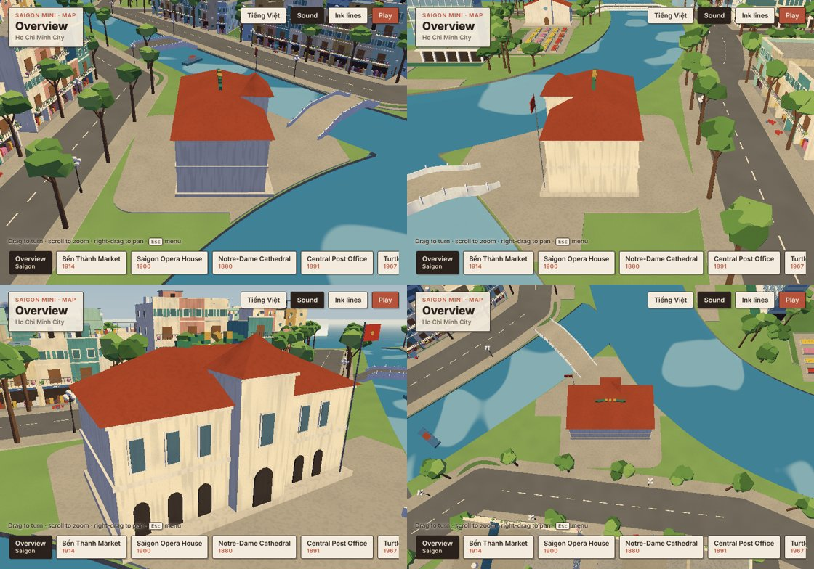
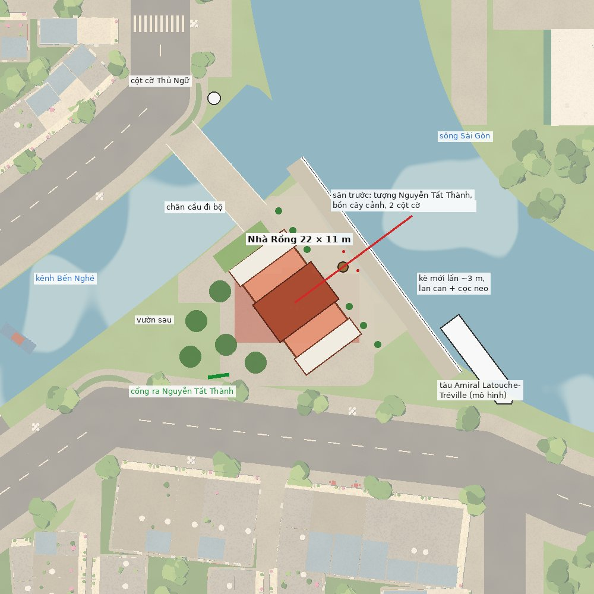
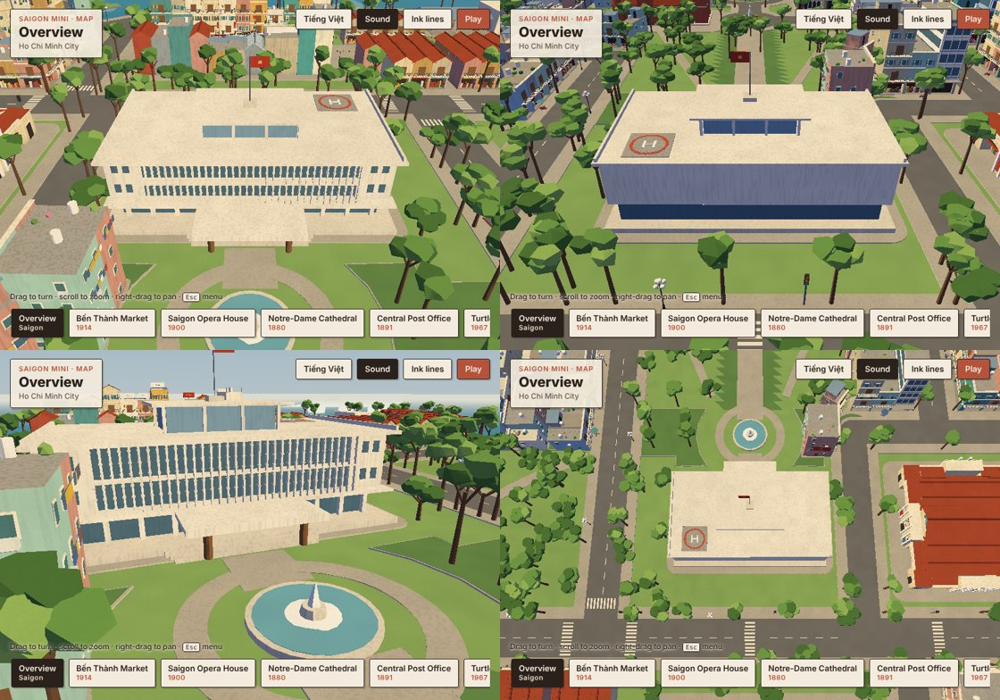
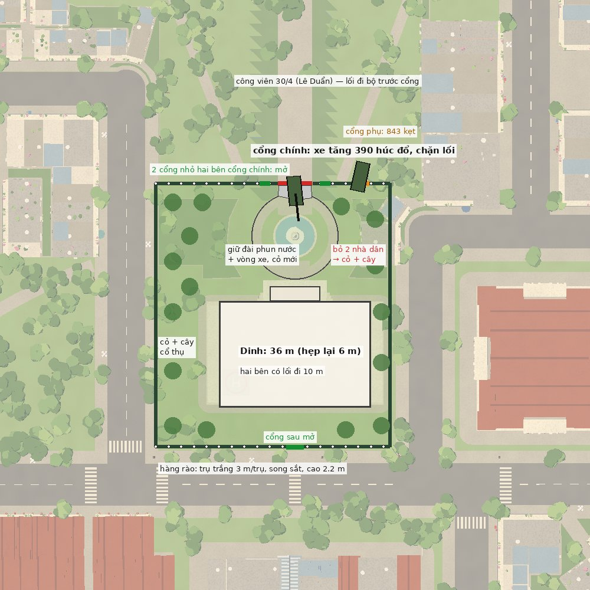
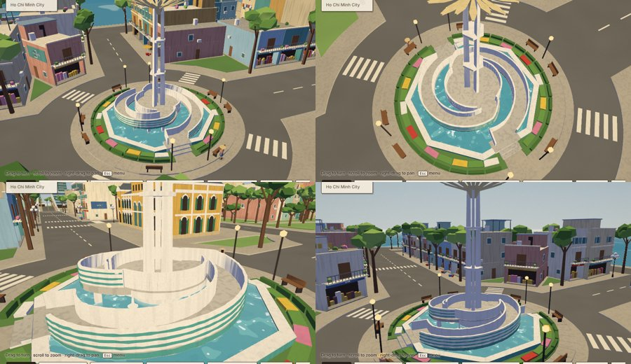
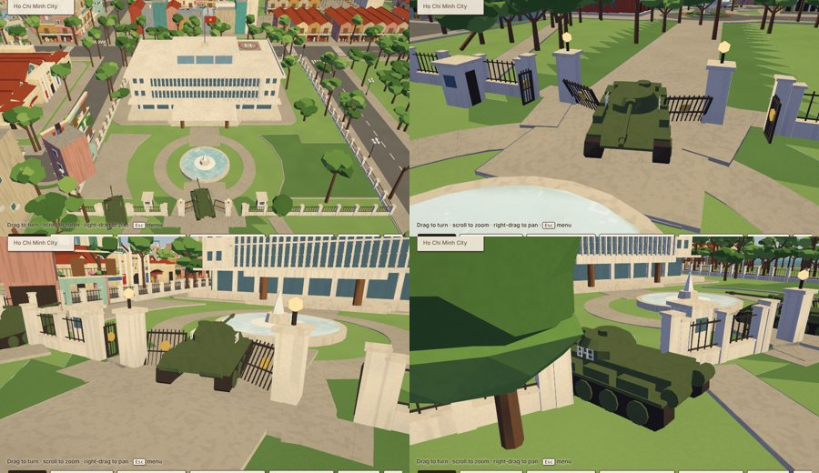
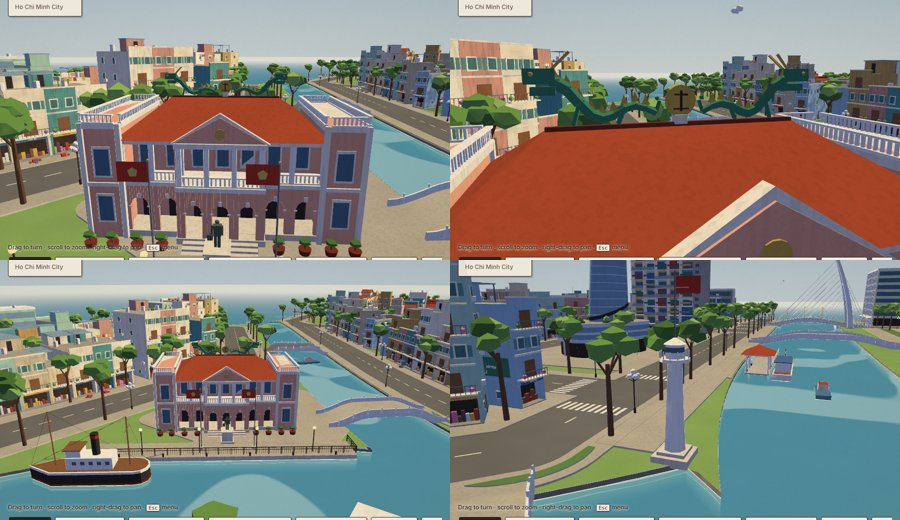

# Ba công trình làm lại chi tiết: Hồ Con Rùa, Bến Nhà Rồng, Dinh Độc Lập (v9)

**Trạng thái:** Khoa duyệt 2026-11-18; đã dựng cả ba cùng ngày (mục "Kết quả" cuối file), chờ Khoa xem trong game.

Yêu cầu của Khoa: vẽ ba công trình chi tiết và đúng hơn.
- Hồ Con Rùa: cầu thang lên chưa đúng, các lối chưa nối với nhau, hồ chưa có nước (thêm nước bằng three.js).
- Bến Nhà Rồng: còn thô, cần chi tiết hơn, quay đúng hướng ra sông, cảnh xung quanh giống ngoài đời.
- Dinh Độc Lập: khuôn viên đang rối (có nhà dân), làm lại cho đúng, có hàng rào, cổng chính bị xe tăng húc đổ, có cổng
  nhỏ bên cạnh để người chơi đi vào.

Toạ độ trong tài liệu là Blender XY (mét) của `models/saigon_mini.blend`. Sơ đồ vẽ đè lên ảnh nhìn từ trên xuống của
map hiện tại (lưới 20 m có trong `/home/claude/bl/plan/*_grid.png` khi làm).

## 1. Hồ Con Rùa (công trường Quốc Tế)

**Ngoài đời:** bùng binh có hồ nước nông; giữa hồ là tháp mảnh nhiều trụ, đỉnh xoè như bông hoa; hai cầu dốc cong
xoắn quanh tháp, đi từ mép hồ lên một sàn tròn dưới chân tháp. Người ta đi bộ qua đường ở các góc rồi đi vòng quanh
hồ.

**Hiện tại:** đảo cỏ, cầu thang thẳng lên chân tháp, không có nước, các lối không nối với vỉa hè.

**Đề xuất** (tâm (-111, 165), đảo bán kính 11 m, giữ nguyên đường vòng):
- **Lối đi nối hết các điểm:** 4 vạch qua đường ở 4 góc chéo (nối 4 góc vỉa hè) → vòng đi bộ lát gạch quanh đảo
  (r 9.4–11) → 2 lối cắt qua cỏ ở phía bắc và nam → mép hồ → 2 cầu dốc → sàn giữa. Đi vòng một mạch không cụt.
- **Bồn cỏ, hoa, ghế đá** ở dải r 7.6–9.4; cây to chuyển ra ngoài vòng đi bộ hoặc bỏ để không che tháp (lần dọn cây
  trước đã xoá các cây đâm vào hồ).
- **Hồ bát giác có nước:** bán kính ngoài 7.4 m, thành hồ trắng cao 0.5 m dày 0.6 m, mặt ngoài ốp sọc xanh ngọc; đáy
  -0.3 m, mặt nước +0.2 m. Thành hồ cao hơn bước chân nên người chơi không đi xuống hồ.
- **Hai cầu dốc xoắn lồng nhau:** rộng 1.6 m, mỗi cầu quay 200° từ mép hồ (+0.5 m, r 6.2) lên sàn (+1.8 m, r 2.8), dài
  ~15 m, dốc ~9% (đi bộ được, không phải bậc thang). Lan can đặc cao 0.9 m, mặt ngoài sọc xanh ngọc như ảnh thật; mỗi
  cầu đứng trên 6 cột vuông dưới nước.
- **Sàn giữa** tròn r 2.6 ở +1.8 m, lan can quanh; tháp 3 trụ thon cao ~14 m, đỉnh là đĩa hoa 24 cánh (r 3.2) và chóp
  mảnh. Giữ màu kem/trắng của tháp hiện tại.
- **Nước:** xem mục 4. Thêm vài vòi phun thấp quanh chân tháp.

## 2. Bến Nhà Rồng (Bảo tàng Hồ Chí Minh, mũi Khánh Hội)

**Ngoài đời:** toà nhà kiểu Pháp ở mũi đất giữa kênh Bến Nghé và sông Sài Gòn, nhìn sang cột cờ Thủ Ngữ và bến Bạch
Đằng. Hai tầng có hành lang vòm cuốn bao quanh. Trên nóc khối giữa có hai con rồng men xanh; từ 1955 hai con rồng quay
đầu ra ngoài, giữa chúng là huy hiệu đầu ngựa và mỏ neo. Sân trước có tượng Nguyễn Tất Thành; khu bến đang có mô hình
tàu Amiral Latouche-Tréville.

**Hiện tại:** một khối hộp mái ngói, rồng là hai khối vuông, mặt tiền nhìn lên phía bắc (song song đường), không có gì
ở bờ sông.

**Đề xuất:**
- **Hướng:** mặt tiền song song bờ kè, nhìn thẳng ra sông Sài Gòn (hướng đông bắc), vẫn thấy cột cờ Thủ Ngữ ở góc
  trái. Lưng nhà quay về đường Nguyễn Tất Thành.
- **Vị trí và kích thước:** 22 × 11 m, lùi sang đông nam để chừa chỗ cho chân cầu đi bộ đổ xuống góc tây bắc của sân
  (mũi đất hẹp; dài hơn 22 m thì đụng vỉa hè hoặc chân cầu).
- **Kiến trúc:** tầng trệt 7 nhịp vòm cuốn; tầng lầu hành lang cột, lan can con tiện. Khối giữa nhô ra, mái ngói đỏ
  dốc có trán tường, trên nóc hai con rồng xanh lục quay đầu ra ngoài (rồng nhiều khúc, có vây, không còn là hộp) và
  huy hiệu ở giữa. Hai cánh mái ngói thấp hơn. Hai đầu nhà là hai khối lầu mái bằng có lan can trắng.
- **Màu:** tường hồng cam như ảnh hiện nay (thêm một màu PAL mới ~#E39A7B), gờ chỉ, cột, lan can trắng, mái ngói đỏ
  `roofRed`. Phương án giữ màu kem cũ vẫn được (câu hỏi ở cuối).
- **Sân trước ~10 m:** tượng Nguyễn Tất Thành trên bệ đá nhìn ra sông, hai hàng chậu cây cảnh, hai cột cờ, đèn.
- **Bờ kè:** lấn ra sông ~3 m dọc mũi đất, lan can sắt, cọc neo; phía hạ lưu neo tàu mô hình kiểu tàu hơi nước đầu
  thế kỷ 20 (thân sẫm, ca bin trắng, ống khói), chỉ để ngắm, không lên tàu.
- **Phía sau:** vườn cây, lối và cổng ra đường Nguyễn Tất Thành.
- **Bên kia kênh (bờ Quận 1):** cột cờ Thủ Ngữ (trụ trắng thon có chòi và cột cờ), mốc nhỏ mới ở bãi cỏ cạnh chân cầu
  đi bộ.
  *Đã dựng rồi bỏ (Khoa 2026-11-19).*

## 3. Dinh Độc Lập (khuôn viên)

**Ngoài đời:** dinh nằm trong khuôn viên có hàng rào, cổng chính nhìn ra công viên 30/4; trước dinh là bãi cỏ lớn có
đài phun nước và vòng xe. Ngày 30/4/1975 xe tăng 843 húc cổng phụ trước, sau đó xe tăng 390 húc đổ cổng chính và chạy
thẳng vào sân. Xe 390 dài 6.46 m, rộng 3.27 m, cao 2.4 m.

**Hiện tại:** không có hàng rào; phía đông có hai nhà dân và bồn hoa rối nằm trong khuôn viên; hàng rào đông (nếu có)
chỉ cách dinh 1.5 m.

**Đề xuất:**
- **Hàng rào** quanh khu x -144…-88.5, y 4…66.5 (~56 × 62 m): trụ vuông trắng 0.5 m, cứ 3 m một trụ, cao 2.2 m; chân
  tường 0.6 m; song sắt sơn xanh đen ở trên. Cây cổ thụ (dầu, me) chạy dọc bên trong hàng rào.
- **Cổng chính** (bắc, giữa trục công viên 30/4): rộng 8 m giữa hai trụ lớn. Hai cánh cổng sắt đổ rạp vào trong, xe
  tăng 390 đứng hơi chéo đè lên, nòng hướng về dinh. Xe chặn hẳn cổng chính.
- **Hai cổng nhỏ** rộng 1.8 m ngay hai bên cổng chính, mở, kèm hai vọng gác: đây là lối người chơi đi vào.
- **Cổng phụ phía đông** (4 m): xe tăng 843 kẹt chéo trong cổng, cánh cổng cong.
- **Cổng sau** (nam, ra đường phía sau) mở.
- **Bên trong:** giữ đài phun nước và vòng xe trước dinh, trồng cỏ lại; bỏ hai nhà dân và bồn hoa phía đông, thay bằng
  bãi cỏ và cây; lối lát gạch quanh dinh.
- **Dinh hẹp lại 40 → 36 m** (giữ tâm, giữ chiều sâu) để hai bên có lối đi ~10 m. Các chi tiết đang có (rèm hoa đá,
  sân thượng có bãi trực thăng) giữ nguyên.

## 4. Nước bằng three.js

Mọi mesh vật liệu `water` (hồ, đài phun nước) hiện được tô phẳng. Đề xuất `src/game/water.ts`, gắn vào `paint.ts` theo
tên vật liệu như các vật liệu khác:
- màu nền xanh ngọc, mép nông sáng hơn nhờ depth texture (cùng cách `sea.ts` làm với biển);
- gợn sóng nhẹ: hai lớp sóng trôi chậm, phản chiếu màu trời theo góc nhìn (fresnel), đốm nắng nhỏ;
- vòi phun: vài cột nước mảnh dao động và vòng bọt ở chân, dùng `{ local: true }` để vân sơn không trôi;
- vẫn phẳng màu theo phong cách PAL, đường viền mực vẫn vẽ (`InkPass.track()`), không đổ bóng.

## 5. Cách làm và kiểm tra

- Mỗi công trình một script dựng riêng trong `scripts/blender/mini/` (`ho_con_rua.py`, `ben_nha_rong.py`,
  `dinh_grounds.py`, sửa `dinh_thong_nhat.py`), gọi từ `build_saigon_mini.py`, và chạy được trên `saigon_mini.blend`
  hiện tại (xoá object cũ của cụm rồi dựng lại) nên không phải dựng lại cả map. Toạ độ/hướng mới ghi vào
  `scripts/map/saigon_mini_layout.json`; kè Nhà Rồng sửa trong phần địa hình.
- Sau mỗi công trình: chạy lại `clean_trees.py`, xuất GLB (`npm run map:export`), thử va chạm trong game: lên xuống hai
  cầu dốc, đi qua cổng nhỏ, không chui qua hàng rào và xe tăng, đi vòng sân Nhà Rồng, tốc độ dưới giới hạn server.
- `npm run typecheck`, `npm run i18n:check` (nếu có thêm tên điểm dừng), chơi thử cả `?lang=vi` và `?lang=en`.
- Cập nhật bảng landmark trong `docs/PROJECT.md` và render lại ảnh của ba công trình.
- Thứ tự đề xuất: Hồ Con Rùa + shader nước → Dinh → Nhà Rồng.

## Khoa đã chốt (2026-11-18)

1. Dinh: dựng cả hai xe tăng, 390 đè cổng chính, 843 kẹt cổng phụ phía đông.
2. Nhà Rồng: tường hồng cam như ảnh thật (màu PAL mới).
3. Shader nước áp cho mọi hồ và đài phun nước trên map.

## Kết quả (2026-11-18)

Mỗi công trình là một script trong `scripts/blender/mini/`, nằm trong `MINI_SCRIPTS` của `build_saigon_mini.py` và
chạy riêng được trên file đang mở (thêm `-- --save` để lưu): `ho_con_rua.py`, `dinh_thong_nhat.py` (đã hẹp lại) +
`dinh_grounds.py`, `ben_nha_rong.py`. Nước: `src/game/water.ts`. Map xuất lại, `clean_trees.py` chạy lại (không còn cây
nào phải xoá).

Khác với bản thiết kế, sửa khi dựng và thử:
- Hồ Con Rùa: hồ sâu 0.28 m, quá mức lội được (WADE 0.25) nên người chơi dừng ở thành hồ, không lọt xuống gầm cầu dốc
  (ở đó không đủ chỗ đứng). Bồn hoa xen màu lá cho đỡ chói.
- Dinh: phía đông chỉ còn lối ~4.5 m giữa dinh và hàng rào (khối đất lệch về đông so với trục dinh, phía tây ~13 m).
  Cổng chính 7 m; hai cánh cổng bị húc nghiêng dựa vào xe 390 bịt hai bên nên cổng chính không đi qua được. Chân tường
  rào cao 0.8 m (hơn một bước chân) để không ai bước lên được.
- Nhà Rồng: dời ra s 10–32 (lệch về đông nam so với bản vẽ) để chân cầu đi bộ đổ xuống một khoảng sân trống trước góc tây
  bắc. Lan can bờ kè lùi vào 0.6 m, cọc neo nằm ngoài lan can, thanh dưới của lan can cao hơn một bước chân, cuối kè có
  đoạn lan can chặn.

Đã thử bằng vật lý của game (đi bộ và chạy): lên xuống hai cầu dốc, 4 vạch qua đường; cổng chính và cổng phụ có xe tăng
không ai lọt (thử 30 vị trí), hai cổng nhỏ và cổng sau vào được, hàng rào chặn mọi phía; từ cầu đi bộ sang sân Nhà
Rồng, lên bậc vào hành lang vòm, đi vòng ra sau, lan can bờ kè giữ người ở trên kè. 120 lượt đi ngẫu nhiên quanh ba
chỗ: không kẹt, không rơi, không lọt nước sâu, quãng 1 giây xa nhất 6.9 m (giới hạn server 8.5 m).

## Tham khảo

- Ảnh Hồ Con Rùa: [Commons, Category:Hồ Con Rùa](https://commons.wikimedia.org/wiki/Category:H%E1%BB%93_Con_R%C3%B9a)
- Ảnh Bến Nhà Rồng: [Commons, Category:Dragon House (Ho Chi Minh City)](https://commons.wikimedia.org/wiki/Category:Dragon_House_(Ho_Chi_Minh_City))
- Xe tăng ở Dinh: [Commons, Category:Tanks at the Independence Palace](https://commons.wikimedia.org/wiki/Category:Tanks_at_the_Independence_Palace),
  [kích thước xe 390](https://commons.wikimedia.org/wiki/Category:The_T-59_tank_No.390),
  [diễn biến 843 và 390](https://commons.wikimedia.org/wiki/File:Vietnam-0339_Gate_Smasher_(3331628983).jpg)
- Hai con rồng quay ra ngoài từ 1955: [mytour](https://mytour.vn/vi/blog/bai-viet/ben-nha-rong-diem-den-lich-su-dac-biet-o-sai-gon.html),
  huy hiệu đầu ngựa và mỏ neo: [vinwonders](https://vinwonders.com/vi/wonderpedia/news/ben-nha-rong-thanh-pho-ho-chi-minh/)
- Tầm nhìn ra cột cờ Thủ Ngữ và Bạch Đằng: [vinpearl](https://vinpearl.com/vi/tham-quan-ben-nha-rong-noi-bac-ra-di-tim-duong-cuu-nuoc)
- Mô hình tàu Amiral Latouche-Tréville ở khu bến: [VOV](https://vov.vn/xa-hoi/dien-mao-ben-nha-rong-khanh-hoi-sau-khi-tphcm-dau-tu-gan-30000-ty-dong-post1310873.vov)
