# Sài Gòn mini: các task vẽ lại sau khi rà map (2026-11-12)

Khoa duyệt cầu Ba Son mới ("đẹp rồi") và yêu cầu rà lại toàn bộ map v5. Những chỗ cần sửa được chia thành các task nhỏ dưới đây. Mỗi task đứng riêng được: đọc phần **Bối cảnh chung** rồi đọc task đó là đủ để vẽ, không cần đọc lại cả cuộc trao đổi.

Yêu cầu gốc của Khoa (2026-11-12):
- Nhìn lại toàn bộ map, tìm những chỗ chưa hợp lý rồi vẽ lại.
- Cây cầu còn lại vẽ thành cầu Mống.
- Núi chưa đẹp, vẽ lại thoải hơn; tượng Chúa dang tay cũng chưa đẹp; bờ bên kia sông (Thủ Thiêm) chưa có gì.
- Nhà liền kề giống nhau, không giống ngoài đời.
- GLB export phải nhẹ để load lên web.
- Bỏ khối đá ở mũi phía nam (khối Cổng Trời), vì không liên quan gì.
- Hải đăng phải ở trên núi; tra lại vị trí thật của hải đăng Vũng Tàu.
- Chia thành task nhỏ nhưng giữ được bối cảnh để vẽ dễ hơn.

Trạng thái: **Khoa duyệt thứ tự và cả 5 câu hỏi theo đề xuất ("ok đó", 2026-11-12)**, thêm một ý: mặt nước biển không cần nằm trong GLB vì Three.js đã vẽ. T0 và T2 xong, T1 xong phần pipeline (phần giảm tam giác nằm ở T9, T10 và instancing). T3, T4, T5 có bản nháp, chờ Khoa duyệt.

## Thứ tự đề xuất

| # | Task | Cỡ | Cần duyệt design trước khi vẽ thật | Phụ thuộc |
|---|---|---|---|---|
| T0 | Cầu Ba Son: đưa bản đã duyệt vào file chính và vào script dựng | nhỏ | đã duyệt 2026-11-12 | **xong** |
| T1 | Ngân sách tam giác và pipeline GLB nhẹ | vừa | không (số liệu, công cụ) | **pipeline xong**; phần giảm tam giác ở T9, T10 |
| T2 | Dọn: bỏ khối Cổng Trời | rất nhỏ | không | **xong** |
| T3 | Núi Nhỏ thoải hơn, hai đỉnh đúng thật, đường Hạ Long, đường lên hải đăng, bậc thang lên tượng | vừa | có (render nháp) | **nháp xong, chờ duyệt** |
| T4 | Hải đăng Vũng Tàu trên đỉnh cao nhất | nhỏ | có | T3; **nháp xong, chờ duyệt** |
| T5 | Tượng Chúa Kitô Vua trên đỉnh thấp phía nam | vừa | có | T3; **nháp xong, chờ duyệt** |
| T6 | ~~Núi Lớn thoải hơn~~ | | | **bỏ** (layout v7 cắt đất phía nam) |
| T7 | Cầu Mống ở cuối Hàm Nghi | vừa | có | |
| T8 | Thủ Thiêm: bố cục rồi dựng | lớn | có (sơ đồ trước, render sau) | T7; **bố cục xong (T15)**, còn model các công trình #32–#36 và tháp |
| T9 | Bộ nhà Sài Gòn (kit) và bảng mẫu | lớn | có (bảng mẫu) | T1 (ngân sách) |
| T10 | Lấp nhà theo block bằng kit, luật trộn để nhà kề nhau không giống nhau | lớn | có (render khu mẫu) | T9 |
| T11 | Khách sạn mini Bãi Sau, Bãi Trước | vừa | có | T9 |
| T12 | Các công trình mới còn là khối thô (mỗi cái một task con) | lớn | có, từng cái | |
| T13 | Lấp các khoảng cỏ trống | vừa | có (sơ đồ) | T8, T10 |
| T14 | Đánh bóng: mặt cỏ, vạch đường, kiểm tra nav | nhỏ | không | cuối cùng |
| T15 | Viền đảo cong tự nhiên, nhỏ hơn một chút; đường ven biển; bố cục Thủ Thiêm (gộp sơ đồ của T8) | vừa | có (sơ đồ) | **xong** (duyệt 2026-11-12, đã dựng lại map) |
| T16 | Layout v7: Vũng Tàu sang bờ đông, bỏ đất phía nam, đưa phố Bùi Viện v4 về, bỏ xe và người ngoài đường | lớn | có (sơ đồ, Khoa đồng ý 2026-11-12) | **xong**, chờ Khoa xem bản dựng |
| T17 | Layout v8: sông uốn quanh Thủ Thiêm, kênh Bến Nghé, ba khu, năm cầu, trục kết thúc ở công trình; sửa các chỗ nối đường, chân cầu, Chợ Lớn (docs/map-v8-design.md) | lớn | có (Khoa duyệt tổng thể 2026-11-12) | **xong**, là map chính; v7 lưu ở `versions/saigon_mini_v4.blend` |

Làm theo thứ tự này vì: T1 đặt ngân sách trước khi vẽ thêm (file hiện đã nặng gấp 7 lần map đang chạy); T2–T6 là phần Khoa thấy chưa đẹp nhất ở Vũng Tàu; T7–T8 làm cho bờ sông có nội dung; T9–T11 là phần việc lớn nhất (nhà), làm sau khi có ngân sách.

---

## Bối cảnh chung (đọc trước mọi task)

### File và nguồn dựng

- Map mới: `models/saigon_mini.blend`, scene `SaigonDiorama`, collection `SD_World` (có viền mực: con `SM_Landmarks`, `SM_Ground`, `SM_Mountains`, `SM_Streets`, `SM_Houses`, `SM_Nature`, `SM_Props`), `SD_NoInk` (con `SM_Preview`: mặt biển xem trước), `SD_Env` (camera, nắng, nét mực `SD_Ink`).
- File chính đã có cầu Ba Son mới và không còn khối Cổng Trời (2026-11-12). Bản blockout trước đó: `versions/saigon_mini_v1.blend`. Bản nháp `models/saigon_mini_draft_cau_ba_son.blend` không còn dùng.
- Mặt biển `PREVIEW_Sea` chỉ để xem trong Blender; `export_glb.py` bỏ qua mọi object `PREVIEW_*` (và `NAV_*`), vì biển và nước sông do Three.js vẽ (`src/game/sea.ts`).
- File được dựng hoàn toàn bằng `scripts/blender/build_saigon_mini.py` từ `scripts/map/saigon_mini_layout.json` (xem [map-v5.md](map-v5.md)), khoảng 30 giây. **Chạy lại script đó thì mọi sửa tay trong file mất.** Đã kiểm tra 2026-11-12: file chính khớp với output của script (Khoa chưa sửa tay gì), chỉ khác chữ bảng hiệu vì font trên máy khác.
- Quy ước cho các task này: mỗi phần vẽ lại là một script riêng trong `scripts/blender/mini/<tên>.py` có hàm `run()`. Dùng chung `kit.py` (vật liệu `SD_` của file, bộ dựng mesh, lưới tam giác cho địa hình, méo tay) và `layout.py` (đọc layout json thành hình shapely theo toạ độ Blender). Hàm đó xoá object cũ của chính nó rồi dựng lại, nên chạy lại bao nhiêu lần cũng được.
  - Script chạy được trên file đang mở (Blender của Khoa, qua MCP Blender) hoặc `--background`.
  - `build_saigon_mini.py` gọi các script trong danh sách `MINI_SCRIPTS` (đầu file) sau phần blockout. Thêm script mới thì thêm tên vào đó; phần blockout tương ứng thì bỏ (như `MODELLED_BRIDGES` cho cầu).
  - Mẫu: `scripts/blender/mini/cau_ba_son.py`.
  - Khoa có sửa tay trong Blender thì báo lại để chép vào script.
- Không sửa đè: trước khi sửa file chính, lưu bản cũ vào `versions/saigon_mini_v<n>.blend`.

### Toạ độ và cao độ

- Sơ đồ (layout json, SVG): x hướng đông, y hướng **nam**, đơn vị mét. Blender XY = (x − 251, 231 − y), Z hướng lên.
- Cao độ: mặt cỏ 0, mặt đường 0.07, vỉa hè và quảng trường 0.18, mực nước biển −0.45, đáy sông −2.4.
- Điểm mốc (Blender XY):

| Chỗ | Toạ độ |
|---|---|
| Chợ Bến Thành, tháp đồng hồ nhìn ra đông | khối chợ x −68…−33, y 7…43; tháp (−37, 25) |
| Bùng binh Quách Thị Trang | (−11, 25) |
| Hàm Nghi | y 25, x −11…35 |
| Tôn Đức Thắng (dọc sông) | lòng đường x 30…40 |
| Sông Sài Gòn | bờ tây x 48, bờ đông x 74; lối đi bộ ven sông x 40…47 (tây), x 84…90 (đông) |
| Cầu Ba Son | trục y 165, mặt cầu x 40…87, trụ (79, 165) |
| Cầu Hàm Nghi (sẽ là cầu Mống) | trục y 25, khối thô hiện x 29…93 |
| Bitexco | (12.8, 58.4) |
| Thủ Thiêm | vòng đường x 105…233, y −53…127; cụm tháp phía bắc x 121…233, y 141…203; ao `CX_Lakes` x 143…195, y 22…50 |
| Núi Nhỏ | chân núi x −73…5, y −210…−125; đỉnh hiện tại (−37, −169) cao 24 m và (−54, −146) cao 17 m |
| Núi Lớn | chân núi x −217…−161, y −143…−99; đỉnh (−191, −121) cao 11 m |
| Bãi Trước | x −167…−75, y −183…−141 |
| Bãi Sau | x 11…177, y −191…−183; dãy khách sạn x 11…141, y −159…−146 |
| Hòn Bà | (51, −216) |

### Style (tóm tắt docs/PROJECT.md)

- Low-poly, màu phẳng, không texture. Màu chỉ lấy từ `PAL` (bảng trong PROJECT.md, thêm `wallMint`, `wallSky`, `sigRed/Amber/Green`). Vật liệu `SD_<key>` đã có sẵn trong file; script dùng lại, không tạo màu mới. Cần màu mới thì hỏi Khoa trước.
- Méo tay `SD_HandWobble`: `LM_` 0.045, object khác 0.07. Thép, kính hiện đại, đường, đảo để thẳng (Bitexco, `LM_CauBaSon`, `IX_`, `IS_`).
- Tỉ lệ: người 1.7 m, tầng 3.2–3.6 m. Chiều cao nén (Bitexco 52 m). Chi tiết đặc trưng phóng 1.2–1.5 lần, bỏ chi tiết vụn.
- Duyệt: model mới nào cũng có render nháp cho Khoa duyệt trước khi gắn vào file chính.

### Xem nhanh

```bash
# render Workbench nhanh theo tên (danh sách góc trong đầu script); file .blend không bị sửa
/Applications/Blender.app/Contents/MacOS/Blender models/saigon_mini.blend --background \
  --python scripts/blender/mini/review_shots.py -- renders/review vung_tau nui_nho_w tuong_chua
```

Ảnh rà map ngày 2026-11-12 nằm trong `docs/img/v5r_*.jpg`, được nhắc tới trong từng task.

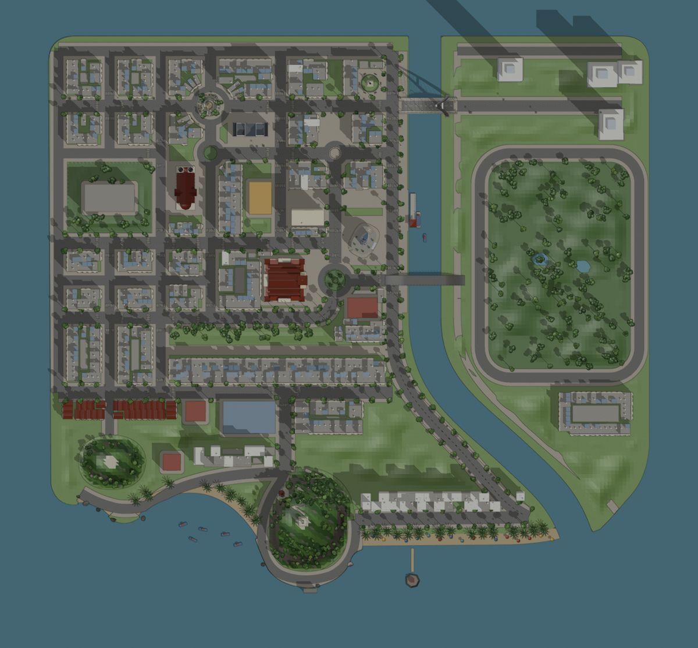
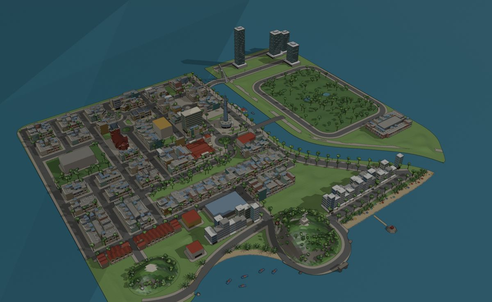

---

## T0. Cầu Ba Son: đưa vào file chính (đã duyệt design)

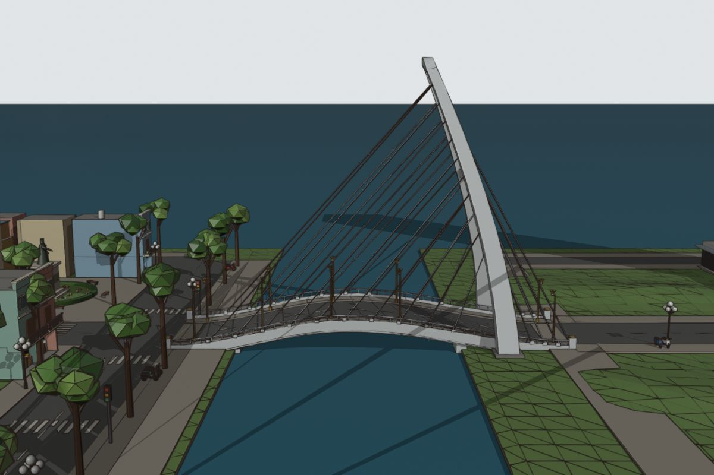
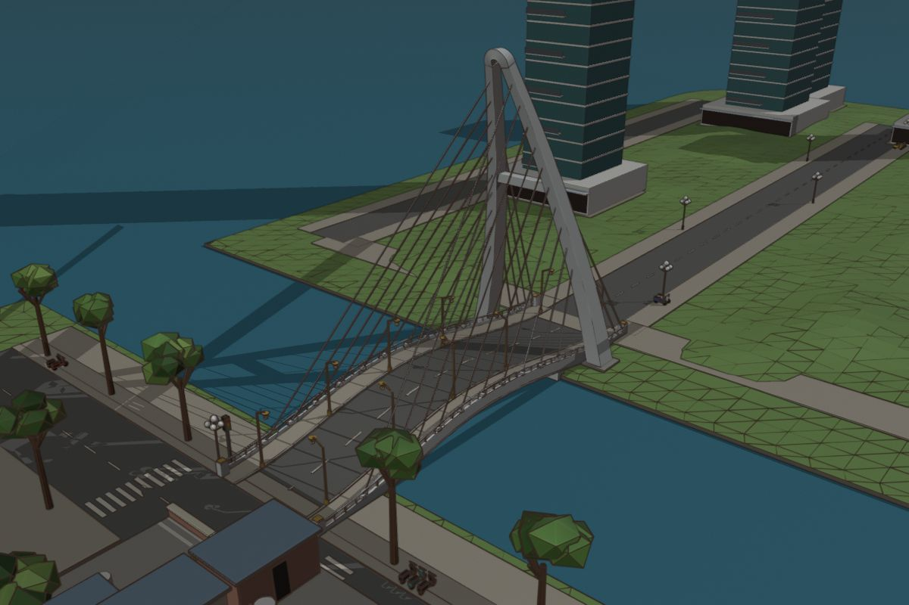

- **Design đã duyệt (2026-11-12):** trụ trắng hai chân cao 32 m trên bờ Thủ Thiêm, nghiêng ra sông 8.5 m, đỉnh bo tròn, có xà ngang ở 19.5 m. Hai mặt dây `finSilver`: mỗi bên 10 dây xoè ra phía sông và 4 dây néo sau. Mặt cầu vồng lên giữa sông (đỉnh 3.07 m, mép dưới cách mặt nước khoảng 2.8 m), hai làn xe 8 m, vạch giữa, bó vỉa, vỉa hè 2 m, lan can trắng với tay vịn bạc, 10 đèn cột vàng trên bó vỉa, 4 trụ đầu cầu. Đầu tây bắt đầu ở mép đông Tôn Đức Thắng, không đè lên ngã tư. Không méo tay.
- **Script:** `scripts/blender/mini/cau_ba_son.py` (thông số ở đầu file). Script tạo `LM_CauBaSon` trong `SM_Landmarks` và xoá nửa Ba Son của khối thô `LM_Bridges`.
- **Việc còn lại:**
  1. Lưu `models/saigon_mini.blend` thành `versions/saigon_mini_v1.blend`. Lấy bản nháp làm file chính, hoặc chạy script trên file chính.
  2. Trong `build_saigon_mini.py`: bỏ phần Ba Son của `build_bridges`, gọi `cau_ba_son.run()` sau `build_bridges`.
  3. Khi bake nav (R3): hộp `NAV_Deck_CauBaSon` để mặt cầu đi được.
- **Xong khi:** file chính có `LM_CauBaSon`, chạy lại `build_saigon_mini.py` vẫn ra đúng cầu này.
- **Đã xong 2026-11-12:**
  - Lưu `versions/saigon_mini_v1.blend`, file chính có `LM_CauBaSon`.
  - `build_saigon_mini.py` dựng cầu bằng `MINI_SCRIPTS = ['cau_ba_son']` và bỏ cầu này khỏi `build_bridges` (`MODELLED_BRIDGES`). Đã chạy thử cả script: ra đúng cầu.
  - Còn hộp `NAV_Deck_CauBaSon`, làm khi bake nav cho map mới (R3).

## T1. Ngân sách tam giác và pipeline GLB nhẹ

**Số đo trên file nháp (2026-11-12):**

| | Hiện tại | Map v4 đang chạy |
|---|---|---|
| Tam giác | 1.39 triệu | khoảng 0.2 triệu |
| GLB qua pipeline hiện tại (`flatten → join → weld → quantize → prune`) | 19.0 MB (gzip 7.2 MB) | 2.8 MB |
| Thêm nén meshopt | 3.7 MB (gzip 1.1 MB) | |

Ăn nhiều nhất là nhà:
- Theo object: `SH_hem` 366k tam giác, `SH_np` 287k, `SH_bar` 194k, `CX_Trees` 155k, `CX_StreetLife` 70k, `SH_cl` 62k, `SH_ks` 52k, `IS_Ground` 51k, `IX_Roads` 35k. Mọi công trình cộng lại chưa tới 100k.
- Theo vật liệu: `white` 278k, `metal` 158k, `signGold` 132k, `signRed` 127k, `lampGlow` 83k. Đó là chữ trên bảng hiệu dựng bằng font 3D, song sắt ban công từng thanh và bóng đèn cầu.

**Mục tiêu:**

| Hạng mục | Ngân sách tam giác |
|---|---|
| Nhà (~590 căn, 150–350 mỗi căn) | ≤ 180k |
| Cây (instancing, vài mẫu cây) | ≤ 60k vẽ ra, file chỉ chứa mẫu |
| Đồ đường phố, xe | ≤ 40k |
| Đất, đường, núi | ≤ 70k |
| Công trình (cũ và mới) | ≤ 150k |
| **Cả map** | **≤ 500k** |

- GLB: ≤ 3 MB sau meshopt (gzip ≤ 1.5 MB).
- Vật liệu: ≤ 100 (mỗi vật liệu một draw call, nhân hai vì ink pass vẽ hai lần).

**Việc:**
1. **Pipeline (thắng nhanh, không đổi hình):** thêm bước `gltf-transform meshopt` vào cuối chuỗi lệnh. Trong game, `src/game/world.ts` gọi `GLTFLoader.setMeshoptDecoder(MeshoptDecoder)` (`three/examples/jsm/libs/meshopt_decoder.module.js`).
2. **Script `scripts/blender/mini/budget.py`:** in số tam giác theo object, hạng mục và vật liệu; báo lỗi khi vượt ngân sách. Chạy sau mỗi task.
3. **Bảng hiệu:**
   - Nhà thường: không dùng chữ font 3D. Thay bằng tấm bảng phẳng và vài khối "chữ" giản lược.
   - Công trình: chữ thật chỉ dùng ở chỗ cần đọc được, độ phân giải đường cong thấp.
4. **Song sắt, bóng đèn:** song sắt thành tấm hoặc thưa hơn; bóng đèn cầu 8 mặt thay icosphere.
5. **Instancing:**
   - Cây, đèn, xe máy, dù, bồn nước dựng thành instance (linked duplicate) trong Blender. Export ra `EXT_mesh_gpu_instancing` (`gltf-transform instance`); `GLTFLoader` đọc thành `InstancedMesh`.
   - Cần kiểm tra paint shader, gió lay cây và `InkPass.track()` chạy đúng với `InstancedMesh`.
6. Giảm nhà là phần lớn nhất: T9, T10.
7. Đo lại fps trên máy yếu (như phase 5).

**Xong khi:** pipeline ra ≤ 3 MB với map hiện tại, `budget.py` chạy được, game nạp được GLB nén meshopt.

**Export một lệnh (2026-11-12):** `npm run map:export` (`scripts/map/export_map.mjs`): Blender chạy `export_glb.py`, rồi chuỗi `gltf-transform` có nén meshopt; ra `export/saigon_mini.glb`, khoảng 3.8 MB (gzip 1.1 MB). Thêm `-- --budget` để in số tam giác.

- **Không dùng File > Export > glTF của Blender cho game.** Bản export đó ghi pháp tuyến và toạ độ dạng float, mỗi vật liệu của mỗi object một primitive, kèm mặt biển xem trước. Khoa export thử ngày 2026-11-12 ra 65 MB.
- Đổi file hoặc đường ra: `npm run map:export -- models/khac.blend export/khac.glb`.

**Đã xong 2026-11-12 (phần pipeline):**
- `export_glb.py` bỏ qua `PREVIEW_*` (mặt biển xem trước) và `NAV_*`; header ghi thêm bước `gltf-transform meshopt` cuối chuỗi.
- `src/game/world.ts` nạp GLB nén meshopt (`setMeshoptDecoder`). Đã thử bằng three 0.160 trong Chromium: bản nén 3.73 MB nạp ra đúng 82 mesh, 1,389,581 tam giác và khung bao như bản 19 MB.
- `scripts/blender/mini/budget.py` in số tam giác theo hạng mục; thêm `-- --strict` thì báo lỗi khi vượt.

Số đo hiện tại:

| Hạng mục | Tam giác | Ngân sách |
|---|---|---|
| Nhà | 963,626 | 180,000 |
| Cây | 155,084 | 60,000 |
| Đồ đường phố | 79,108 | 40,000 |
| Đất, đường | 89,128 | 70,000 |
| Công trình | 102,635 | 150,000 |
| Cả map | 1,389,581 | 500,000 |
| Vật liệu | 82 | 100 |

GLB nén meshopt: 3.73 MB (gzip 1.09 MB).

Còn lại: chữ bảng hiệu, song sắt, bóng đèn và nhà (T9, T10); instancing cho cây, đèn, xe (làm cùng T3 cho cây trên núi rồi áp dụng cả map).

## T2. Dọn: bỏ khối Cổng Trời

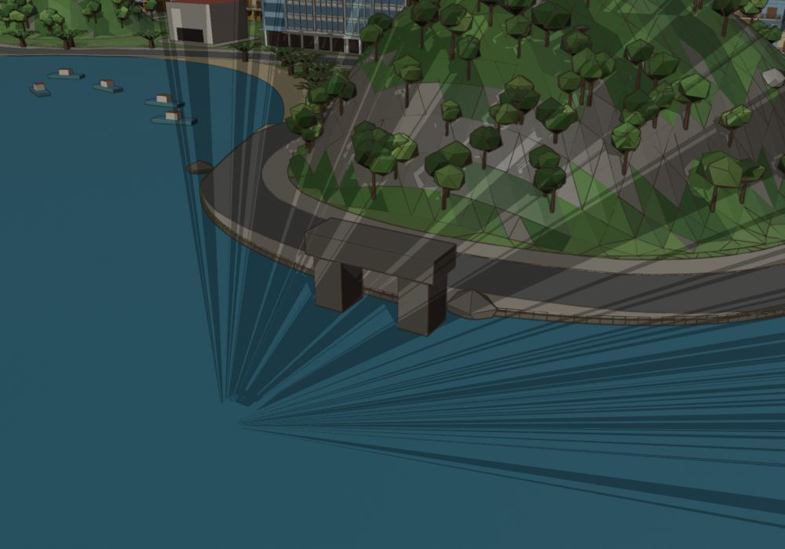

- **Hiện tại:** ba hộp `rock` (hai chân và một xà) tại (−31, −224), nằm trong `LM_Blockout`. Đó là khối thô "Mũi Nghinh Phong, Cổng Trời" (#27), dựng trong `build_new_landmarks` (`if lm['id'] == 'mui_nghinh_phong'`).
- **Việc:** xoá ba hộp này khỏi `LM_Blockout` và bỏ đoạn code đó. Mũi Nghinh Phong sau này chỉ là ghềnh đá tự nhiên, làm trong T3. Không có cổng hay khối vuông.
- **Xong khi:** góc `mui_nghinh_phong` không còn khối đó.
- **Đã xong 2026-11-12:** xoá 18 mặt `rock` khỏi `LM_Blockout` trong file chính, bỏ đoạn code trong `build_new_landmarks`.

## T3. Núi Nhỏ thoải hơn

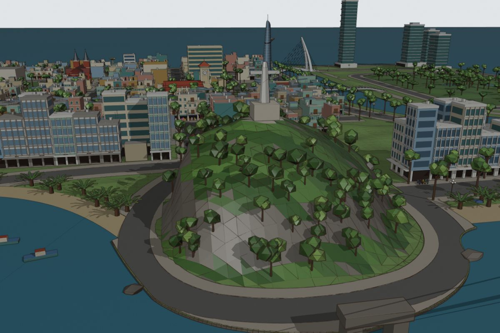
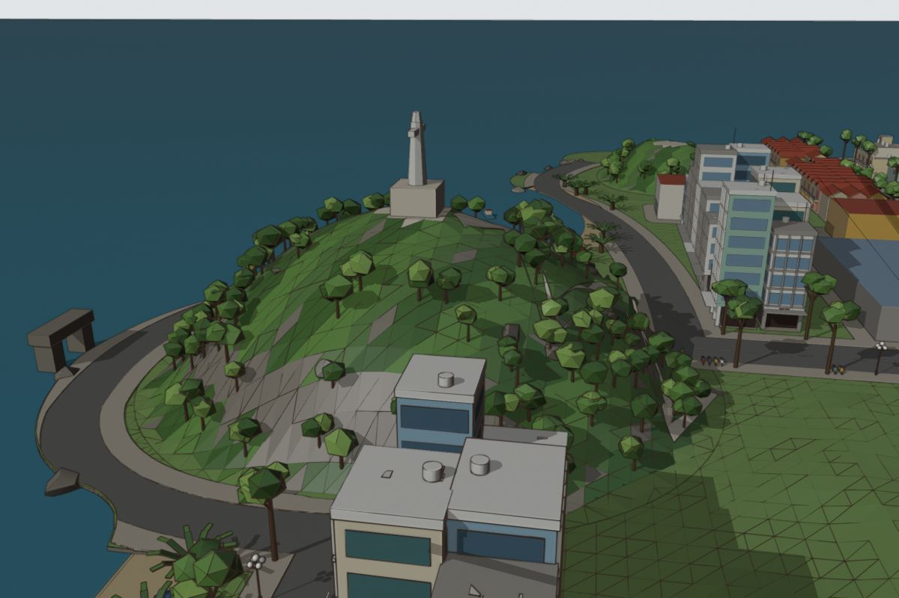
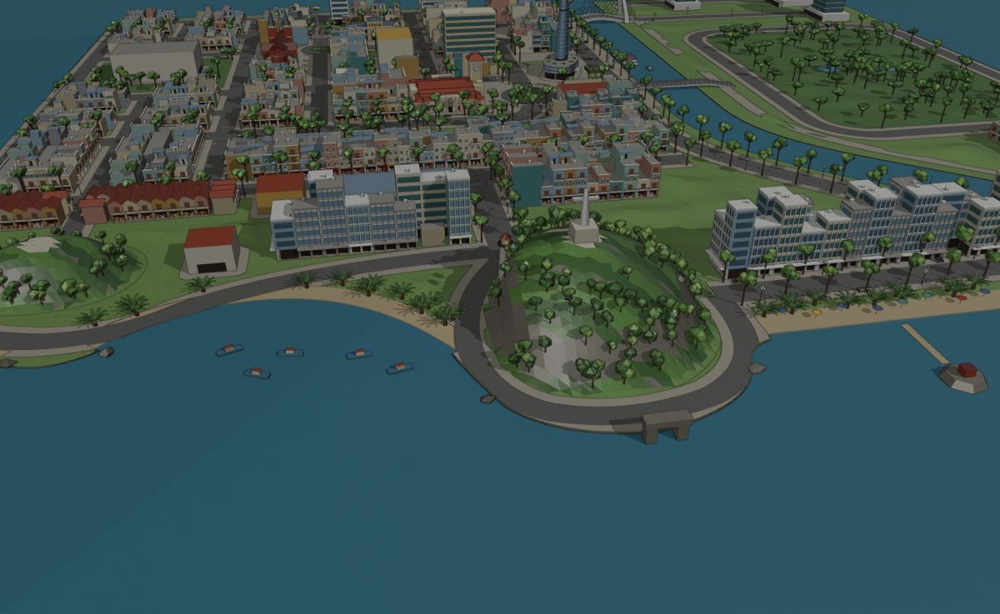

**Hiện tại** (`IS_nui_nho`, `build_mountains`, `mountain_height`):
- Núi là một vòm tròn cao 24 m. Phía tây có một mặt dốc đứng màu đá: chân núi bị cắt gắt (`smoothstep(0, 14, inside)` và `smoothstep(1.5, 9, distance(road))`) chỗ đường Hạ Long ôm sát chân núi.
- Lưới tam giác 2.6 m, mặt phẳng từng tam giác, nên nét mực vẽ đầy lên sườn núi.
- Cây rải đều như rắc muối.
- Đỉnh cao nhất đặt tượng Chúa. Hải đăng đặt theo `terrain_z` (không thấy núi) nên đứng dưới chân núi, cạnh đường.

**Thật** (VinWonders, xem nguồn cuối file):
- Núi Nhỏ (núi Tao Phùng) cao khoảng 170 m, có hai đỉnh. **Đỉnh cao hơn đặt hải đăng; đỉnh thấp hơn đặt tượng Chúa.**
- Đường Hạ Long chạy ven biển quanh chân núi. Đường Hải Đăng lên hải đăng rẽ từ Hạ Long, ngoằn ngoèo gần 3 km. Đường bộ lên tượng là bậc thang (khoảng 800 bậc) từ phía đường Thùy Vân (Bãi Sau).

**Design đề xuất:**
- **Dáng:** núi thuôn theo hướng bắc–nam, giữ chân núi hiện tại.
  - Đỉnh bắc ≈ (−42, −150) cao 24 m, cho hải đăng.
  - Đỉnh nam ≈ (−34, −190) cao 18–19 m, cho tượng.
  - Yên ngựa giữa hai đỉnh khoảng 14 m.
- **Độ dốc:** sườn tối đa khoảng 25°, chỉ vài mỏm đá lộ ra dốc hơn. Chân núi loe ra 12–15 m. Đường Hạ Long chạy trên một gờ phẳng có kè đá thấp phía biển; sườn núi bắt đầu lên từ mép đường, không bị cắt.
- **Mặt đất:** lưới mịn hơn ở sườn (khoảng 2 m), pháp tuyến mượt (smooth shading), để paint shader tạo bề mặt và nét mực chỉ vẽ ở bóng núi.
- **Cây:** trồng thành cụm rừng (`leafDark`, `leaf`), để trống quanh đỉnh và dọc đường. Thêm vài cây hoa giấy (`flowerPink`) dọc đường Hải Đăng và vài mảng đá granite (`rock`, `stone`) lộ ra.
- **Đường Hải Đăng:** đường nhỏ 4 m lượn từ Hạ Long phía tây bắc lên đỉnh bắc, độ dốc ≤ 12%.
- **Bậc thang lên tượng:** từ phía đông (gần Bãi Sau) lên đỉnh nam, zig-zag có chiếu nghỉ và lan can. Bậc ≤ 0.5 m mỗi ô nav (R3).
- **Mũi Nghinh Phong:** ghềnh đá tự nhiên ở mũi nam (vài khối `rock`, `rockDark` lớn, chìm một nửa xuống nước).

**Cách làm:**
- Viết `scripts/blender/mini/nui.py`: hàm cao độ mới dùng chung cho Núi Nhỏ và Núi Lớn, dựng lại `IS_nui_nho`, cây trên núi (tách khỏi `CX_Trees`), `LF_nui_nho_Stairs`, đường Hải Đăng. Sửa `peaks` trong layout json cho khớp.
- Nhớ cập nhật `terrain_z` hoặc `ground_z` để mọi thứ đặt lên núi đọc được độ cao núi. Đó là lý do hải đăng bị đặt sai.

**Xong khi:** các ảnh `nui_nho_w`, `nui_nho_e`, `vung_tau` không còn mặt cắt dốc đứng, hai đỉnh rõ, đường lên hải đăng và bậc thang lên tượng nhìn thấy được. Không quá 15k tam giác cho núi và cây trên núi (cây instancing).

**Bản nháp 2026-11-12** (`scripts/blender/mini/nui_nho.py`; thông số ở đầu file):

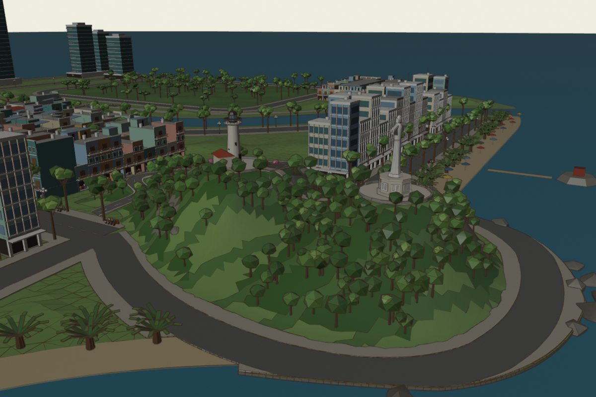
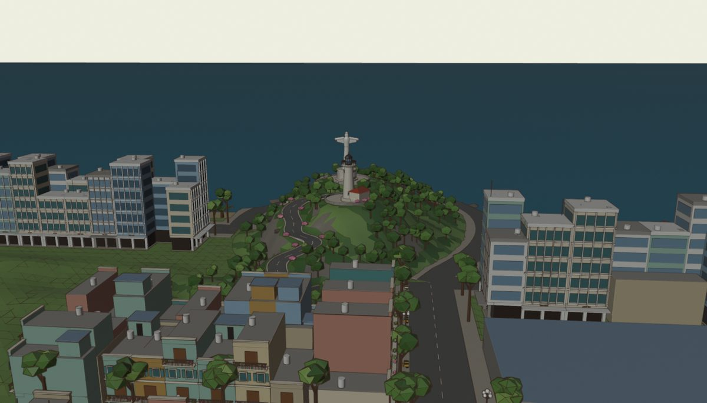

- **Đỉnh bắc (hải đăng):** (−30, −151), cao 14 m. **Đỉnh nam (tượng):** (−26, −186), cao 12 m. Yên ngựa 8.5 m. Cả hai đỉnh là sân lát đá có tường thấp.
- **Vì sao thấp hơn bản thô (24 m):** núi thật cao 170 m trên chân khoảng 1 km; theo tỉ lệ chân núi trong map thì chỉ khoảng 14 m. Hải đăng và tượng phóng lớn hơn thật, đúng luật style.
- **Chân núi:** khởi từ mép đường Hạ Long, bằng mặt đường, không còn mặt cắt. Về phía bắc chân núi nới ra bãi cỏ trống (x −39…9, y −128…−104), nên sườn bắc thoải dần về phía thành phố. Chân núi không bao giờ thấp hơn mặt cỏ của đảo.
- **Đường Hải Đăng:** rộng 4 m, có bó vỉa và vạch giữa, dài 91 m, dốc 15%. Rẽ từ Quốc lộ 51 ở chân bắc, lượn theo sườn lên sân hải đăng. Đường được tính tự động: đi từng mét, bám mặt núi với độ dốc đều. Hai bên có hoa giấy.
- **Bậc thang lên tượng:** từ đường Hạ Long phía Bãi Sau, ba đợt bậc, hai chiếu nghỉ, tường thấp hai bên; bậc bám theo mặt đất. Lối đi bộ dọc sống núi nối hai sân.
- **Cây và đá:** khoảng 225 cây thành từng cụm, chừa trống quanh sân, dọc đường và sống núi. 12 mỏm đá chỗ dốc nhất; ghềnh đá Mũi Nghinh Phong ở mũi nam, nửa chìm dưới biển.
- **Object:** `IS_nui_nho`, `CX_NuiNho_Trees`, `CX_NuiNho_Rocks`, `IX_NuiNho_Road`, `LF_nui_nho_Stairs`, `LF_NuiNho_Paths`.
- **Khi chạy trên file đang mở:** script gỡ cây và đá cũ của núi khỏi `CX_Trees` và `IS_Boulders`.
- **Trong `build_saigon_mini.py`:** `MODELLED_MOUNTAINS = {'nui_nho'}` để bản thô không dựng lại núi này. Layout json cập nhật `peaks`, `stairs`, vị trí tượng và hải đăng.
- **Tam giác:** khoảng 19k cho cả núi (đất 3.6k, cây 9.6k, đường 3.4k, bậc 1.8k).

## T4. Hải đăng Vũng Tàu

- **Thật:** tháp trụ tròn sơn trắng cao 18 m, đường kính 3 m, đứng trên đỉnh cao nhất Núi Nhỏ (170 m so với mực nước biển). Bên trong có cầu thang xoắn lên đèn, bên ngoài có ban công nhìn ra thành phố. Xây năm 1862 ở mỏm nam, năm 1910 dời lên vị trí hiện tại.
- **Design đề xuất:**
  - **Tháp:** trụ tròn `opWhite` cao 9 m (phóng so với tượng cho dễ thấy), bán kính chân 1.5 m, thuôn nhẹ lên 1.2 m. Vài ô cửa sổ nhỏ `archDark` chạy dọc theo cầu thang.
  - **Đầu tháp:** ban công tròn có lan can `archDark`, buồng đèn kính `glassBlue` với bóng `lampGlow`, mái vòm nhỏ màu tối.
  - **Xung quanh:** nhà người gác đèn một tầng mái ngói `roofRed` và sân có tường rào, tường phủ hoa giấy (`flowerPink`). Đường Hải Đăng (T3) kết thúc ở sân này.
  - **Ban đêm:** đèn quay làm bằng Three.js, như đã ghi trong map-v5.md.
- **Cách làm:** `scripts/blender/mini/hai_dang.py`, object `LM_HaiDang` đặt trên đỉnh bắc của T3, cao độ lấy từ mặt núi. Xoá hải đăng thô trong `LM_Blockout`.
- **Xong khi:** ảnh `hai_dang` (sửa toạ độ góc này theo đỉnh mới), nhìn từ thành phố thấy hải đăng nổi trên đỉnh núi. Không quá 3k tam giác.

**Bản nháp 2026-11-12** (`scripts/blender/mini/hai_dang.py`, object `LM_HaiDang`, 1,060 tam giác):

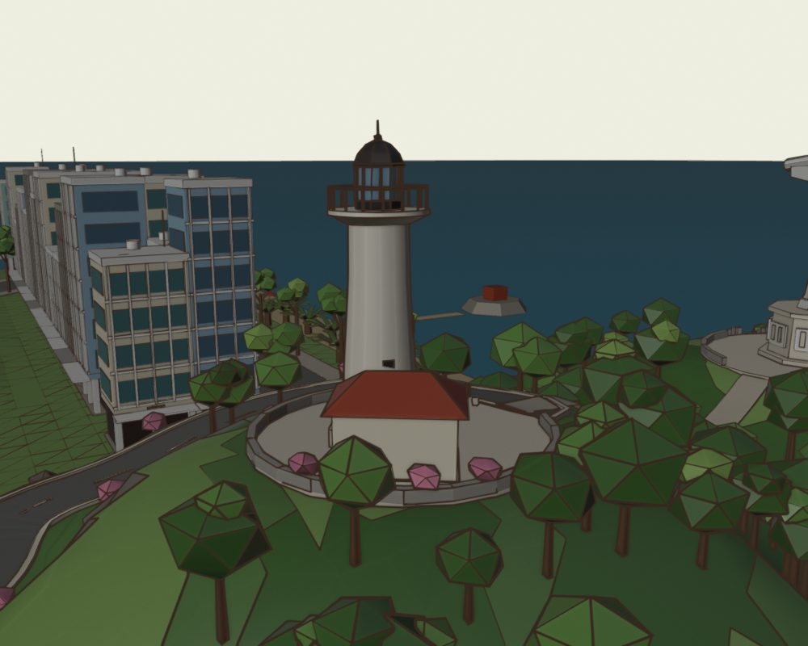

- **Tháp:** trụ trắng thuôn cao 8.6 m trên bệ đá; cửa sổ nhỏ chạy vòng theo cầu thang xoắn; cửa nhìn về phía đường lên.
- **Đầu tháp:** ban công có lan can tối, buồng đèn kính 8 cạnh có bóng `lampGlow`, mái vòm tối, quả cầu và cột thu lôi.
- **Nhà gác đèn:** nhà trắng một tầng mái ngói đỏ, cửa chớp xanh `poGreen`; hoa giấy trên tường sân.
- Gỡ khối hải đăng thô khỏi `LM_Blockout`.

## T5. Tượng Chúa Kitô Vua

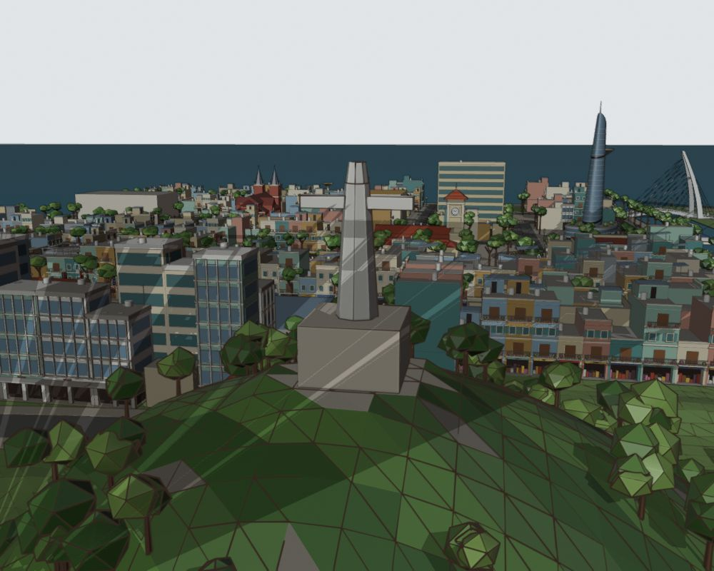

- **Hiện tại:** một khối bệ vuông, một trụ, một thanh ngang. Không ra dáng người.
- **Thật:** tượng cao 32 m, sải tay 18.3 m, trên bệ 4 m (tổng 36 m), xây năm 1974, đứng trên đỉnh thấp của Núi Nhỏ, nhìn ra biển. Bên trong có 133 bậc xoắn lên tới vai.
- **Design đề xuất** (giữ tỉ lệ thật, phóng chi tiết cho dễ đọc):
  - **Tượng:** cao 12 m `statueW`.
    - Áo dài phủ chân, loe nhẹ ở gấu (dựng bằng `lathe`).
    - Thân thon dần, đầu có tóc dài tới vai.
    - Hai tay dang ngang, hơi chếch xuống, sải khoảng 7–7.5 m. Tay áo rộng rủ xuống thành hai mảng dưới cánh tay: đây là chi tiết làm ra dáng "dang tay" khi nhìn từ xa.
  - **Bệ:** 4 m, khối tròn hoặc bát giác bằng `stone`, có một dải phù điêu (khối nổi giản lược) quanh thân.
  - **Sân:** sân lát `stone` quanh bệ, lan can, vài ghế. Bậc thang (T3) dẫn lên sân.
  - **Hướng:** mặt tượng nhìn ra biển phía nam.
- **Cách làm:** `scripts/blender/mini/tuong_chua.py`, object `LM_TuongChua` trên đỉnh nam của T3. Xoá tượng thô trong `LM_Blockout`. Render nháp ba góc (chính diện, nghiêng, từ Bãi Sau) cho Khoa duyệt dáng trước.
- **Xong khi:** từ Bãi Sau và từ thành phố nhìn ra được dáng người dang tay. Không quá 4k tam giác.

**Bản nháp 2026-11-12** (`scripts/blender/mini/tuong_chua.py`, object `LM_TuongChua`, 1,144 tam giác):

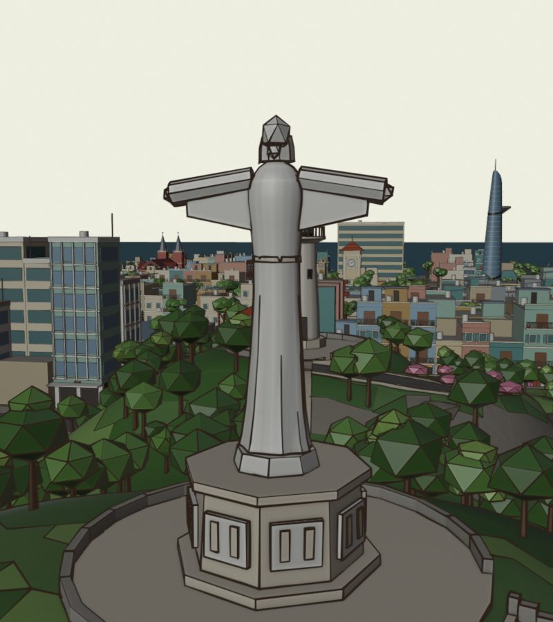
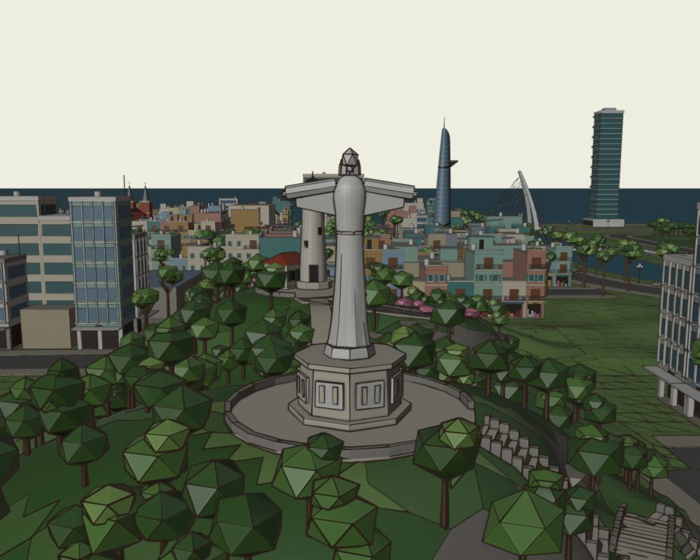

- **Tượng:** cao 11.3 m trên bệ 4 m, đỉnh tượng ở 27.5 m so với mặt biển.
  - Áo dài có nếp gấp dọc (sâu ở gấu, nhạt dần lên ngực), dải thắt lưng.
  - Hai tay dang thẳng hơi chếch xuống, sải 7.4 m. Tay áo rộng rủ thành hai mảng dưới cánh tay.
  - Đầu có tóc tới vai và râu ngắn.
- **Bệ:** đế bậc, thân bát giác có 8 tấm phù điêu, gờ mái.
- **Hướng:** mặt nhìn ra biển phía nam (−Y).
- Gỡ khối tượng thô khỏi `LM_Blockout`.

## T6. Núi Lớn thoải hơn

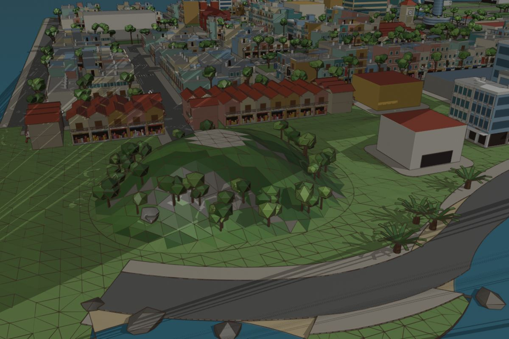

- **Hiện tại:** vòm thấp 11 m, đỉnh có một mảng lát đá trống (code đặt mặt `stone` ở mọi đỉnh, kể cả khi không có công trình), sườn có mặt cắt gắt như Núi Nhỏ.
- **Design:** đồi thấp 10–12 m, thoải hơn, dùng chung hàm của T3. Đỉnh phủ cây, không lát đá. Vài mỏm đá về phía Bãi Dâu. Bạch Dinh (#29, T12) nằm dưới chân phía đông, nhìn ra Bãi Trước.
- **Xong khi:** ảnh `nui_lon` không còn mảng đá trống trên đỉnh.

## T7. Cầu Mống ở cuối Hàm Nghi

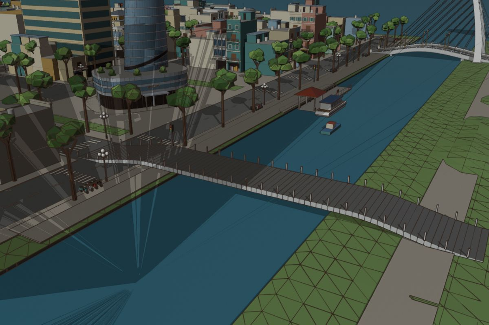

- **Hiện tại:** phần còn lại của `LM_Bridges`: một tấm phẳng 8 m có cọc lan can. Đầu tây dốc ngay trên ngã tư Tôn Đức Thắng (như lỗi cũ của cầu Ba Son); đầu đông đáp xuống lối đi bộ và bãi cỏ Thủ Thiêm, không nối vào đường nào.
- **Thật:**
  - Cầu thép Eiffel, xây cuối thế kỷ 19 (Saigoneer ghi 1882), bắc qua rạch Bến Nghé, nối Quận 1 với Quận 4.
  - Dài 128 m, rộng 5.2 m, một nhịp vòm tựa lên hai trụ chính.
  - Sơn xanh ngọc nên còn gọi là "Cầu Mống Xanh". Tên "mống" (cầu vồng) là do dáng cong.
  - Hai đầu có bậc thang và dốc lát đá; có đèn cột kiểu cổ.
  - Từ năm 2010 chỉ cho người đi bộ.
  - Trong map, cầu bắc qua sông Sài Gòn ở cuối Hàm Nghi; không đúng vị trí thật, theo ý Khoa.
- **Design đề xuất:**
  - **Kiểu cầu:** cầu đi bộ rộng 5.5 m, chỉ người đi bộ (xe không qua; đường vòng cho xe chỉ còn cầu Ba Son).
  - **Dáng:** mặt cầu cong vồng như cầu vồng, nhịp từ trụ bờ tây (x 48) sang trụ bờ đông (x 74). Hai bên là dàn thép mắt cáo (thanh chéo chữ X) màu `poGreen`, có sẵn trong PAL, gần với xanh ngọc thật. Dàn cao khoảng 1.5 m, làm luôn lan can.
  - **Đầu cầu:** dốc và bậc lát `stone` đáp xuống lối đi bộ ven sông hai bờ (x 40…47 và 84…90). Không đè lên ngã tư Tôn Đức Thắng.
  - **Đèn:** đèn cột kiểu cổ `archDark` với bóng `lampGlow`.
  - **Màu:** không méo tay (thép).
- **Cách làm:** `scripts/blender/mini/cau_mong.py`, object `LM_CauMong`, xoá hết `LM_Bridges`. Đổi `cau_ham_nghi` trong layout json thành cầu đi bộ để cắt đường cho đúng.
- **Xong khi:** ảnh `cau_ham_nghi` và render nháp được duyệt. Không quá 6k tam giác.

## T8. Thủ Thiêm

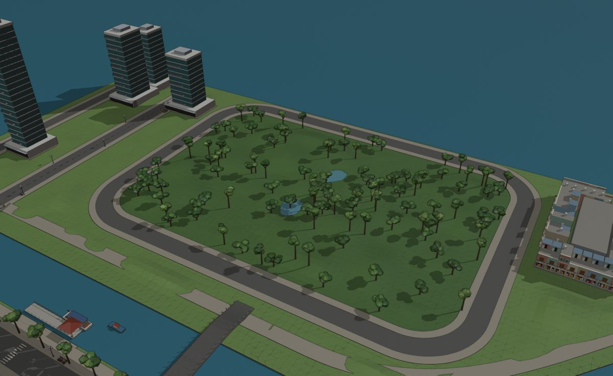

- **Hiện tại:**
  - Một vòng đường như trường đua (x 105…233, y −53…127), bên trong là bãi cỏ với khoảng 140 cây rải ngẫu nhiên và hai ao nhỏ.
  - Bốn tháp `tt_tower` giống nhau ở phía bắc, một dãy nhà hẻm ở góc đông nam.
  - Lối đi bộ ven sông trống, phía nam là bãi cỏ trống.
- **Thật bây giờ** (SGGP, xem nguồn):
  - Công viên bờ sông: bãi cỏ, cánh đồng hướng dương mỗi dịp Tết, đường chạy bộ và đường xe đạp rợp cây.
  - Công viên Sáng tạo ở đầu cầu Ba Son, nơi có gian hàng và sự kiện.
  - Khu Sala có hồ cho cá ăn.
  - Tháp cao dọc các trục đường; còn có nhà thờ Thủ Thiêm và đình An Khánh.
- **Design đề xuất** (cần Khoa duyệt sơ đồ trước):

| Khu | Vị trí | Nội dung |
|---|---|---|
| Công viên bờ sông | dải ~30 m dọc bờ đông, từ cầu Ba Son tới cầu Mống | lối đi bộ, đường xe đạp, bãi cỏ thoải xuống sông, một mảng đồng hoa (`flowerYellow`), ghế và đèn, nhìn sang trung tâm |
| Công viên Sáng tạo | đầu cầu Ba Son | quảng trường lát gạch có sân khấu nhỏ và vài gian hàng; chỗ cho sự kiện và game co-op (R7) |
| Quảng trường nhỏ | đầu cầu Mống | bến buýt đường sông |
| Hồ trung tâm | thay hai ao nhỏ | một hồ lớn có đài phun, đường dạo quanh hồ, cầu gỗ nhỏ |
| Cụm tháp | phía bắc | một tháp điểm nhấn cao ~70 m (cao hơn Bitexco, dáng khác hẳn) và 3 tháp thấp hơn, mỗi tháp một kiểu (không lặp lại `tt_tower`) |
| Khu phố mới | phía nam | vài dãy shophouse thấp kiểu Sala; nhà thờ Thủ Thiêm nhỏ (trắng, một tháp chuông) làm điểm nhấn |
| Trục đường | trong khu | thay vòng đường kiểu trường đua bằng một đại lộ cong có hàng cây (kiểu Mai Chí Thọ) và vài đường nhánh |

- **Cách làm:** sửa `loops`, `parks`, `lakes`, `towers` trong layout json, vẽ lại sơ đồ (`layout_svg.mjs`) cho Khoa duyệt, rồi viết `scripts/blender/mini/thu_thiem.py`.
- **Xong khi:** sơ đồ được duyệt, rồi ảnh `thu_thiem` được duyệt. Không quá 60k tam giác cho cả khu (tháp kính đơn giản, cây instancing).

## T9. Bộ nhà Sài Gòn (kit)

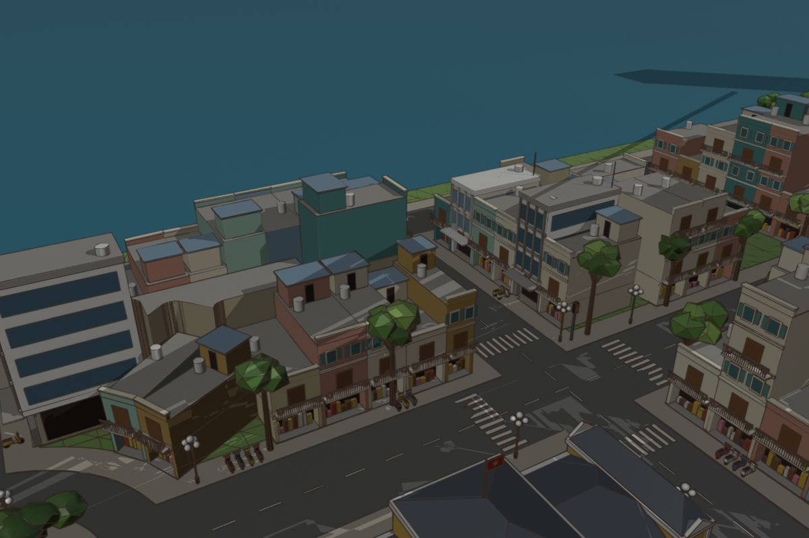
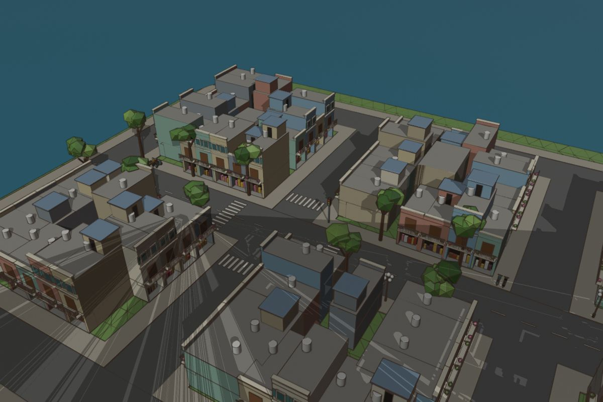
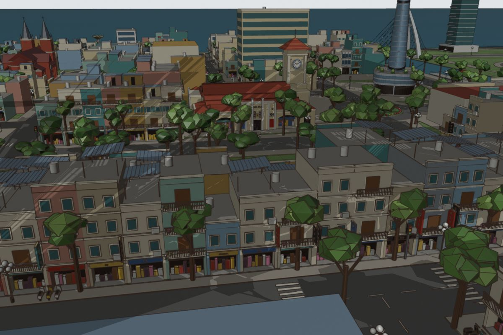

**Hiện tại** (`build_houses`, `build_house`): mọi căn đều dựng bằng `house_plain` của map v4 nên nhà kề nhau trông giống nhau.
- Cùng độ sâu (11 m nhà phố, 9 m nhà hẻm), cùng mặt tiền thẳng hàng.
- 1–4 tầng, phần lớn 2–3 tầng.
- Cùng kiểu cửa sổ, ban công và bảng hiệu.
- Mái nhà nào cũng có tum và bồn nước giống nhau.
- Phía sau các dãy là khối bê tông `SH_Backs`.
- Nặng: 960k tam giác cho khoảng 590 căn, khoảng 1,600 mỗi căn.

**Những điểm làm nên phố Sài Gòn:** xem [map-v5.md](map-v5.md), mục "Nhà kiểu Sài Gòn". Tóm tắt:
- Mái bằng có sân thượng.
- Cao thấp không đều, lộ tường hông trơn.
- Mặt tiền 3–5 m.
- Ban công có khung sắt.
- Tầng trệt là cửa hàng: cửa cuốn, mái hiên, bảng hiệu to.
- Mỗi nhà một màu.
- Có thêm nhà thời 1960 (ô văng, lam đứng, gạch hoa gió).

**Kit:** 7 kiểu (NP-A, NP-B, NH, CC, PCL, KS, BT) như bảng trong map-v5.md. Mỗi kiểu ghép từ các mô-đun chọn theo seed:
- **Mặt tiền tầng trệt:** cửa cuốn mở hoặc đóng, quán mở có mái hiên bạt (`clothRed`, `clothBlue`, `clothYellow`) hoặc tôn (`tinBlue`), cửa kính, cửa sắt xếp.
- **Tầng trên:**
  - Cửa sổ: khung sắt, cửa chớp hoặc kính.
  - Ban công: lồng sắt, lan can, bồn hoa bê tông hoặc ô văng.
  - Ban công đua ra 0.6–1.2 m.
- **Mái:**
  - Tum mái tôn (vị trí và màu khác nhau).
  - Bồn nước inox nằm hoặc đứng, có giá.
  - Chậu cây, dây phơi đồ, giàn hoa giấy, mái tôn che một nửa sân thượng.
- **Bảng hiệu:** ngang to, dọc, hai bảng chồng, hoặc không có bảng. Tấm phẳng và khối "chữ" giản lược, không dùng font 3D (T1).
- **Thêm:** máy lạnh treo tường, dây điện, đồ bày vỉa hè.

**Ngân sách:** 150–350 tam giác mỗi căn (T1).

**Duyệt:** render một bảng mẫu gồm 7 kiểu × 3 biến thể, đặt cạnh `docs/img/10_nha_ong.jpg` và ảnh thật. Khoa duyệt bảng mẫu xong mới làm T10.

**Cách làm:** `scripts/blender/mini/house_kit.py` (mô-đun và hàm `build_house(kind, w, d, floors, seed)`), có thể dùng lại từng chi tiết của `house_plain`, nhưng bản chất là kit mới.

## T10. Lấp nhà theo block

Luật trộn để một dãy nhìn như phố thật:
- **Chiều cao theo loại đường:**

  | Loại | Số tầng |
  |---|---|
  | Phố chính | 3–6 (nhiều nhất 4–5) |
  | Phố phụ | 2–4 |
  | Hẻm | 2–3 |

  Khoảng 70% cặp nhà kề nhau lệch nhau ít nhất 1 tầng, tạo đường mái răng cưa và lộ tường hông. Trên tường hông có vệt ố hoặc mảng quảng cáo vẽ.
- **Bề ngang:**
  - Thường 3.5–6 m.
  - Thỉnh thoảng có căn 8–10 m (hiện đại, khách sạn).
  - Nhà góc rộng hơn, có góc vát hoặc bo, tầng trệt thường là quán cà phê.
- **Độ sâu và mặt tiền:**
  - Sâu 9–18 m.
  - Mặt tiền lệch nhau ±0.3 m, tầng trên đua ra.
- **Màu:** không lặp màu trong 2 căn liền nhau.
- **Lõi block:** có hẻm 2–3 m chui vào giữa, nhà hẻm NH bên trong, thay khối `SH_Backs`.
- **Theo khu:**
  - Bùi Viện dùng biến thể quán bar.
  - Chợ Lớn dùng PCL.
  - Quanh công trình cũ thấp hơn để không che.

**Cách làm:** viết lại `build_houses` thành `scripts/blender/mini/houses.py` dùng kit T9. Dựng thử một khu mẫu (ví dụ block giữa Pasteur và Hàm Nghi, cạnh chợ) cho Khoa duyệt, rồi chạy cả map.

**Xong khi:**
- Các ảnh `nha_pho`, `nha_hem`, `bui_vien` không còn dãy nhà giống nhau.
- Nhà cả map ≤ 180k tam giác.

## T11. Khách sạn mini Bãi Sau, Bãi Trước


- **Hiện tại:** dãy `SH_ks` dọc Bãi Sau (x 11…141, y −159…−146) là một bức tường liền gồm các khối `modern_block` giống nhau, cao gần bằng nhau. Dãy nhỏ hơn ở Bãi Trước (x −123…−61, y −123…−109) cũng vậy.
- **Design:**
  - Kiểu KS của kit: khách sạn mini 6–9 tầng, ngang 6–8 m, ban công kính nhìn ra biển, bảng tên dọc, bồn nước trên mái, màu sáng.
  - Có khe hẻm ra biển mỗi 3–5 căn, cao thấp xen kẽ.
  - Tầng trệt quán hải sản hoặc cho thuê đồ tắm biển.
- **Xong khi:** ảnh `bai_sau` được duyệt.

## T12. Công trình mới còn là khối thô

Mỗi công trình một task con, mỗi cái một render nháp cho Khoa duyệt trước. Thứ tự gợi ý theo độ quan trọng với gameplay (gần điểm xuất phát trước):

| Task | Công trình (#) | Vị trí Blender XY | Hiện tại | Đặc trưng cần có |
|---|---|---|---|---|
| T12a | UBND Thành phố (#7) | (−71, 91), 18 × 26 m | hộp vàng | dinh thự Pháp tường vàng kem, tháp đồng hồ giữa, hai cánh, mái xám, đầu phố Nguyễn Huệ |
| T12b | Chung cư 42 Nguyễn Huệ (#9) | (−33, 75) | `modern_block` | kiểu CC: 9 tầng, mỗi tầng một quán, hành lang và cầu thang lộ, bảng hiệu nhiều màu |
| T12c | Dinh Thống Nhất (Dinh Độc Lập, #16) | (−201, 91), mặt tiền 40 m nhìn ra đông | **nháp xong** (`dinh_thong_nhat.py`) | hiện đại 1966, rèm hoa đá hình đốt trúc, mái hiên trên hai cột bọc gỗ, lầu Tứ phương trên sân thượng, kỳ đài và cờ, sân trực thăng, đài phun trước sân |
| T12d | Bến Nhà Rồng (#15, tuỳ chọn) | (11, 3) | hộp đỏ | nhà kiểu Pháp hai tầng, mái ngói có rồng trên nóc, sát sông |
| T12e | Chùa Bà Thiên Hậu (#17) | (−123, −80) | hộp đỏ | chùa người Hoa: mái ngói xanh lục và đỏ nhiều lớp, tượng gốm trên nóc, sân có lư hương |
| T12f | Bến xe (#18) | (−80, −85), 42 × 26 m | hộp xanh | mái tôn che sân đậu, vài xe buýt, cổng bến |
| T12g | ~~Bạch Dinh (#29)~~ | | | **bỏ** (layout v7) |
| T12h | Hòn Bà (#26) | (239, −179), ngoài khơi Bãi Sau | trụ đá và hộp đỏ | đảo đá có miếu nhỏ mái ngói, con đường đá ra đảo lúc nước ròng (hướng vào bờ: `tideTo`) |

## T13. Lấp các khoảng cỏ trống

Nhìn từ trên (`top`) còn mấy mảng cỏ trống lớn:
1. Giữa mép nam thành phố (Trần Hưng Đạo, y −65) và dãy khách sạn Bãi Sau, phía đông Quốc lộ 51, dọc đoạn cong của Tôn Đức Thắng: khoảng x 11…79, y −144…−69.
2. Thủ Thiêm phía nam: phần của T8.
3. Bãi cỏ giữa Chợ Lớn, Núi Lớn và Bãi Trước.

Đề xuất nội dung cho từng mảng (phải hỏi Khoa):
- Khu dân cư mới (nhà theo kit T10).
- Công viên ven sông có sân bóng.
- Chợ hải sản và bến thuyền gần cửa sông.
- Cây xăng, trạm xe buýt.

Vẽ sơ đồ trước khi dựng.

## T14. Đánh bóng cuối

- **Mặt cỏ:** cỏ nhấp nhô (`rolling_z`) trên lưới tam giác phẳng làm nét mực vẽ đầy bãi cỏ (thấy rõ ở Thủ Thiêm và quanh Núi Lớn). Pháp tuyến mượt cho đất, hoặc bớt nhấp nhô.
- **Vạch đường:** vạch bị đứt quanh hai đầu cầu cũ; vạch qua đường ở hai đầu cầu mới.
- **Nav (R2, R3):** hộp `NAV_Deck_` cho cầu, bậc thang lên tượng, đường Hải Đăng; chạy `nav:check` (R2) tìm túi kẹt.
- **Kết thúc:** cập nhật `docs/PROJECT.md` và ảnh công trình khi map mới vào game.

---

## T15. Viền đảo cong tự nhiên, nhỏ hơn; Thủ Thiêm có nội dung

Khoa (2026-11-12): "viền của thành phố đang vuông ko giống một cái đảo lắm, restruct lại cho nhỏ hơn tí rồi cong tự nhiên hơn, bên khu thủ thiêm đang trống".

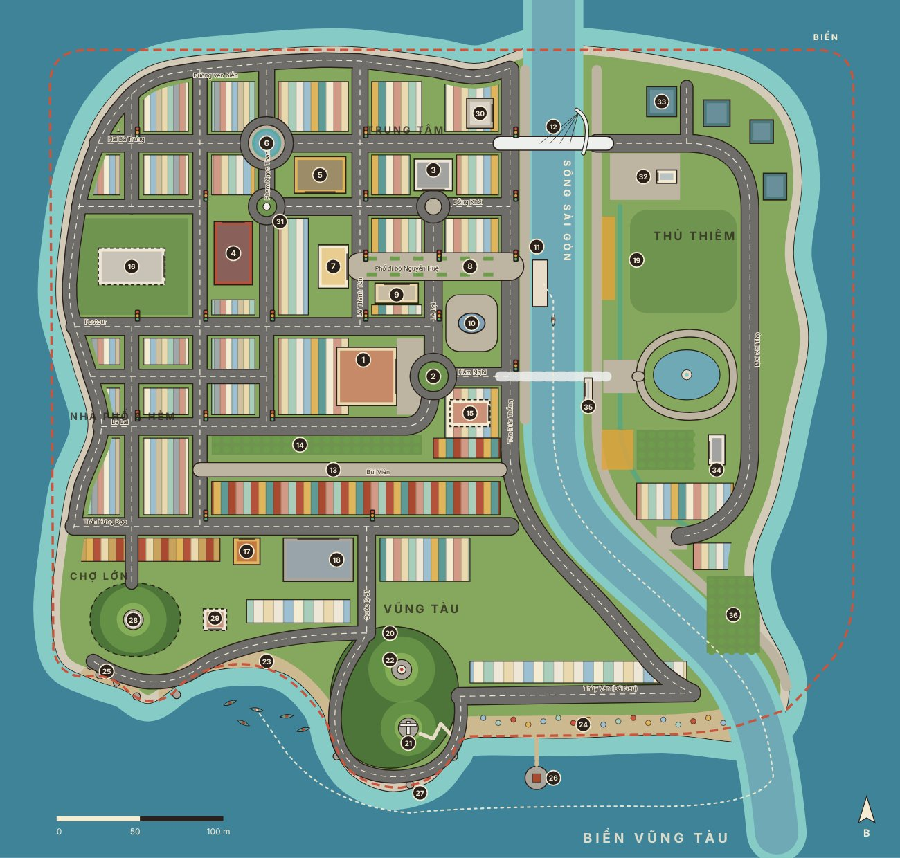

**Đề xuất** (`scripts/map/reshape_coast.py` tạo `scripts/map/saigon_mini_layout_proposal.json` từ layout hiện tại; sơ đồ `docs/img/saigon_mini_layout_proposal.svg`):

- **Viền đảo:** một đường cong khép kín qua các điểm đặt tay, không còn cạnh thẳng hay góc vuông.
  - Góc tây bắc cắt vát.
  - Bờ bắc phình nhẹ ở giữa, có một vịnh nhỏ trước cửa sông.
  - Bờ tây có một vịnh.
  - Thủ Thiêm thành mũi đất bo tròn, bờ đông thụt vào.
  - Vũng Tàu (Bãi Trước, Núi Nhỏ, Bãi Sau, Bãi Dâu) giữ nguyên.
  - Diện tích 172 nghìn m², nhỏ hơn 11% (cũ 192 nghìn).
- **Dải ven bờ:** kè và lối đi 4 m, đường ven biển 8 m, vỉa hè; nhà chỉ dựng phía trong (`inland`, cách bờ 15 m).
- **Đường ven biển:** một đường cong chạy dọc bờ bắc và bờ tây, thay hai đường thẳng ở mép cũ. Các phố ô cờ trước chạy ra mép đảo giờ dừng ở đường này.
- **Thủ Thiêm** (gộp sơ đồ của T8):

| Khu | Nội dung |
|---|---|
| Trục đường | đại lộ Mai Chí Thọ cong từ đầu cầu Ba Son vòng xuống phía nam, thay vòng đường kiểu trường đua |
| Bờ sông | lối đi bộ, đường xe đạp (xanh), hai mảng đồng hoa (vàng) |
| Công viên Sáng tạo (#32) | quảng trường và sân khấu nhỏ ở đầu cầu Ba Son |
| Bãi cỏ lớn (#19) | |
| Hồ trung tâm | đài phun và đường dạo quanh hồ |
| Đầu cầu Mống | quảng trường nhỏ và bến buýt đường sông (#35) |
| Cụm tháp phía bắc | 4 tháp, tháp điểm nhấn ~70 m (#33) |
| Phía nam | nhà thờ Thủ Thiêm (#34), hai dãy shophouse, rừng dừa nước ven sông (#36) |

**Ảnh hưởng:**
- Phải dựng lại cả map bằng `build_saigon_mini.py`, khoảng 1 phút, vì đất, đường, nhà, cây đều đổi.
- Cần sửa `build_saigon_mini.py`:
  - dựng nhà trong `inland`;
  - vẽ thêm công viên loại `flowers`, đường xe đạp, đài phun;
  - bỏ các khối thô còn lại theo layout mới.
- Các công trình mới ở Thủ Thiêm (#32–#36) sau đó cần model và duyệt riêng (như T12).
- Xong thì layout đề xuất thay `saigon_mini_layout.json`.

## Đã làm ngày 2026-11-12 (sau khi Khoa duyệt viền đảo)

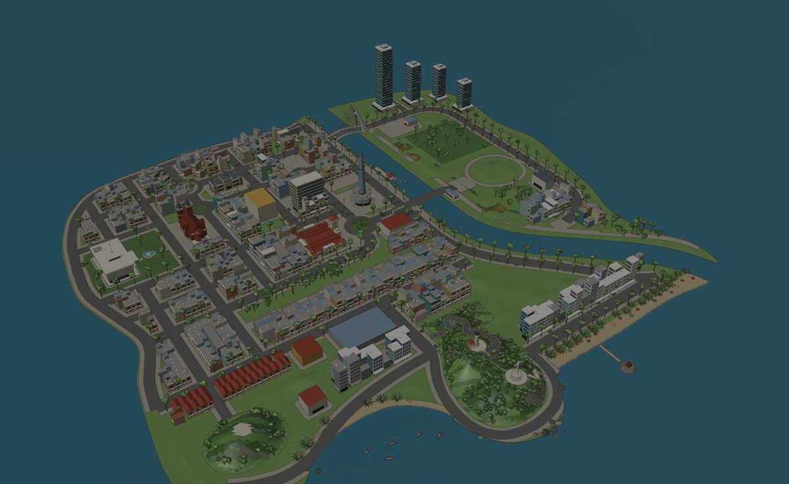
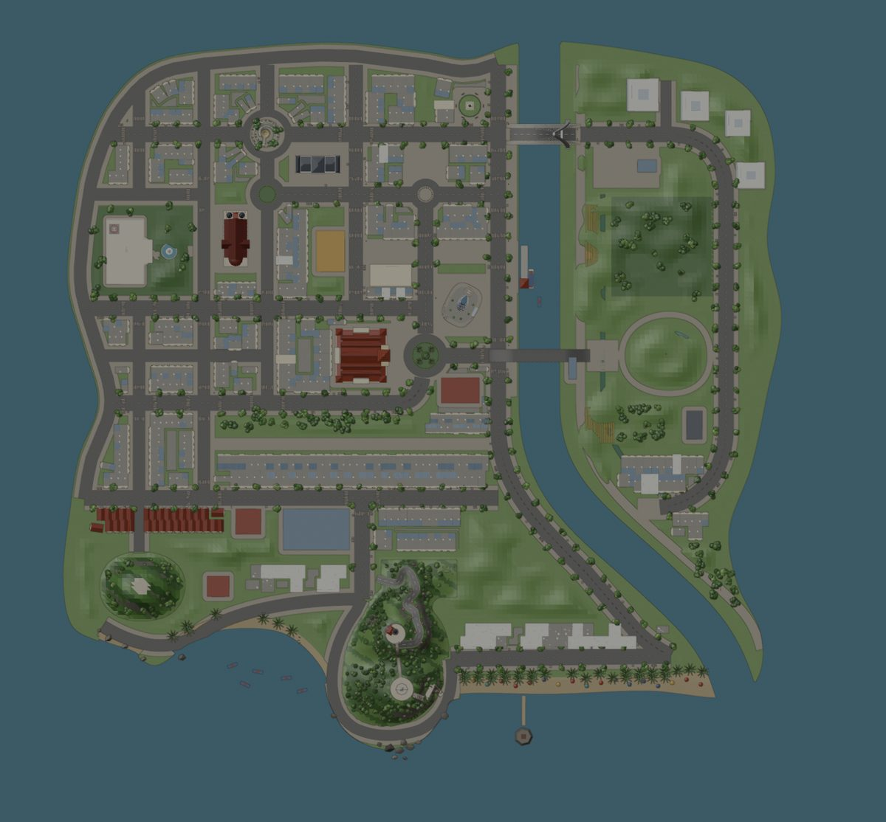

- **Layout mới:** `scripts/map/saigon_mini_layout.json` là layout đã duyệt; bản đảo vuông cũ là `saigon_mini_layout_v1.json`. `reshape_coast.py` giữ cách làm, chạy lại được từ v1 nếu đổi điểm bờ.
- **Dựng lại cả map:** `models/saigon_mini.blend`; bản trước lưu ở `versions/saigon_mini_v2.blend`. Map gồm viền mới, đường ven biển, Thủ Thiêm mới, cầu Ba Son, Núi Nhỏ, hải đăng, tượng Chúa và Dinh Thống Nhất.
  - 512 căn nhà (trước 593).
  - GLB qua `map:export`: 3.5 MB (gzip 1.07 MB).
  - 1.26 triệu tam giác (nhà vẫn là phần lớn: T9, T10).
- **`build_saigon_mini.py` thêm:**
  - Nhà chỉ dựng trong `inland`.
  - Công viên loại `flowers` (đồng hoa: luống xanh, đầu vàng) trong `CX_Flowers`.
  - Đường xe đạp (promenade `kind: cycle`, mặt xanh `poGreen`).
  - Đài phun giữa hồ (`fountain`).
  - Mặt đất phẳng dưới hồ, đồng hoa và các vòng tròn `flats` (sân trước dinh), để cỏ nhấp nhô không phủ lên.
  - `MODELLED_LANDMARKS` cũng bỏ hộp thô của các công trình đã có model.
- **Dinh Thống Nhất:** `scripts/blender/mini/dinh_thong_nhat.py`, object `LM_DinhThongNhat` (3,736 tam giác) và `LF_DinhThongNhat` (đài phun, vòng sân, lối vào ra phố).

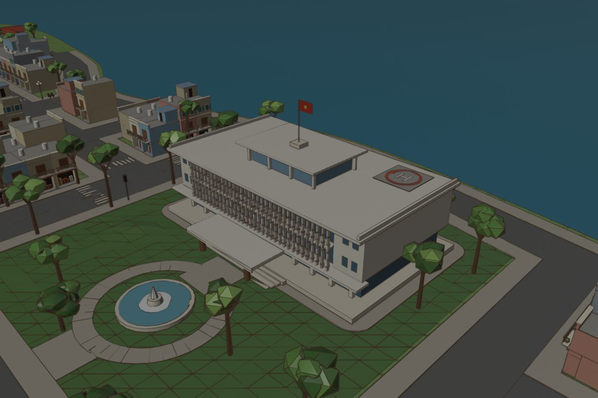
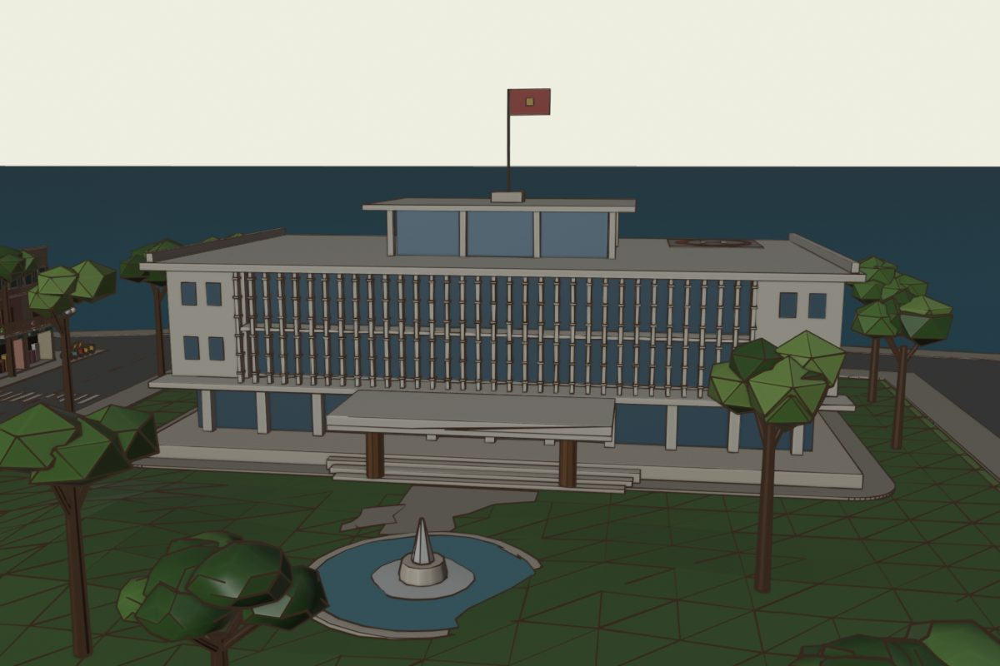
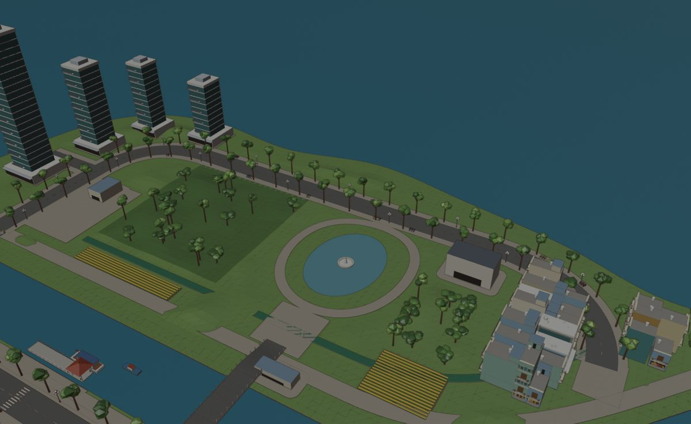

## Layout v7 (2026-11-12): Vũng Tàu sang bờ đông, Bùi Viện về, không xe không người

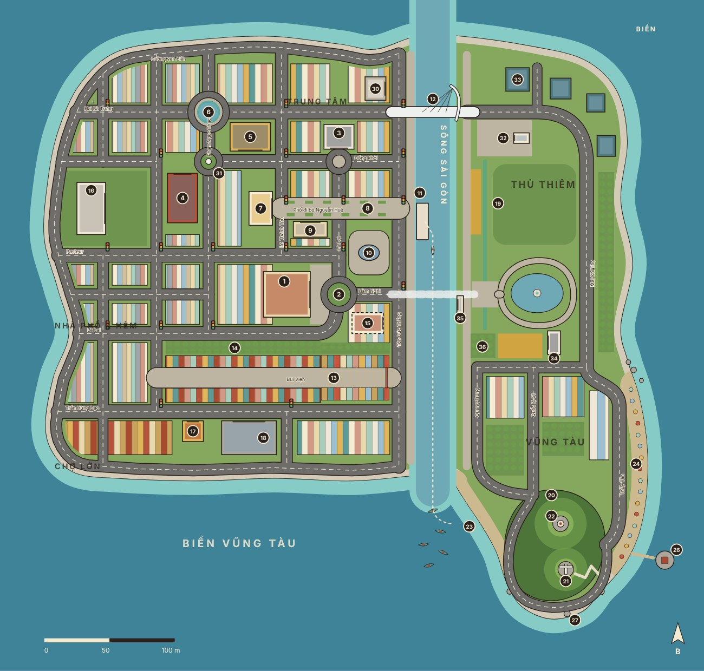
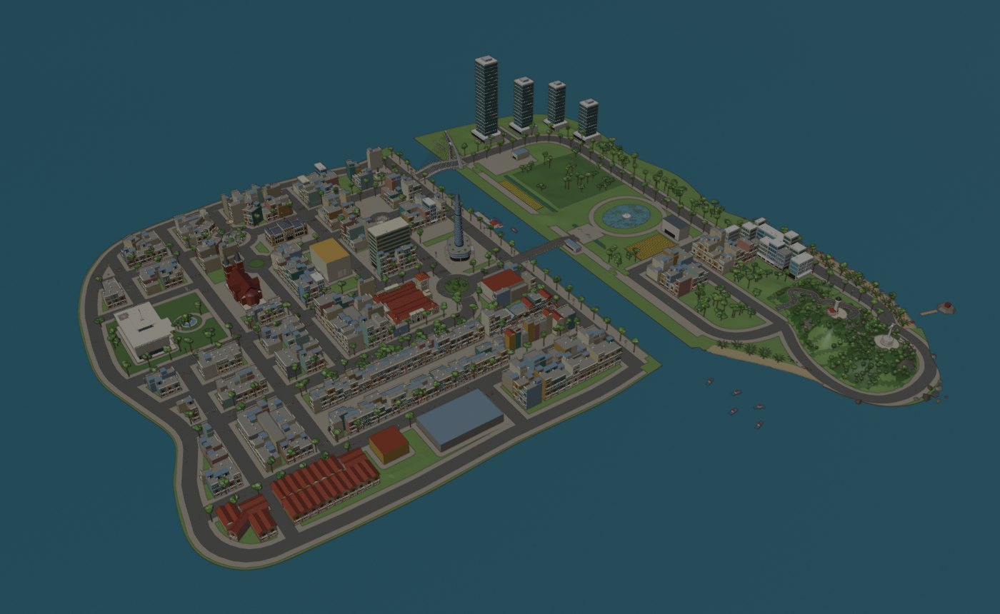

Lý do (rà map theo góc nhìn game): đảo quá to cho game đi bộ, nhiều bãi cỏ chết (Thủ Thiêm, quanh Núi Lớn), Vũng Tàu nằm tận cuối map, thiếu phố Bùi Viện của bản trước.

- **Layout:** `scripts/map/relayout_v7.py` làm `saigon_mini_layout.json` từ `saigon_mini_layout_v2.json` (bản trước, giữ lại). Đảo nhỏ hơn 9% (156 nghìn m², trước 172 nghìn m²).
  - Sông chảy thẳng ra biển phía nam. Bờ tây (thành phố) dừng ở bờ biển phía nam; đường ven biển chạy vòng bắc, tây, nam, nối Tôn Đức Thắng dọc sông.
  - Bỏ: Núi Lớn, Bãi Dâu, Bạch Dinh, phố Vũng Tàu cũ và các bãi cỏ giữa chúng. Giữ Chợ Lớn, bến xe.
  - Bờ đông: Thủ Thiêm ở nửa bắc như cũ; Vũng Tàu ở nửa nam thành một mũi đất như thật: Núi Nhỏ ở mũi (tượng, hải đăng), Bãi Sau dọc bờ đông (Thùy Vân, khách sạn, dù), Bãi Trước ở bờ tây cạnh cửa sông (Quang Trung, ghe neo), Hòn Bà ngoài khơi, một khu phố nhỏ và hai công viên.
  - Núi Nhỏ, đường Hạ Long, bậc thang, tượng Chúa, hải đăng được dời nguyên khối +189 m theo x (`designMove` của núi trong layout). `nui_nho.py`, `hai_dang.py`, `tuong_chua.py` vẫn dựng theo số đã duyệt rồi dời mesh, nên hình dáng không đổi.
  - Thủ Thiêm: nhà thờ Thủ Thiêm dời lên (405, 243); rừng dừa nước bên sông; một dải cây ven biển phía đông Mai Chí Thọ.
- **Phố Bùi Viện:** khối phố v4 Khoa thích (hai dãy nhà, quán bar, bảng hiệu, mái hiên, ghế nhựa, đèn dây, lồng đèn, cổng PHỐ ĐI BỘ BÙI VIỆN) đem về nguyên khối, chỉ dời, không xoay.
  - Đặt ở đầu đông của phố, cổng mở ra Tôn Đức Thắng và sông. Phố đi bộ dời xuống y 270, rộng 15 m; đoạn phía tây vẫn là dãy bar dựng bằng kit.
  - `scripts/blender/mini/extract_bui_vien.py` tách khối phố một lần từ `models/temp.sg.tinymap.blend` sang `models/bui_vien_v4.blend` (bỏ người, xe máy, xe van). `bui_vien.py` (MINI_SCRIPTS) đặt nó vào map: `SH_BuiVien` 85 nghìn tam giác, `SH_BuiVien_Lights` 7 nghìn.
  - Lưu ý: `*.blend` đang bị `.gitignore`, nên `models/bui_vien_v4.blend` cần được giữ cùng `saigon_mini.blend`.
- **Không xe, không người** (để làm NPC bằng code): `build_props` không dựng xe máy đậu nữa (trước 181 chiếc); `no_figures.py` gỡ người ngồi ở Hồ Con Rùa; khối Bùi Viện đã bỏ người và xe. Còn giữ: đèn đường, ghế nhựa, dù bãi biển, ghe neo ở Bãi Trước (cảnh). `kit.strip_figures` dùng chung: người nhận ra từ đầu màu da, xe máy từ cặp bánh.
- **Dựng lại:** `models/saigon_mini.blend` (bản v6 lưu ở `versions/saigon_mini_v3.blend`). 505 căn nhà, 403 cây đường phố. GLB qua `map:export`: 3.65 MB (gzip 1.12 MB), 1.33 triệu tam giác, đã thử nạp bằng three.js với MeshoptDecoder.
- **Góc review mới** trong `review_shots.py`: `vung_tau`, `bui_vien`, `bui_vien_34`, `bai_sau`, `bai_truoc`, `bo_nam`, `ho_con_rua`; các góc núi, tượng, hải đăng đã dời theo.

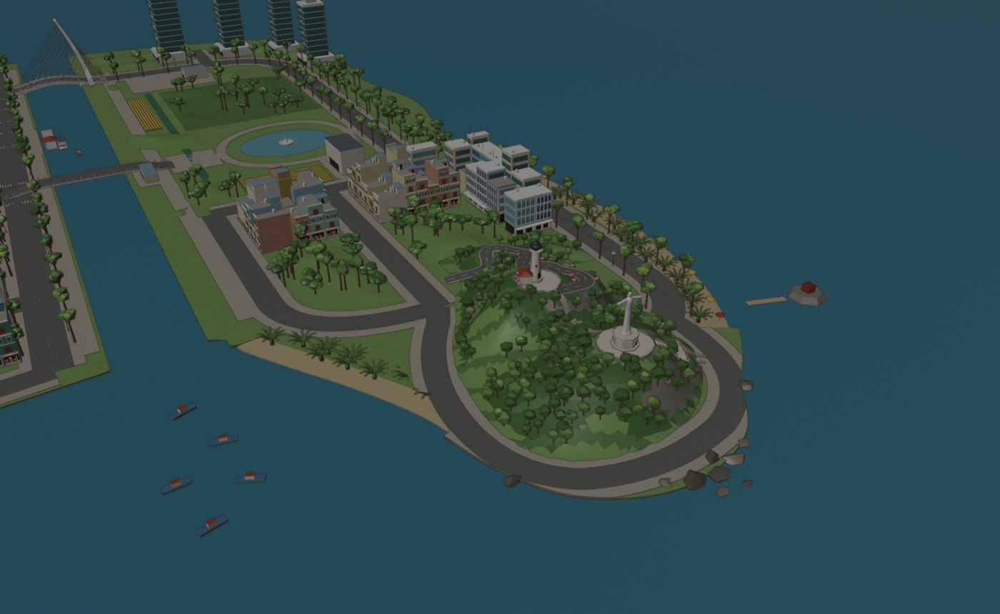
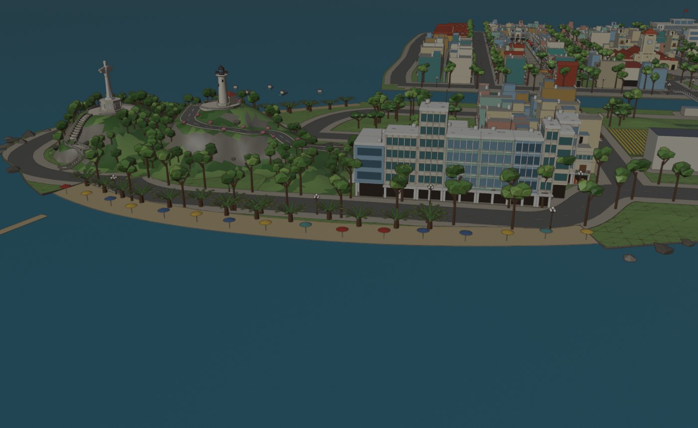
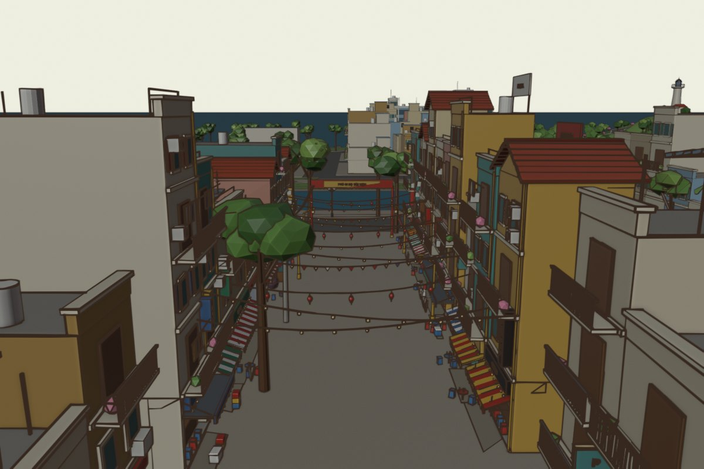
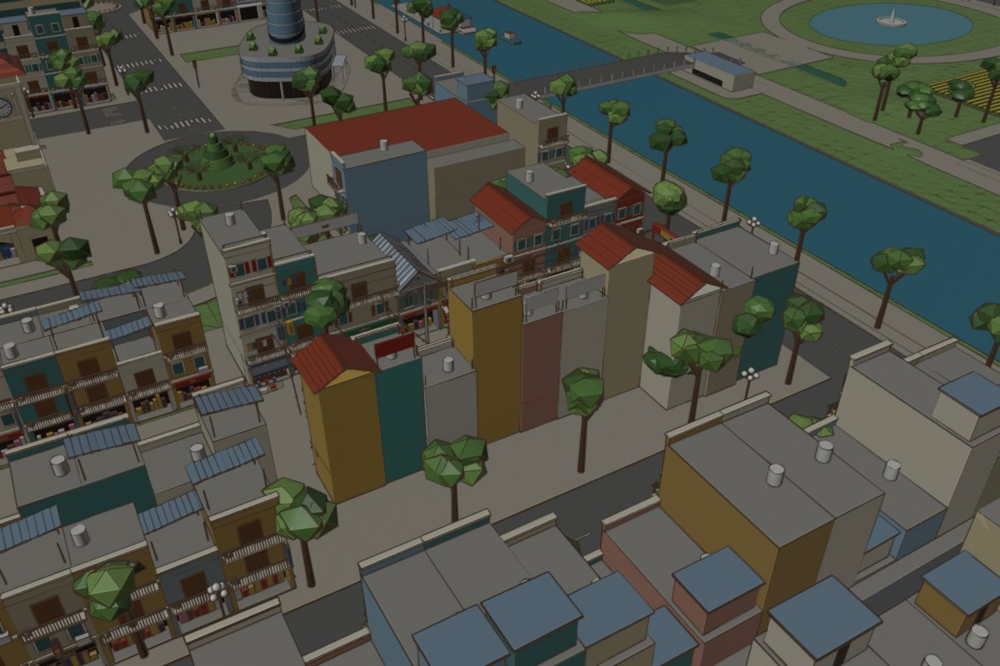
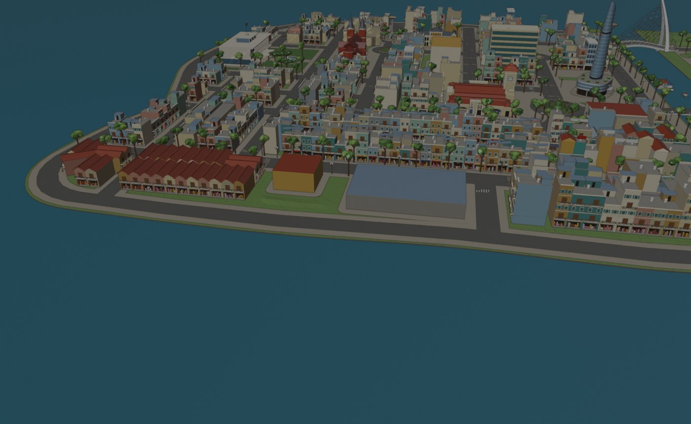
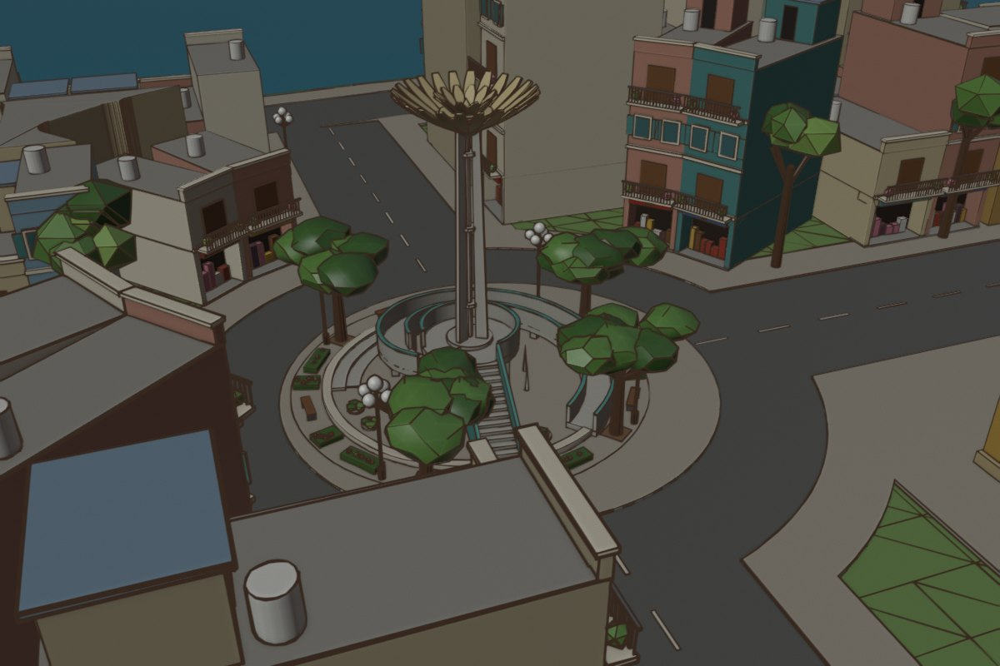

## Layout v8 (2026-11-12): map chính hiện tại

Xem `docs/map-v8-design.md`. Bố cục làm bằng `scripts/map/relayout_v8.py` (đọc `saigon_mini_layout_v7.json`, ghi
`saigon_mini_layout.json`). Sau mỗi lần sửa layout chạy `python3 scripts/map/check_layout.py` (phải ra 0 lỗi) rồi mới
dựng lại. Bản cũ: `versions/saigon_mini_v4.blend` (v7), `export/saigon_mini_v7.glb`.

Game đã chuyển hẳn sang map này (model, nav, địa điểm, NPC, chỗ xuất hiện): xem phần "Game chạy trên map v8" trong
`docs/map-v8-design.md`. Bản game cũ để ở `versions/backup_2026-11-12/`.

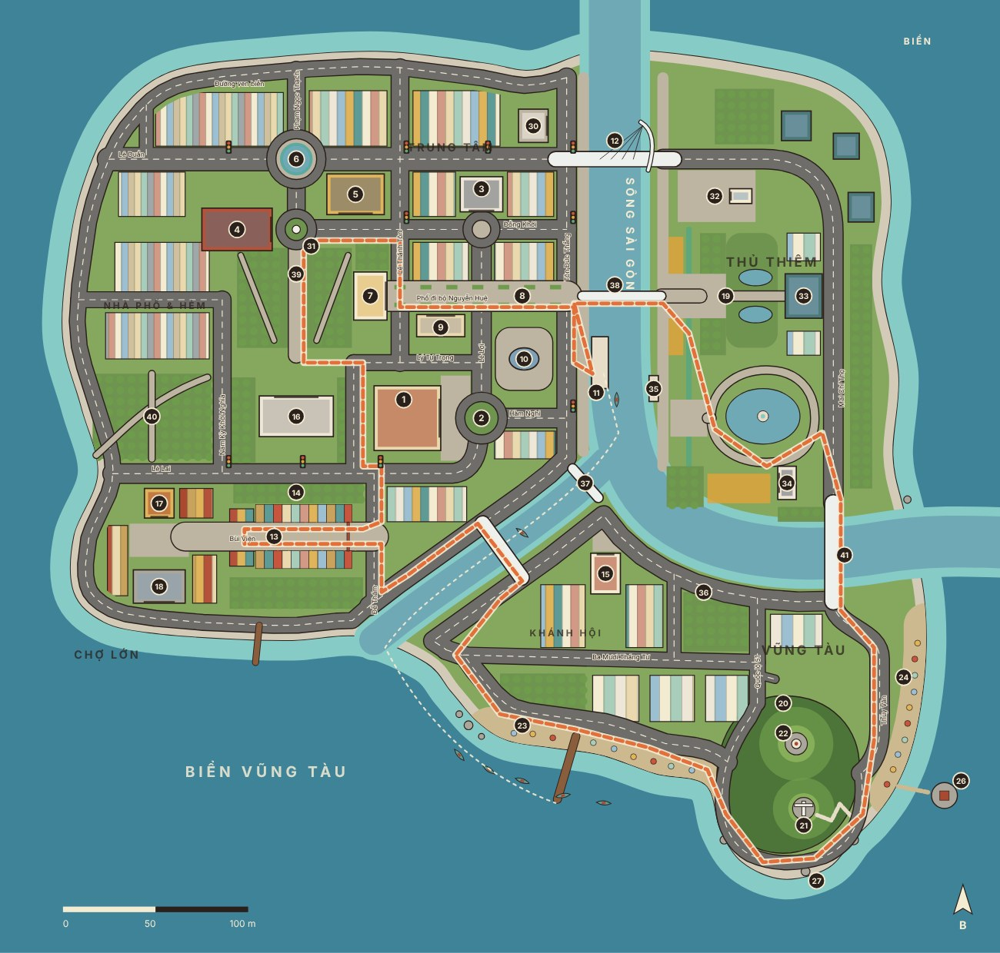

## Câu hỏi cho Khoa

1. Thứ tự T0 → T14 ở trên ổn không, hay muốn làm phần nào trước?
2. Từ giờ mỗi phần vẽ lại là một script chạy lại được (`scripts/blender/mini/`), và `build_saigon_mini.py` dựng lại cả file từ các script đó. Khoa có sửa tay gì trong `saigon_mini.blend` cần giữ không?
3. Cầu Mống chỉ cho người đi bộ như ngoài đời (xe chỉ qua sông bằng cầu Ba Son), được không?
4. Thủ Thiêm theo hướng trong T8 (công viên bờ sông, công viên Sáng tạo, hồ, cụm tháp có một tháp cao ~70 m, phố mới phía nam) được không?
5. Ngân sách ≤ 500k tam giác và ≤ 3 MB GLB (T1) có hợp không?

## Nguồn

- Hải đăng và Núi Nhỏ: [Hải đăng Vũng Tàu (VinWonders)](https://vinwonders.com/vi/wonderpedia/news/hai-dang-vung-tau/), [Núi Nhỏ Vũng Tàu (VinWonders)](https://vinwonders.com/vi/wonderpedia/news/nui-nho-vung-tau/)
- Tượng Chúa: [Christ of Vũng Tàu (Wikipedia)](https://en.wikipedia.org/wiki/Christ_of_V%C5%A9ng_T%C3%A0u)
- Cầu Mống: [Mong Bridge (VinWonders)](https://vinwonders.com/en/wonderpedia/news/mong-bridge/), [Saigoneer: Cầu Mống, công trình của Eiffel](https://saigoneer.com/saigon-heritage/1422-the-rainbow-bridge-a-true-eiffel-classic-in-the-heart-of-saigon)
- Thủ Thiêm: [Sức sống mới bên bờ sông Sài Gòn (SGGP)](https://www.sggp.org.vn/suc-song-moi-ben-bo-song-sai-gon-post831978.html)
- Cầu Ba Son: [Ba Son Bridge (Wikipedia)](https://en.wikipedia.org/wiki/Ba_Son_Bridge)
