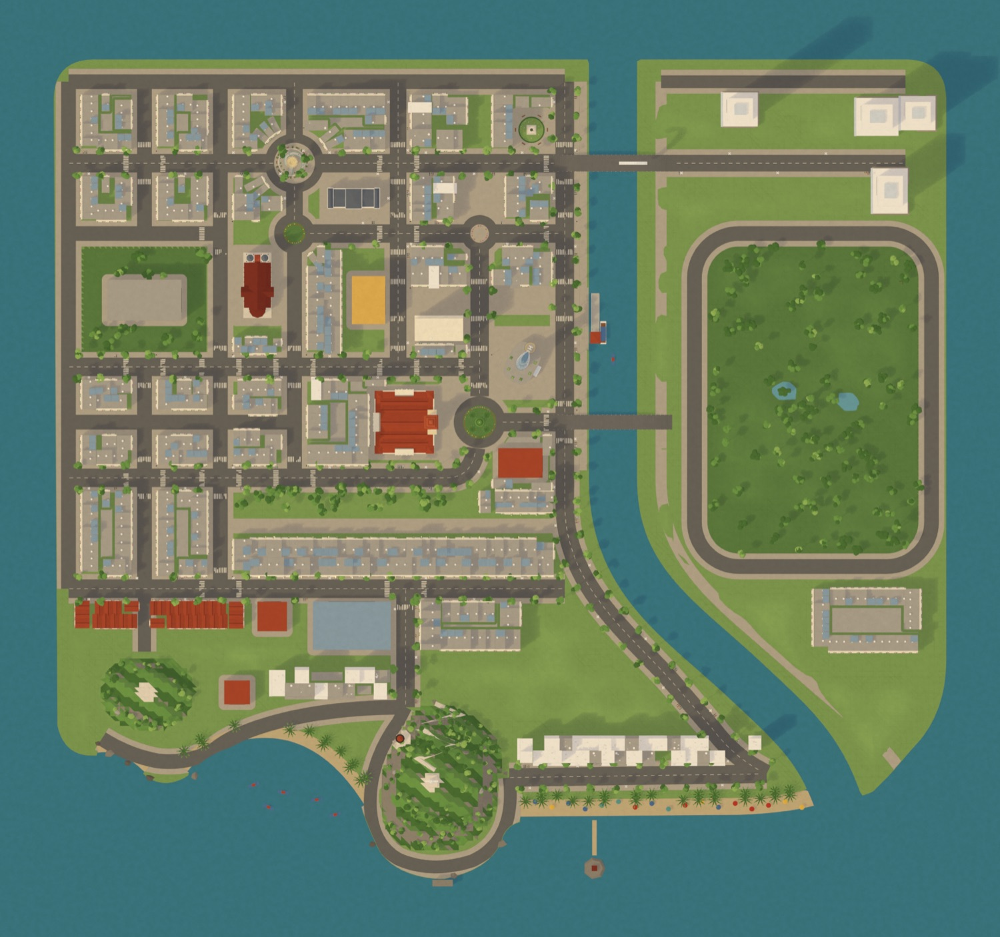
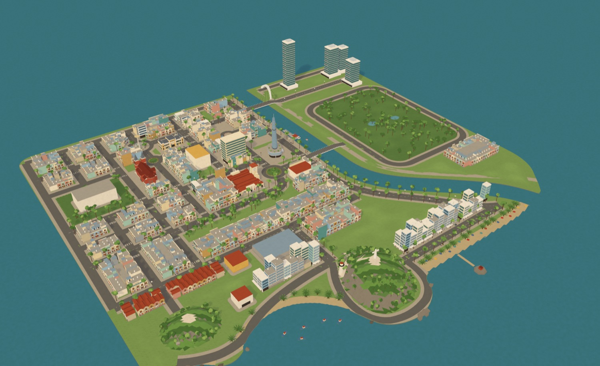
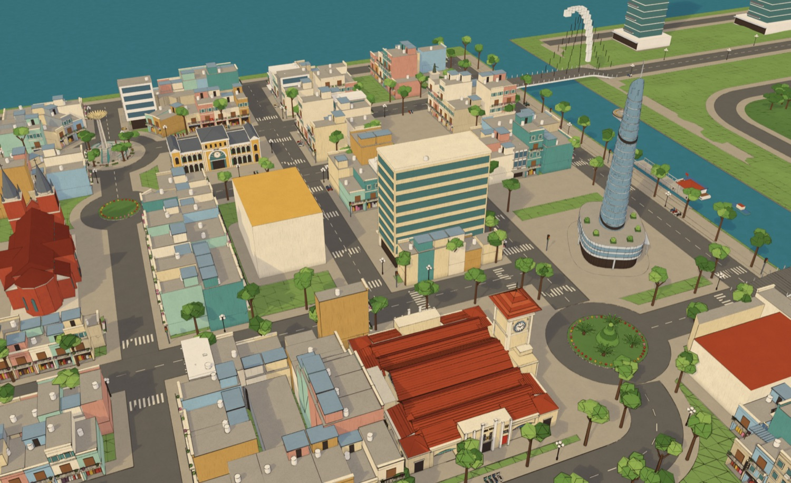
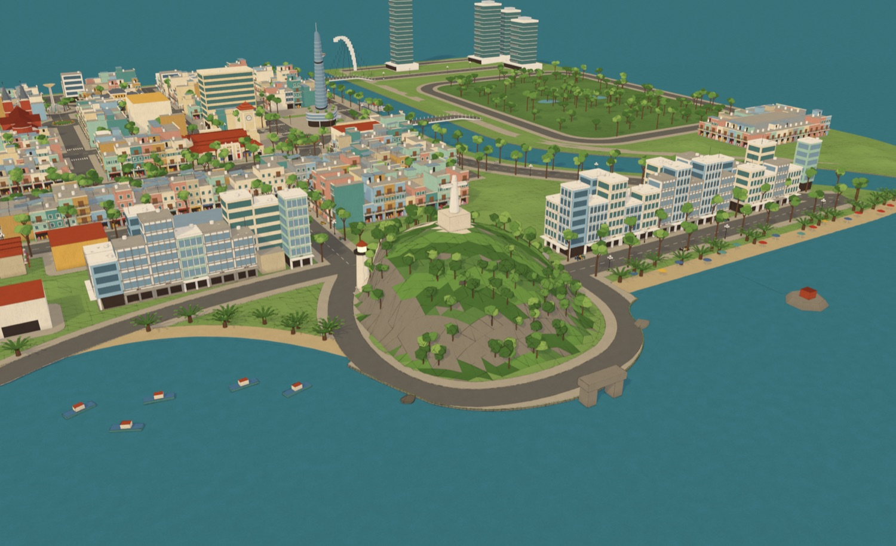
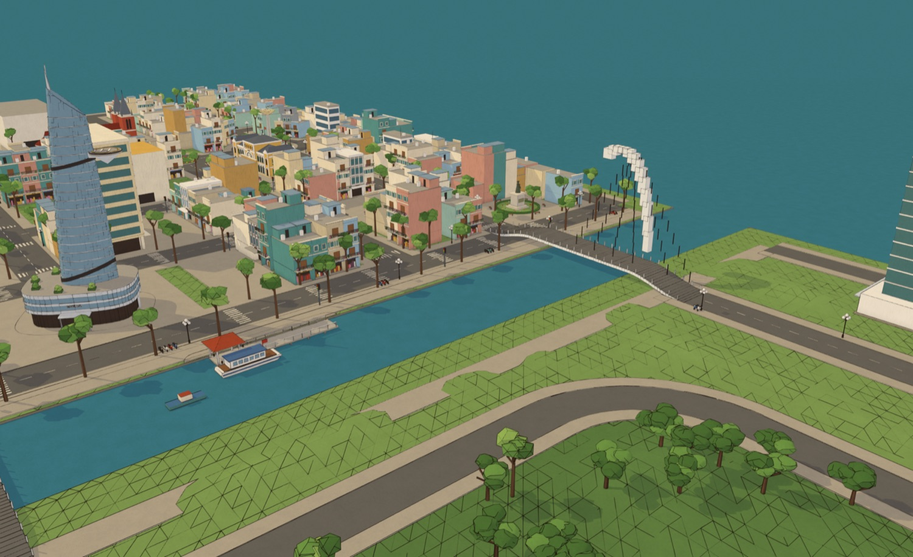
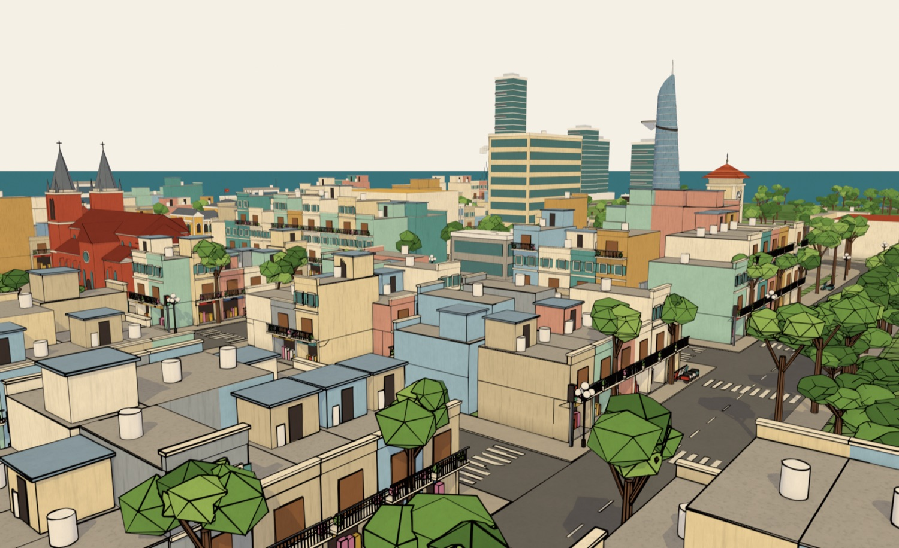
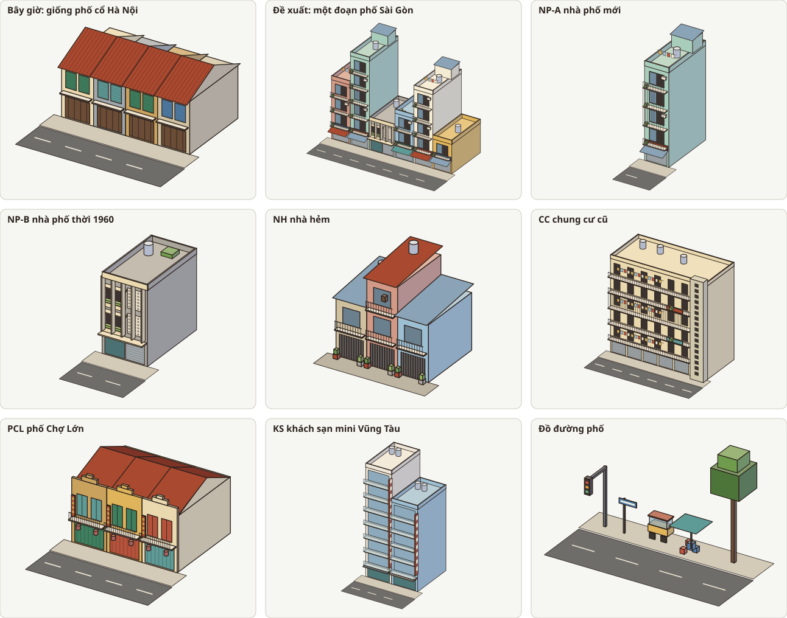
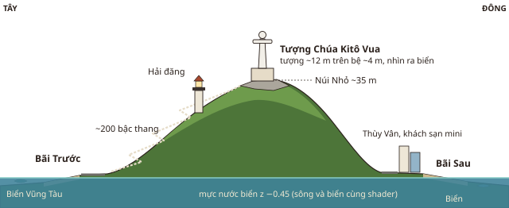

# Sài Gòn mini: bản đề xuất map mới (v5)

**Cập nhật 2026-11-12:** cầu Ba Son mới được duyệt; rà lại cả map và chia việc tiếp theo thành các task T0–T14 trong [map-v5-tasks.md](map-v5-tasks.md) (núi, hải đăng, tượng Chúa, cầu Mống, Thủ Thiêm, bộ nhà, ngân sách GLB).

**Trạng thái (2026-11-11):** design đã được Khoa duyệt ("ok r đó", theo các lựa chọn mặc định của bản đề xuất); **blockout lần 1 xong, chờ Khoa duyệt lần 2** (phần "Blockout lần 1" bên dưới). Bộ nhà và các công trình mới chưa vẽ thật. Map đang chạy trong game vẫn là đảo v4 (docs/PROJECT.md) cho tới khi map mới xong.

## Blockout lần 1

Dựng bằng script từ cùng một file bố cục với sơ đồ, nên sơ đồ và file Blender luôn khớp nhau:

```bash
# một lần: shapely + mapbox_earcut cho Python của Blender, cài vào .blender-site/ (đã gitignore), không đụng vào Blender
/Applications/Blender.app/Contents/Resources/5.1/python/bin/python3.13 -m pip install --target .blender-site shapely mapbox_earcut
# sơ đồ
node scripts/map/layout_svg.mjs
# blockout + ảnh render (khoảng 70 giây; thêm --workbench để render nhanh, không nét mực)
/Applications/Blender.app/Contents/MacOS/Blender --background --factory-startup --python scripts/blender/build_saigon_mini.py -- models/saigon_mini.blend --render renders/blockout
```

- Bố cục: `scripts/map/saigon_mini_layout.json` (toạ độ sơ đồ, mét, y hướng nam; Blender XY = (x − 251, 231 − y)). Sửa bố cục thì sửa file này rồi chạy lại hai lệnh trên.
- `models/saigon_mini.blend`: địa hình (cỏ, kè đá, bãi cát dốc xuống biển, lòng sông thấp hơn mực nước biển, hai núi), đường, vỉa hè, vạch đường và vạch qua đường, khoảng 590 căn nhà, khoảng 590 cây, đèn cột cầu, xe máy đậu, đèn giao thông, vườn bùng binh, cầu. Nhà, cây và đồ đường phố dựng bằng chính các bộ dựng của map production (Text trong `models/sg.tinymap.blend`, nạp như `saigon_diorama_00_ns_loader.py`): `house_plain` (ban công song sắt, cửa chớp, bảng hiệu, mái bằng có bồn nước) thêm tum mái tôn cho ra mái Sài Gòn, `house_bv` cho Bùi Viện, `modern_block` cho nhà hiện đại và khách sạn, `tt_tower` cho tháp Thủ Thiêm, `tree_sao`/`tree_me`/`cycad`, `globe_lamp`, `topiary`, `scooter`, `lantern`. Các công trình giữ lại được nạp từ `models/sg.tinymap.blend` và dời nguyên khối: chợ Bến Thành, Nhà hát, Nhà thờ, Bưu điện, Hồ Con Rùa, Bitexco, tượng Đức Mẹ (Công xã Paris), Công trường Mê Linh, cầu tàu Bạch Đằng. Công trình mới là khối thô. Vật liệu tên `SD_<key>` như map cũ.
- Nhìn giống map hiện tại: vật liệu dựng bằng `get_mat` (shader vẽ tay `SD_Paint`), scene `SaigonDiorama` với nền giấy và nắng ấm, nét mực Grease Pencil LineArt `SD_Ink`, méo tay `SD_HandWobble`, đều lấy từ script `saigon_diorama_01_setup.py` và `17_art_pass.py` trong file gốc. Nhà và công trình mới vẫn là khối thô.
- Mở trong Blender: file mở sẵn ở Material Preview có nắng và nền giấy. Nét mực tính theo camera của scene (đặt sẵn ở góc trung tâm, `CAM_02_center`), nên bấm numpad 0 hoặc F12 mới thấy đúng; các camera khác là `CAM_00_top` … `CAM_05_street`. Máy chậm khi sửa thì tắt object `SD_Ink`. File này sinh ra từ script: sửa tay trong đó sẽ mất khi chạy lại script (xem "Các bước sau khi duyệt").
- Ảnh render (EEVEE):








Đổi so với bản đề xuất, sau khi đo kích thước thật của các model cũ:
- Chợ Bến Thành thật rộng ~36 × 35 m, Nhà thờ ~21 × 37 m, Bưu điện ~21 × 31 m, Bitexco cả khối đế ~28 × 25 m: không vừa các block 20–25 m. Lưới phố trung tâm được nới (Lê Thánh Tôn x 196, Lê Lợi x 240, Tôn Đức Thắng x 286), sông dời sang đông 20 m, chợ có nguyên một block, Bitexco chiếm block giữa Nguyễn Huệ và Hàm Nghi (đúng như ngoài đời), Bưu điện nằm phía bắc Đồng Khởi nhìn ra đường.
- Đảo dài thêm 35 m về phía nam: **500 × 445 m**.
- Núi hạ xuống ~24 m (Núi Nhỏ) và ~11 m (Núi Lớn), dáng tròn và thoải, đỉnh Núi Nhỏ dời vào giữa; cỏ ở chỗ trống nhấp nhô nhẹ (tới ~2 m), chỗ có đường và nhà vẫn phẳng. Bùng binh Quách Thị Trang là vườn (cây cắt tỉa, cau, hoa) như bản production.
- Thêm hai model có sẵn trong file gốc: Công trường Mê Linh (tượng Trần Hưng Đạo, #30) cạnh đầu cầu Ba Son, và cầu tàu Bạch Đằng (#11) dùng model `LM_MeLinh_Pier`. Tượng Đức Mẹ đứng giữa bùng binh Công xã Paris (#31).
- Màu: `wallMint` và `wallSky` đã có sẵn trong file gốc (`#A9CDBB`, `#9DBFD2`, script `saigon_diorama_15b_frontage.py`), nên dùng lại đúng màu đó; chỉ 3 màu đèn giao thông là mới.

Cần Khoa xem ở lần duyệt này: kích thước và độ dày block, vị trí các công trình, Núi Nhỏ (đồi tròn cao ~24 m, đỉnh ở giữa, phủ cây), dãy khách sạn dọc Bãi Sau (đang dài và dày), Thủ Thiêm (đang trống, để dành cho sự kiện).

Trong `models/sg.tinymap.blend` có sẵn từ trước các script `saigon_diorama_51…57_v5_*` (một bố cục "v5" đảo bầu dục ~215 × 120 m theo phác thảo cũ của Khoa) và `saigon_mini_*` (bản "Sài Gòn mini" dạng hành tinh nhỏ, bảng màu tươi hơn). Bản này không dùng chúng; chưa xoá gì trong file đó.

Yêu cầu gốc: [requirements.md](requirements.md), mục R1. Sơ đồ: [img/saigon_mini_layout.svg](img/saigon_mini_layout.svg) (bắc ở trên, 1 đơn vị = 1 m, số trên sơ đồ khớp với bảng công trình bên dưới).


## Ý tưởng

Một hòn đảo low-poly gom những gì đặc trưng nhất của Sài Gòn và biển Vũng Tàu, không theo đúng bản đồ thật: trung tâm thành phố với các công trình đã có, nhiều phố nhà ống và hẻm, sông Sài Gòn với cầu Ba Son, và phía nam là biển Vũng Tàu với Núi Nhỏ, tượng Chúa Kitô Vua. Tên là **Sài Gòn mini**, bỏ chữ "Quận 1".

Hướng đi giống ngoài đời ở những chỗ người Sài Gòn nhận ra: Lê Lợi đi từ chợ Bến Thành tới Nhà hát, Nguyễn Huệ chạy từ UBND ra sông, Đồng Khởi từ Nhà thờ ra sông, Hàm Nghi từ bùng binh ra sông, Bùi Viện và Chợ Lớn nằm về phía nam và tây, Vũng Tàu ở cuối sông nơi sông đổ ra biển.

## Kích thước

- Đảo **500 × 445 m** (đề xuất ban đầu 500 × 410 m, nới ở blockout; hiện tại ~200 × 200 m), diện tích gấp khoảng 5 lần.
- Chạy bộ (6.8 m/s) từ chợ Bến Thành tới chân Núi Nhỏ khoảng 30 giây, xe máy khoảng 10 giây; từ đầu này tới đầu kia đảo khoảng 1 phút chạy. Đủ xa để đi xe và Crab Bike có ý nghĩa (D10).
- Tỉ lệ giữ như cũ: người 1.7 m, tầng 3.2–3.6 m, lòng đường 6–10 m, vỉa hè 2.6–3 m, chiều cao nén (Bitexco 52 m), công trình đặt trên nền z = 0.18.
- Lưới nav 0.35 m trên 540 × 485 m là khoảng 2.1 triệu ô (hiện 0.42 triệu): ảnh nav vẫn nhỏ, bake khoảng 1 phút.

## Bố cục (xem sơ đồ)

| Khu | Vị trí trên sơ đồ | Có gì |
|---|---|---|
| Trung tâm | giữa phía bắc, bờ tây sông | Các công trình đã có, xếp lại theo lưới phố: chợ Bến Thành và bùng binh Quách Thị Trang, Nhà hát và quảng trường Lam Sơn, Nhà thờ Đức Bà, Bưu điện, Công xã Paris, Hồ Con Rùa, phố đi bộ Nguyễn Huệ với UBND ở đầu phố và chung cư 42 Nguyễn Huệ, Bitexco sát sông. Block nhà phố kín giữa các công trình |
| Nhà phố và hẻm | phía tây | Lưới phố ô cờ, block 20–25 m, mỗi block có hẻm 2–3 m chui vào giữa. Nhà phố mặt tiền, nhà hẻm bên trong. Dinh Độc Lập với bãi cỏ (tuỳ chọn) |
| Bùi Viện, công viên 23/9 | nam của chợ | Phố đi bộ Bùi Viện như bản v4 nhưng nhà theo kiểu Sài Gòn; công viên 23/9 chạy dọc Lê Lai |
| Chợ Lớn | tây nam, dọc Trần Hưng Đạo | Một dãy phố người Hoa 2 tầng, lồng đèn đỏ, Chùa Bà Thiên Hậu |
| Bến xe, Quốc lộ 51 | nam của trung tâm | Bến xe, đường lớn chạy xuống Vũng Tàu |
| Sông Sài Gòn | bờ đông của thành phố | Sông rộng ~26 m, chảy từ bờ biển bắc xuống, uốn về đông nam rồi đổ ra biển cạnh Bãi Sau: **cả hai đầu sông ra biển**. Bến Bạch Đằng có bến tàu; Bến Nhà Rồng (tuỳ chọn) ở chỗ sông uốn |
| Cầu Ba Son | nối Hai Bà Trưng sang Thủ Thiêm | Cầu dây văng một trụ cong, lấy khung từ bản v2. Cầu thứ hai ở Hàm Nghi (tuỳ chọn) để có đường vòng |
| Thủ Thiêm | bờ đông | Công viên lớn có hồ, lối đi bộ ven sông nhìn sang trung tâm, vài tháp kính, một dãy nhà thấp phía nam. Chỗ trống cho sự kiện và game co-op, sau này mở rộng tiếp |
| Vũng Tàu | phía nam | Núi Nhỏ có tượng Chúa Kitô Vua và hải đăng; Bãi Trước, Bãi Sau, Bãi Dâu; Hòn Bà; Mũi Nghinh Phong. Chi tiết ở phần sau |

Bờ biển phía bắc và tây không có bãi cát: kè đá với lối đi bộ ven biển. Cát chỉ có ở ba bãi tắm Vũng Tàu, để ba bãi đó nổi bật.

## Công trình

Số khớp với sơ đồ. "Giữ" là model đã có, chỉ dời và xoay nguyên khối (như quy tắc trong PROJECT.md). "Mới" là model mới, phải duyệt design trước khi vẽ.

| # | Công trình | | Ghi chú |
|---|---|---|---|
| 1 | Chợ Bến Thành | giữ | cổng nam (tháp đồng hồ) nhìn ra bùng binh |
| 2 | Bùng binh Quách Thị Trang | giữ, làm lại phần giữa | sửa luôn chỗ kẹt (R2) |
| 3 | Nhà hát Thành phố + Lam Sơn | giữ | cuối đường Lê Lợi |
| 4 | Nhà thờ Đức Bà | giữ | đầu tây đường Đồng Khởi |
| 5 | Bưu điện Thành phố | giữ | cạnh Nhà thờ, trên Công xã Paris |
| 6 | Hồ Con Rùa | giữ | bùng binh trên Phạm Ngọc Thạch; cầu thang lên vòng đi bộ (R3) |
| 7 | UBND Thành phố | **mới** | đầu phố Nguyễn Huệ (ô đất đã để dành từ v4) |
| 8 | Phố đi bộ Nguyễn Huệ | giữ, nối dài ra sông | |
| 9 | Chung cư 42 Nguyễn Huệ | **mới** | "chung cư cà phê" 9 tầng, mỗi tầng một quán; chỗ hay để đi cầu thang lên cao |
| 10 | Bitexco | giữ | sát sông, giữa Hàm Nghi và Nguyễn Huệ |
| 11 | Bến Bạch Đằng | **mới** | lối đi bộ ven sông, bến tàu đi Vũng Tàu |
| 12 | Cầu Ba Son | **mới** (từ bản v2) | |
| 13 | Phố Bùi Viện | làm lại nhà | đổi mái ngói thành mái bằng có sân thượng (xem phần nhà) |
| 14 | Công viên 23/9 | giữ, nối dài | |
| 15 | Bến Nhà Rồng | **mới**, tuỳ chọn | nhà kiểu Pháp, mái có rồng |
| 16 | Dinh Độc Lập | **mới**, tuỳ chọn | công trình hiện đại 1966 với lam chắn nắng hình đốt tre, bãi cỏ lớn |
| 17 | Phố Chợ Lớn + Chùa Bà Thiên Hậu | **mới** | |
| 18 | Bến xe | **mới** | vài xe buýt đậu |
| 19 | Công viên và tháp Thủ Thiêm | **mới** | |
| 20 | Đường bậc thang lên Núi Nhỏ | **mới** | ngoài đời 811 bậc; trong game khoảng 200 bậc, có chiếu nghỉ |
| 21 | Tượng Chúa Kitô Vua | **mới** | |
| 22 | Hải đăng Vũng Tàu | **mới** | |
| 23 | Bãi Trước | **mới** | |
| 24 | Bãi Sau | **mới** | |
| 25 | Bãi Dâu | **mới** | |
| 26 | Hòn Bà | **mới** | |
| 27 | Mũi Nghinh Phong, Cổng Trời | **mới** | |
| 28 | Núi Lớn | **mới**, tuỳ chọn | đồi thấp sau Bãi Dâu; là "đồi thứ hai" nếu muốn |
| 29 | Bạch Dinh | **mới**, tuỳ chọn | biệt thự trắng dưới chân Núi Lớn, nhìn ra Bãi Trước |
| 30 | Công trường Mê Linh | giữ (model có sẵn `LM_MeLinh`) | tượng Trần Hưng Đạo, cạnh đầu cầu Ba Son (thêm ở blockout) |
| 31 | Công xã Paris | giữ (`LM_TuongDucMe`) | tượng Đức Mẹ giữa bùng binh trước Nhà thờ |

Dãy nhà ống Lê Lai (`SH_01..05`) và xe đậu (`CX_Traffic_v4`) không giữ: nhà làm lại theo bộ nhà Sài Gòn bên dưới, xe đậu thành xe thật (R6).

## Nhà kiểu Sài Gòn

### Vì sao map hiện tại nhìn giống Hà Nội

Nhà ống trên Lê Lai và Bùi Viện là nhà 2 tầng, mái ngói đỏ dốc song song mặt phố, cửa chớp gỗ: đó là dáng phố cổ Hà Nội (nhà ống trước 1954 thường 2 tầng, mái ngói, hai tường hồi nhô lên trên mái) và dãy shophouse thời Pháp. Phố Sài Gòn bây giờ khác ở mấy điểm nhìn thấy ngay từ xa:

1. **Mái bằng, có sân thượng.** Sân thượng là chỗ phơi đồ, trồng rau trong thùng xốp. Trên đó có **tum thang** (hộp nhỏ che đầu cầu thang, hay có mái tôn), **bồn nước inox** nằm trên giá sắt, dây phơi, chậu cây.
2. **Cao hơn, cao thấp không đều.** Nhà 3–6 tầng đứng cạnh nhà 2 tầng, nên **tường hông trơn** của nhà cao lộ ra (sơn một màu, có vệt ố, đôi khi có quảng cáo vẽ). Đường mái răng cưa là dấu hiệu dễ nhận nhất.
3. **Mặt tiền hẹp, sâu:** 3–5 m, sâu 10–20 m.
4. **Ban công tầng nào cũng có**, hay bọc **khung sắt bảo vệ** (kiểu lồng), có chậu cây, máy lạnh.
5. **Tầng trệt là cửa hàng:** **cửa cuốn**, **mái hiên** bạt hoặc tôn kéo ra vỉa hè, **bảng hiệu** ngang to.
6. **Màu sơn tươi, mỗi nhà một màu:** hồng, xanh bạc hà, xanh da trời, vàng, trắng, kem.
7. **Nhà thời 1960 (hiện đại miền Nam):** **ô văng** (tấm bê tông mỏng che trên cửa sổ), **lam đứng** chắn nắng, **gạch hoa gió** (gạch có lỗ cho gió qua), **bồn hoa bê tông** gắn trên mặt tiền, mặt **đá rửa** màu xám be. Mỗi nhà sắp các chi tiết này một kiểu nhưng theo cùng một bộ.
8. **Hẻm:** ngõ rộng 2–3 m chui vào giữa block, nhà 2–3 tầng nhỏ hơn, cửa sắt, chậu cây, xe máy dựng trước cửa, bàn thờ ông địa.

Mái ngói chỉ còn ở **phố Chợ Lớn** (shophouse người Hoa 2 tầng, mái ngói sau tường mặt tiền trang trí) và **biệt thự kiểu Pháp** (Bạch Dinh, vài biệt thự).

### Bộ nhà (kit) đề xuất



Dựng một bộ chi tiết trong Blender (bằng bộ `Geo`), rồi script ghép thành từng căn với số tầng, màu, kiểu ban công, bảng hiệu và đồ trên mái thay đổi theo seed. Như vậy làm được nhiều block mà vẫn đồng bộ style. Mỗi căn khoảng 150–300 tam giác.

| Mã | Kiểu | Kích thước | Đặc điểm | Màu (`PAL`) | Ở đâu |
|---|---|---|---|---|---|
| NP-A | Nhà phố mới | 4–5 × 12–18 m, 3–6 tầng | mái bằng, sân thượng, tum mái tôn, bồn nước inox; ban công khung sắt; cửa cuốn, mái hiên, bảng hiệu | wallPink, cream, creamLight, opWhite, poYellow, wallTeal, wallMint, wallSky, wallCream | khoảng 60% nhà mặt phố |
| NP-B | Nhà phố 1960 | 5–8 × 14 m, 2–4 tầng | ô văng, lam đứng, gạch hoa gió, bồn hoa bê tông, mặt đá rửa | concrete, stone, cream, wallMint | xen vào, khoảng 1/5 nhà mặt phố |
| NH | Nhà hẻm | 3–4 × 10 m, 2–3 tầng | mái tôn trên tum, cửa sắt, chậu cây, lồng chim | wallBeige, cream, wallGrey, wallPink, tinBlue | trong hẻm khu tây |
| CC | Chung cư cũ | 25–40 × 10 m, 5–9 tầng | hành lang dài, ban công lồng sắt, phơi đồ, quán cà phê, cầu thang lộ | cream, poYellow, concrete (vệt ố bằng grime của `SD_Paint`) | Nguyễn Huệ (#9), 1–2 chỗ khác |
| PCL | Phố Chợ Lớn | 4–5 × 14 m, 2 tầng | tường mặt tiền trang trí che mái ngói, cửa chớp màu, lồng đèn đỏ | wallOchre, poYellow, brick, roofRed | dọc Trần Hưng Đạo |
| KS | Khách sạn mini Vũng Tàu | 6–8 × 14 m, 6–9 tầng | ban công kính nhìn ra biển, bảng tên dọc, bồn nước trên mái | opWhite, wallSky, creamLight, wallMint | dọc Bãi Sau, Bãi Trước |
| BT | Biệt thự Pháp | 12–16 m vuông, 2 tầng | tường vàng hoặc trắng, cửa chớp xanh, mái ngói, tường rào, vườn | wallOchre, opWhite, poGreen, roofRed | Bạch Dinh, vài căn |
| — | Tháp kính | | thẳng, không méo tay (như Bitexco) | glassBlue, glassTeal, finSilver | Thủ Thiêm, bờ sông |

## Vũng Tàu

Ngoài đời: Bãi Trước là vịnh hình bán nguyệt phía tây, giữa Núi Lớn và Núi Nhỏ, chỗ thuyền đánh cá về đậu; Bãi Sau (bãi Thùy Vân) ở phía đông, bãi cát dài bắt đầu từ chân Núi Nhỏ; Bãi Dâu ở phía tây chân Núi Lớn, nhiều ghềnh đá. Trên sơ đồ giữ đúng thứ tự đó: Bãi Dâu (tây) → Núi Lớn → Bãi Trước → Núi Nhỏ ở mũi phía nam → Bãi Sau (đông) → cửa sông.



- **Núi Nhỏ:** đồi tròn, thoải, cao ~24 m (ngoài đời ~170 m; bản đề xuất ghi 35 m, hạ xuống ở blockout vì nhìn dựng đứng), rộng ~75 m, phủ cây (leafDark, leaf), đá granite lộ ra ở đỉnh (concrete, stone). Hai đỉnh: đỉnh nam có tượng, đỉnh tây bắc có hải đăng.
- **Tượng Chúa Kitô Vua:** ngoài đời cao 32 m, sải tay 18.4 m, đứng trên bệ khắc hình Chúa và 12 tông đồ, nhìn ra biển; trong tượng có cầu thang xoắn 133 bậc lên tới vai. Trong game: tượng ~12 m trên bệ ~4 m (phóng to chi tiết 1.2–1.5 lần theo quy tắc style), màu statueW, dang tay ngang, mặt nhìn ra biển phía nam. Bệ có vài bậc và một khoảng sân để đứng ngắm.
- **Đường bậc thang lên tượng:** ngoài đời ~811 bậc; trong game một đường zig-zag ~200 bậc với chiếu nghỉ, lan can, vài cây che (cần R3 để đi lên).
- **Hải đăng:** tháp trụ trắng (opWhite), đỉnh đèn màu tối, ban công tròn; đèn quay buổi tối làm bằng Three.js.
- **Bãi Trước:** vịnh cong, công viên dọc bờ, nhiều ghe đánh cá xanh đỏ (có "mắt thuyền") và thúng chai neo ngoài vịnh, bến tàu cao tốc.
- **Bãi Sau:** bãi cát dài nhất, dù và ghế bố cho thuê, chòi cứu hộ, đường Thùy Vân với dãy khách sạn mini.
- **Bãi Dâu:** vịnh nhỏ, ghềnh đá to ở hai đầu, yên tĩnh.
- **Hòn Bà:** đảo đá nhỏ ngoài khơi Bãi Sau (ngoài đời cách chân Núi Nhỏ ~200 m) có miếu; con đường đá ra đảo chỉ hiện lúc nước ròng. Trong game: con đường nổi lên theo một chu kỳ thời gian (gợi ý gameplay).
- **Mũi Nghinh Phong:** mũi đất cực nam, có khối đá vòm "Cổng Trời".

## Sông và cầu

- **Sông Sài Gòn:** rộng ~26 m. Đào lòng sông thấp hơn mực nước biển (z −0.45) là shader biển (`src/game/sea.ts`, một đĩa nước tô màu theo độ sâu) tự vẽ nước, màu nước cạn và bọt dọc bờ, nên không cần shader mới và màu nước khớp với biển. Hai bờ là kè có lối đi bộ.
- **Cầu Ba Son:** dây văng một trụ cong, mặt cầu có làn xe và lối đi bộ, lan can. Lấy khung từ `versions/sg.tinymap_v2.blend`, chỉnh tỉ lệ cho hợp map mới; màu bridgeWhite, finSilver, không méo tay (như thép hiện đại).
- **Cầu thứ hai (tuỳ chọn)** ở cuối Hàm Nghi: có đường vòng qua sông thì đua xe và tiếp sức hay hơn, xe không dồn hết lên một cầu.
- **Trên sông:** sà lan, buýt đường sông, tàu cao tốc từ Bến Bạch Đằng ra Bãi Trước (đường chấm trên sơ đồ); làm bằng Three.js như hải âu, sau này có thể thành phương tiện để đi (R6).

## Đường và chi tiết phố

- Phố chính rộng 10 m, phố phụ 8 m, vỉa hè 3 m, hẻm 2–3 m. Ba bùng binh: Quách Thị Trang, Hồ Con Rùa, Công xã Paris.
- **Đèn giao thông** ở khoảng 20 ngã tư chính (biểu tượng ba chấm trên sơ đồ). Cột và hộp đèn trong Blender; ba bóng do Three.js đổi màu theo đồng hồ chung (R4).
- **Đồ đường phố (kit nhỏ, dùng lặp lại):** cột điện với bó dây (đã có `SH_Wires`), biển tên đường màu xanh lam chữ trắng, trạm xe buýt, xe bánh mì, xe nước mía, sạp báo, ghế nhựa và dù quán cà phê vỉa hè, tiệm sửa xe (bơm, lốp chồng), tủ điện, ki-ốt, một cây xăng, cột đèn cao áp, hàng cây sao, cây dầu thân cao (đặc trưng đường Sài Gòn).
- **Vũng Tàu:** dù và ghế bố, chòi cứu hộ, ghe và thúng chai, quán hải sản, dừa, xe đạp đôi.

## Màu

Giữ nguyên toàn bộ `PAL` hiện có (bảng trong PROJECT.md), nắng ấm `#FFF2DC`, bóng lạnh `#717BA2`, viền mực, paint shader. Hai màu tường xanh dùng lại key đã có trong file gốc (thêm từ script `15b_frontage`, bảng trong PROJECT.md chưa ghi); chỉ 3 màu đèn giao thông là mới:

| Key mới | Màu | Dùng cho |
|---|---|---|
| `wallMint` (có sẵn) | `#A9CDBB` | tường xanh bạc hà, màu nhà phố rất phổ biến ở Sài Gòn |
| `wallSky` (có sẵn) | `#9DBFD2` | tường xanh da trời nhạt |
| `sigRed` | `#C8553D` | bóng đèn đỏ (Three.js làm sáng lên khi bật) |
| `sigAmber` | `#E3A33B` | bóng đèn vàng |
| `sigGreen` | `#5FA77A` | bóng đèn xanh |

Inox của bồn nước dùng `finSilver` có sẵn; khung sắt dùng `archDark`; mái tôn dùng `tinBlue`.

## Ảnh hưởng tới gameplay và code

- **Địa điểm:** viết lại `server/content/places.json` (id cũ giữ cho công trình còn giữ, thêm id mới), quest nào dùng địa điểm thì kiểm tra lại; chỗ đứng NPC trong `npcs.json` dời theo; điểm xuất phát vẫn là trước cổng nam chợ.
- **Nav:** khung lưới mới trong `bake_nav.py` (`X0…Y1`), bake theo R2 (không kẹt, nhảy qua vật thấp) và R3 (hộp `NAV_Deck_` cho cầu, bậc thang, Hồ Con Rùa); `npm run nav:sync`; server nhúng bản mới.
- **Camera trên núi:** camera hiện tránh nhà bằng ảnh `roof`; trên sườn núi cần thêm kiểm tra độ cao mặt đất dọc cần máy quay để camera không chui vào núi.
- **Hiệu năng:** đảo lớn gấp 5 nên GLB nặng hơn và nhiều draw call hơn. Giữ ngân sách: nhà theo kit (ít tam giác), đồ lặp lại (đèn, cây, dù) vẽ bằng instancing, vật ở xa ẩn như người chơi và xe; đo lại fps trên máy yếu như phase 5.
- **Quyết định:** D10 (giữ đảo ~200 m) đổi thành quyết định mới khi Khoa duyệt; ghi vào `docs/design/README.md`.
- **Tên:** "Sài Gòn Q1" → "Sài Gòn mini" trong game (index.html, `src/game/i18n/`), README, PROJECT.md, CLAUDE.md.

## Các bước sau khi duyệt

1. **Blockout (xong lần 1, xem phần trên):** `models/saigon_mini.blend` dựng bằng `scripts/blender/build_saigon_mini.py` (map v4 giữ nguyên trong `models/temp.sg.tinymap.blend` và `versions/`) → **Khoa duyệt lần 2**.
2. **Bộ nhà:** dựng 7 kiểu nhà trong kit, render một bảng mẫu cạnh ảnh `docs/img/10_nha_ong.jpg` để so → **Khoa duyệt lần 3**.
3. **Công trình mới:** tượng Chúa, hải đăng, cầu Ba Son, UBND, chung cư 42, các bãi biển...; mỗi cái một render → duyệt.
4. **Lấp đầy:** script ghép nhà theo block, đặt đồ đường phố, cây, đèn giao thông.
5. **Vào game:** export GLB, bake nav (cùng R2, R3), sửa places, NPC, quest, tên game; cập nhật PROJECT.md và render lại ảnh công trình.

## Câu hỏi của bản đề xuất (đã duyệt theo mặc định)

1. Kích thước 500 × 410 m có ổn không, hay gọn hơn (khoảng 400 × 330 m, bớt một hàng block khu tây và thu nhỏ Thủ Thiêm)?
2. Bố cục: thành phố phía bắc, sông ở phía đông, Vũng Tàu phía nam, sông đổ ra biển cạnh Bãi Sau.
3. Mục tuỳ chọn nào làm: Dinh Độc Lập, Bến Nhà Rồng, Núi Lớn và Bạch Dinh (đồi thứ hai), cầu thứ hai, tháp cao kiểu Landmark 81 ở Thủ Thiêm.
4. 5 màu mới.
5. Giữ các công trình cũ nguyên khối (chỉ dời), làm lại nhà Bùi Viện và Lê Lai theo bộ nhà Sài Gòn.

## Nguồn tham khảo

- Nhà ống: [Tube house (Wikipedia)](https://en.wikipedia.org/wiki/Tube_house), [ArchDaily: 15 nhà ống](https://www.archdaily.com/956220/tube-houses-15-projects-reinterpreting-the-narrow-vietnamese-residences), [Hanoi Times: nhà ống Hà Nội](https://hanoitimes.vn/insider-tube-houses-are-a-funky-feature-of-hanois-streets-320513.html).
- Hiện đại miền Nam: [Saigoneer: vernacular modernism](https://saigoneer.com/vietnam-architecture/29031-vietnamese-vernacular-modernism-is-a-local-language-created-by-the-ordinary-people), [Wallpaper: Vietnamese modernist architecture](https://www.wallpaper.com/architecture/vietnamese-modernist-architecture-guide), [Saigoneer: 5 công trình hiện đại](https://www.saigoneer.com/vietnam-architecture/27305-5-iconic-buildings-in-saigon-that-showcase-vietnamese-modernist-architecture).
- Shophouse và Chợ Lớn: [Historic Vietnam: shophouse](https://historicvietnam.com/shophouse-architecture), [Saigoneer: dạo Chợ Lớn](https://saigoneer.com/vietnam-travel/19804-cho-lon-tour).
- Chung cư 42 Nguyễn Huệ: [Việt Nam News](https://vietnamnews.vn/life-style/826601/old-apartment-building-full-of-cafes-shops-featured-on-national-geographic-uk.html).
- Vũng Tàu: [Christ of Vũng Tàu (Wikipedia)](https://en.wikipedia.org/wiki/Christ_of_V%C5%A9ng_T%C3%A0u), [Tượng Chúa Kitô Vua (Wikiwand)](https://wikiwand.com/vi/articles/T%C6%B0%E1%BB%A3ng_Ch%C3%BAa_Kit%C3%B4_Vua_(V%C5%A9ng_T%C3%A0u)), [vị trí các bãi biển](https://hoatieu.vn/tai-lieu/bai-truoc-bai-sau-bai-dau-bai-dua-la-nhung-bai-bien-nam-o-tinh-thanh-nao-210770), [Bãi Dâu](https://mytour.vn/vi/blog/bai-viet/bai-dau-vung-tau-kham-pha-ve-dep-huyen-bi-do-thien-nhien-uu-ai.html), [Hòn Bà (Wikipedia)](https://en.wikipedia.org/wiki/H%C3%B2n_B%C3%A0), [Mũi Nghinh Phong](https://mytour.vn/vi/blog/bai-viet/kham-pha-ve-dep-me-hoac-cua-mui-nghinh-phong-o-vung-tau.html).
- Cầu Ba Son bản cũ: `versions/sg.tinymap_v2.blend`, `renders/q1_bason_opera.png`.
