# Sài Gòn mini v8: thiết kế lại bố cục

**Trạng thái:** Khoa duyệt tổng thể ngày 2026-11-12, sau đó sửa các chỗ Khoa khoanh (mục "Sửa sau góp ý" bên dưới).
v8 là map chính: `scripts/map/relayout_v8.py` ghi `scripts/map/saigon_mini_layout.json`, `models/saigon_mini.blend`
dựng từ đó. Bản v7 giữ ở `scripts/map/saigon_mini_layout_v7.json` và `versions/saigon_mini_v4.blend`.

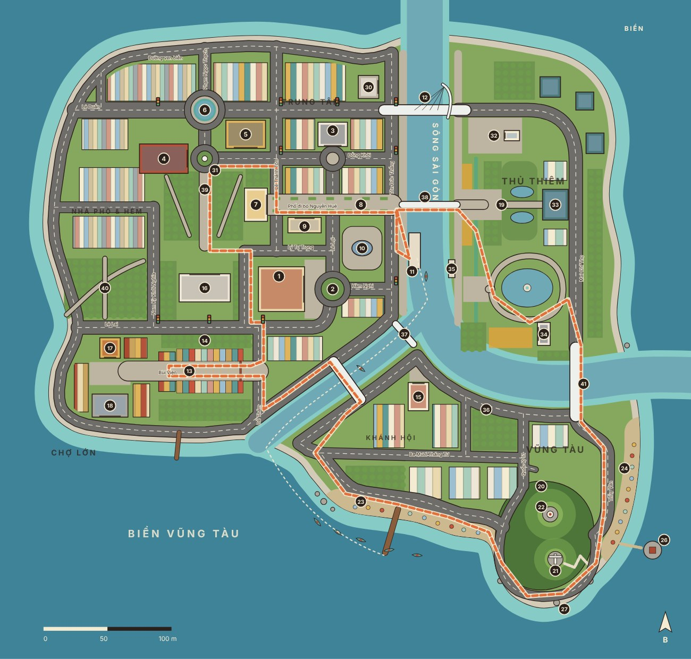
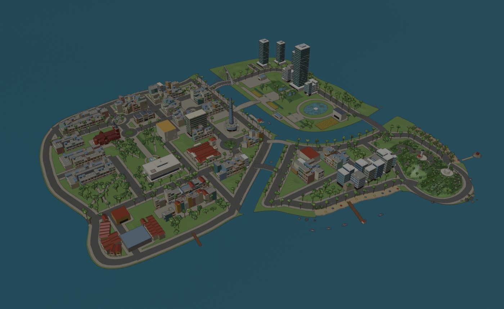

## Vì sao làm lại

Góp ý của Khoa sau v7: sông thẳng, bố cục rời rạc, có những block nhà thừa, chưa giống một map game làm kỹ. Cần:
bố cục rõ, nhìn tổng thể tự nhiên, cảm giác có thể khám phá cả thành phố lẫn bãi biển.

## Nguyên tắc rút ra từ tài liệu

1. **Người chơi định hướng bằng công trình mốc nhìn thấy từ xa** (nghiên cứu "The Image of the Open World Game", dùng 5
   yếu tố của Kevin Lynch: đường, biên, khu, nút, mốc). Đường trong game ít khi có tên, nên mốc phải cao và khác biệt;
   chỗ đứng cao (núi, cầu) giúp nhìn thấy các mốc.
2. **"Weenie" của Disneyland**: đặt một công trình cao, lạ ở cuối mỗi trục đường để kéo người chơi đi tới (lâu đài cuối
   Main Street). Trục chính đi vào một khu trung tâm, từ đó toả ra các khu, mỗi khu một chủ đề và một mốc riêng.
3. **A Short Hike**: đảo nhỏ, đích đến rõ là đỉnh núi nhìn thấy từ mọi nơi; có đường mòn dẫn lối nhưng vẫn cho đi tắt
   khám phá; thưởng nhỏ rải ở những chỗ lệch khỏi đường chính.
4. **Sable**: đầu và cuối rõ ràng, giữa thoáng; các điểm khám phá như những đảo nhỏ, mỗi chỗ tự đủ nội dung; chấp nhận
   chỗ thưa có chủ ý thay vì lấp đầy cho có.
5. **Messenger (abeto)**: thế giới bé, đi một vòng vài phút, chỗ nào cũng có chi tiết sống động, đi vài lần là thuộc.
6. **Sài Gòn thật**: Thủ Thiêm là bãi bồi nằm trong khúc sông uốn (sông ôm phía tây và phía nam); kênh Bến Nghé tách
   Quận 1 với Quận 4, có cầu Mống bắc qua; Bến Nhà Rồng ở góc kênh và sông; cầu đi bộ hình lá dừa nước nối Bạch Đằng
   (đầu Nguyễn Huệ) với quảng trường Thủ Thiêm; trục Dinh Độc Lập, công viên 30/4, công xã Paris (Nhà thờ, Bưu điện).

## Bố cục v8

**Nước là khung.**
- Sông Sài Gòn vào từ phía bắc, chảy dọc thành phố, rồi uốn một vòng lớn sang đông quanh Thủ Thiêm và ra biển, như
  sông thật.
- Kênh Bến Nghé rẽ ra ở khúc uốn, chạy chéo về tây nam ra biển.
- Sông và kênh chia đảo thành **ba khu**, mỗi khu một tính cách:

| Khu | Tính cách | Mốc nhìn từ xa |
|---|---|---|
| Trung tâm (Quận 1, Chợ Lớn) | phố Pháp, quảng trường, phố đi bộ, hẻm, chợ | Bitexco, tháp Nhà thờ Đức Bà, Chợ Bến Thành |
| Thủ Thiêm (trong khúc sông) | đô thị mới, công viên, hồ, tháp kính | tháp Thủ Thiêm ~72 m cuối trục Nguyễn Huệ |
| Khánh Hội – Vũng Tàu | cảng, phố cũ, khách sạn, hai bãi biển, núi | tượng Chúa và hải đăng trên Núi Nhỏ |

**Năm cây cầu là các nút, nối thành một vòng tham quan.**
- Cầu Ba Son ở phía bắc (đã có model).
- Cầu đi bộ lá dừa nước: nối thẳng từ phố Nguyễn Huệ sang quảng trường Thủ Thiêm; mặt cầu phình ở giữa như phiến lá.
- Cầu Thủ Thiêm 3: nối Thủ Thiêm với Vũng Tàu.
- Cầu Mống: cầu đi bộ qua kênh, cạnh Bến Nhà Rồng.
- Cầu Ông Lãnh: qua kênh ở đầu phố Đề Thám, Bùi Viện.

Đường vàng cam trên sơ đồ là tuyến tham quan gợi ý (sau này làm tuyến dẫn đường trong game): Bến Bạch Đằng → Nguyễn
Huệ → UBND → Nhà thờ, Bưu điện → công viên 30/4 → Dinh Thống Nhất → Bến Thành → Bùi Viện → cầu Ông Lãnh → Khánh Hội →
Bãi Trước → Núi Nhỏ → Bãi Sau → cầu Thủ Thiêm 3 → Thủ Thiêm → cầu đi bộ → về Bến Bạch Đằng.

**Trục nào cũng kết thúc ở một công trình.**
- Nguyễn Huệ: từ UBND, qua cầu đi bộ, qua quảng trường và hai hồ phản chiếu, tới tháp Thủ Thiêm. Đây là trục chính của
  cả map, nhìn từ UBND thấy thẳng tháp bên kia sông.
- Trục công viên 30/4: từ Dinh Thống Nhất lên công xã Paris (Nhà thờ, Bưu điện), tới Hồ Con Rùa.
- Lê Duẩn: từ Hồ Con Rùa ra cầu Ba Son.
- Lê Lợi: nối Nhà hát với Bến Thành.
- Đồng Khởi: từ Nhà thờ ra sông.

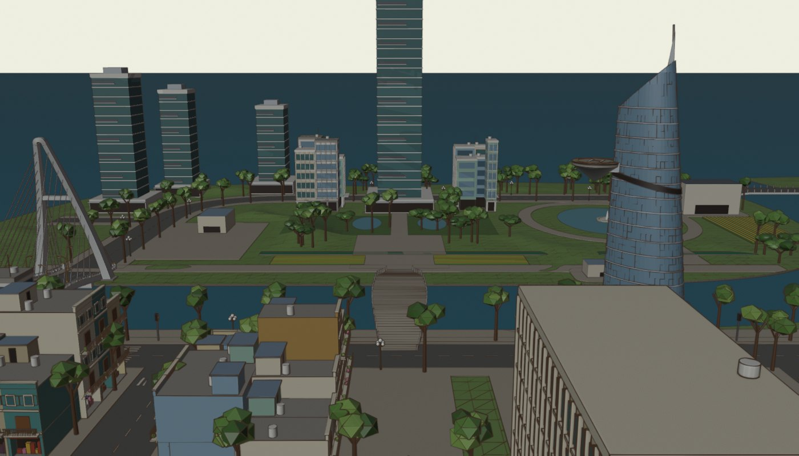

**Phân cấp đường.**
- Đại lộ có hàng cây: Lê Duẩn, Đồng Khởi, Lê Lợi, Mai Chí Thọ, Quang Trung.
- Phố thường, phố đi bộ (Nguyễn Huệ, Bùi Viện), lối dạo trong công viên.
- Đường ven biển vòng quanh từng khu. Bờ sông và bờ kênh có lối đi dạo liên tục.

**Ít block hơn nhưng to hơn**, mọi block là một lô ghi rõ trong layout (không còn lưới tự sinh): 310 căn, trước 505.
Chỗ trống thành công viên có tên ở các nút: 30/4, Tao Đàn (có lối đi chéo), 23/9, Bến Bình Đông, rừng dừa nước,
công viên Bãi Trước. Không còn bãi cỏ thừa.

**Bãi biển.**
- Bãi Trước quay về tây nam, có cầu tàu cánh ngầm (tàu từ Bạch Đằng theo kênh ra), dù, ghe.
- Bãi Sau dọc bờ đông, có khách sạn trên Thùy Vân.
- Núi Nhỏ ở mũi đông nam, có tượng Chúa và hải đăng; đỉnh núi là chỗ ngắm toàn map.

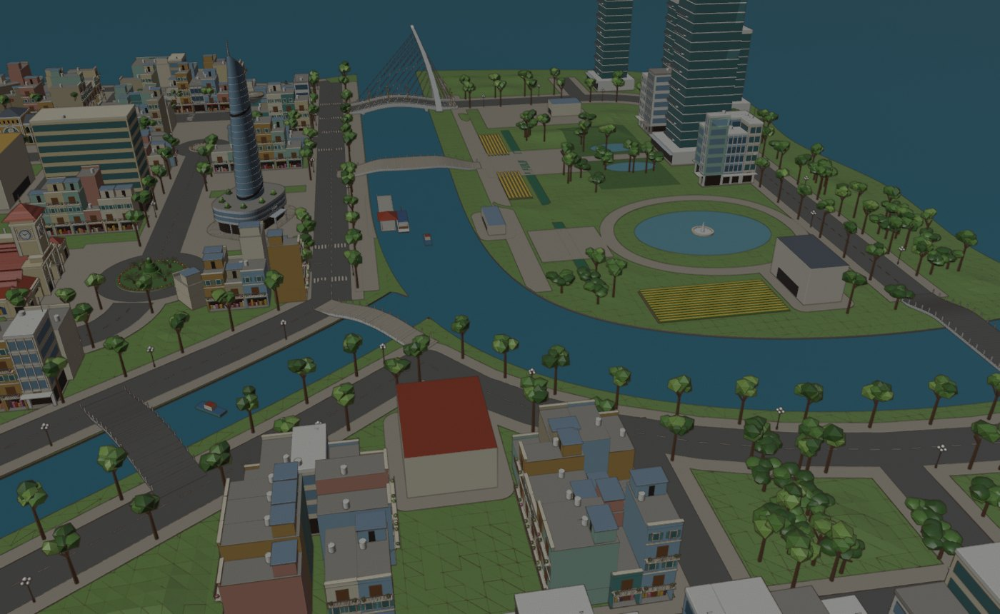
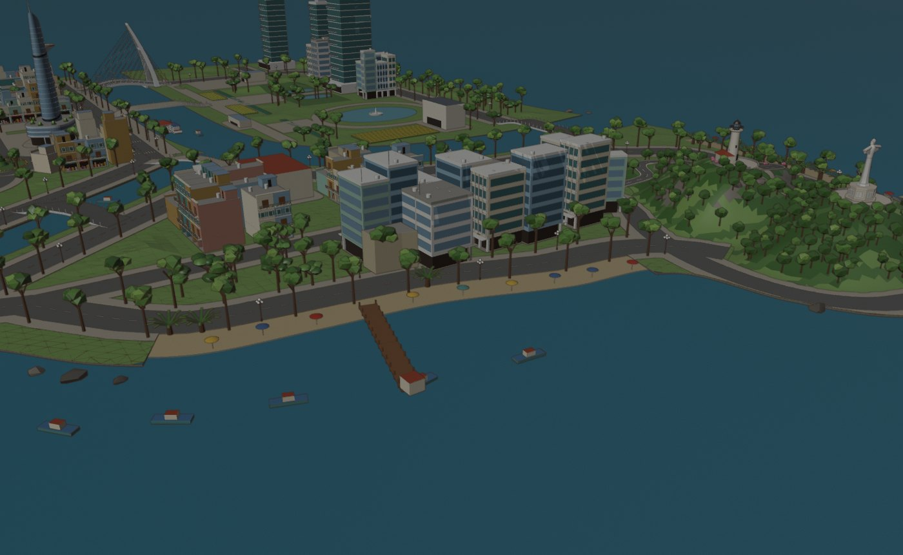
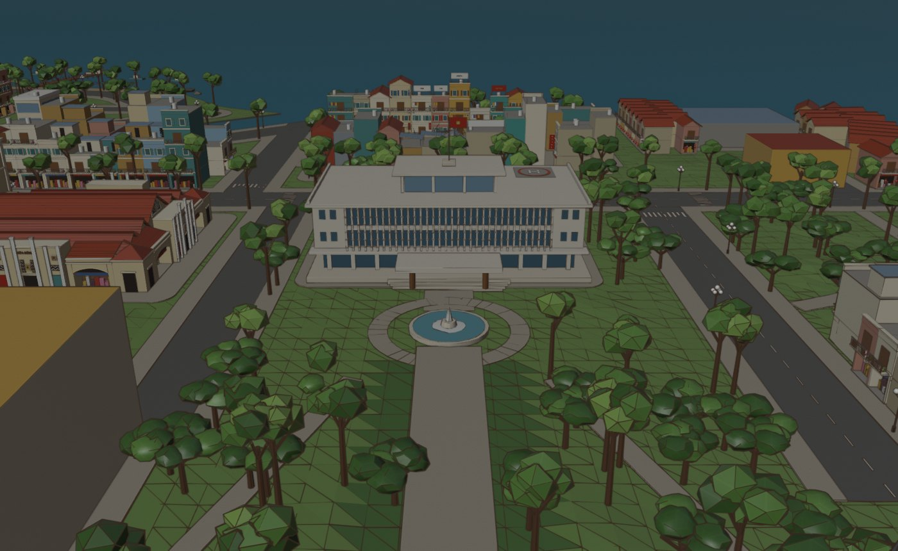
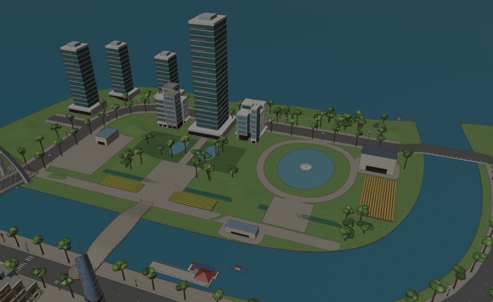

## Những gì giữ nguyên và những gì đổi

- **Giữ nguyên hình (chỉ dời hoặc xoay):** cầu Ba Son, Núi Nhỏ cùng tượng và hải đăng (vẫn chỗ cũ của v7), khối phố
  Bùi Viện v4 (dời sang tây), Dinh Thống Nhất (quay mặt về bắc nhìn lên công viên 30/4), các công trình cũ của map.
- **Đổi:**
  - Sông, thêm kênh Bến Nghé.
  - Đảo nhỏ hơn: 144 nghìn m² (v7: 156 nghìn m²).
  - Thủ Thiêm có trục chính và tháp cao ở cuối trục; ba tháp thấp ở phía bắc.
  - Khánh Hội thành khu mới giữa kênh và sông.
  - Chợ Lớn và bến xe dời về góc tây nam.
  - Nhà thờ Đức Bà quay mặt ra công xã Paris.
- **Script dựng đã hỗ trợ v8 và vẫn dựng v7 y như cũ:** kênh (`canals`), cầu đi bộ (`walk`, `wMid`), cầu tàu
  (`piers`), tuyến tham quan (`tour`, chỉ vẽ trên sơ đồ), chọn layout bằng `SAIGON_LAYOUT`.

## Sửa sau góp ý (2026-11-12)

Khoa khoanh các chỗ: đường không liền mạch, cầu đáp xuống giữa lòng đường, đường đâm vào nhà, nhà đứng chơ vơ.

- **Đầu đường:** `relayout_v8.py` có bước dọn cuối, áp cho mọi đầu đường:
  - đầu đường trong bùng binh thì kéo vào tâm (hết khấc ở công xã Paris, Lê Lai vào Quách Thị Trang);
  - đường chạy lố qua đường khác thì cắt ở ngã ba (Lê Lai ở mép biển, Đề Thám ở cửa kênh, Quốc lộ 51, Quang Trung vào chân núi);
  - đường dừng hụt thì kéo thẳng tới đường phía trước (các phố ra đường ven biển);
  - đường lệch vài mét thì dời đầu lên tim đường kia.
- **Chỗ nối:** đầu đường trong bản dựng bo tròn, nên hai đường nối đầu vào nhau ở một góc (đường ven biển và Võ Văn
  Kiệt, Quốc lộ 51 và Hạ Long) không còn khấc.
- **Cầu:**
  - Cầu đi bộ lá dừa nước xuống trên vỉa hè và lối dạo bờ sông, không còn đáp xuống lòng Tôn Đức Thắng.
  - Cầu xe (Thủ Thiêm 3, Ông Lãnh): đầu cầu nằm trên tim đường, phẳng bằng mặt đường suốt ngã ba và vỉa hè (`flat`),
    rồi mới lên dốc (`ramp`) trên mặt nước. Lan can chỉ có trên đoạn qua nước.
  - Thùy Vân bắt đầu ngay chân cầu Thủ Thiêm 3.
  - Cầu Mống đi từ vỉa hè bờ kênh bên này sang vỉa hè bên kia.
- **Không còn đường cụt:**
  - Lê Thánh Tôn chạy tiếp ngang trước mặt UBND như đường thật, tới phố mới Lý Tự Trọng sau Bến Thành. Con đường sau
    lưng UBND bắt đầu từ đó, không còn đâm vào lưng UBND.
  - Bỏ đường cụt ở phía bắc Thủ Thiêm, chỗ đó thành vườn.
  - Đường lên hải đăng nối vào Quốc lộ 51 bằng một đoạn ngắn.
- **Chợ Lớn:**
  - Bỏ con đường chạy xuyên chùa Bà Thiên Hậu và bến xe.
  - Chùa nhìn ra một quảng trường nhỏ, phố Bùi Viện chạy thẳng vào quảng trường đó.
  - Bến xe quay ra đường ven biển, dãy phố người Hoa bao quanh.
- **Bỏ block thừa:** dải nhà 8 m sát biển phía bắc, dải nhà sau Chung cư 42, khách sạn bị Thùy Vân đè.
- **Kiểm tra tự động:** `scripts/map/check_layout.py` bắt các lỗi trên: đầu đường lơ lửng, cầu đáp vào lòng đường
  hoặc lên dốc giữa ngã ba, đường đâm vào công trình, lối dạo cụt, lô nhà quá nhỏ hoặc không có đường trước mặt, công
  trình không có lối vào. v8 có 0 lỗi (v7 có 12).

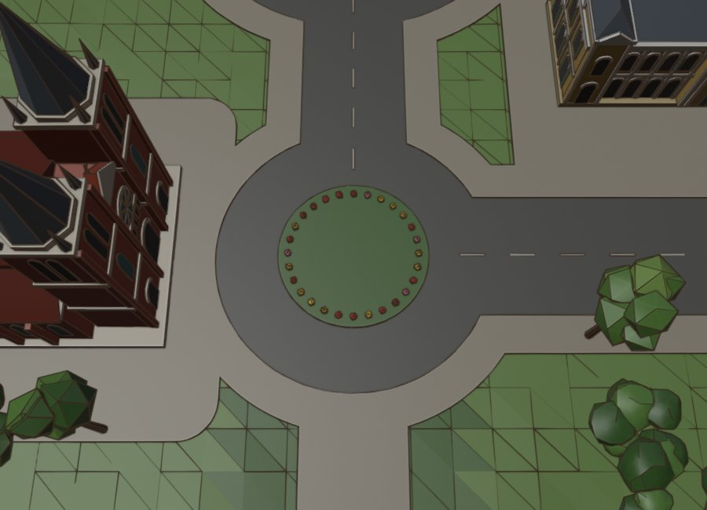
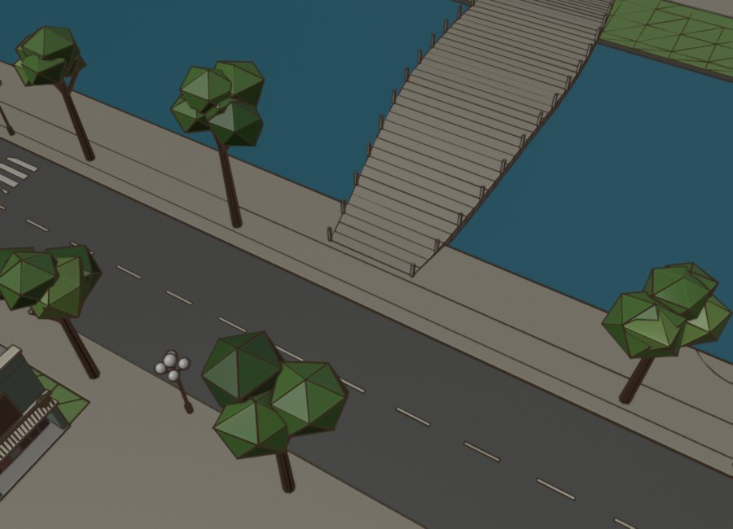
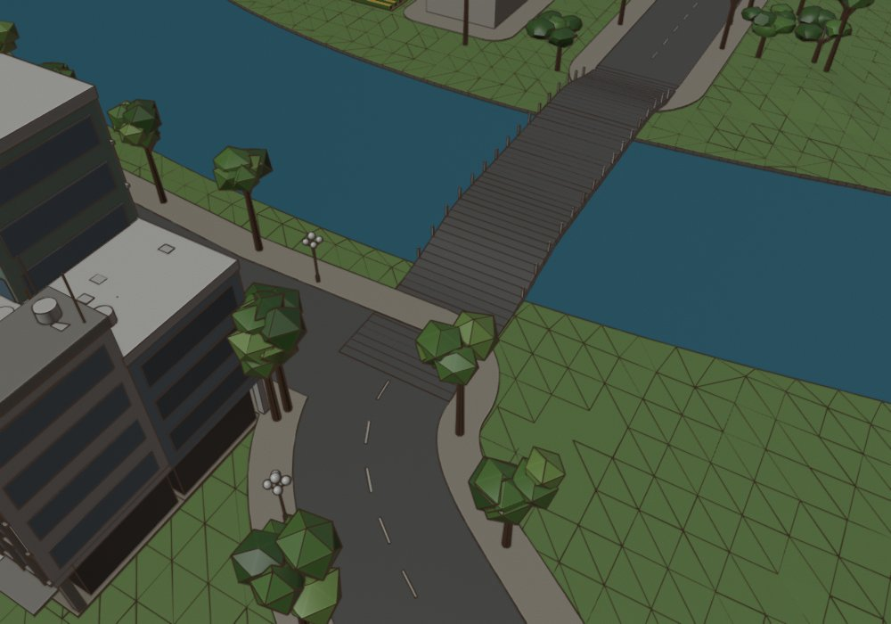
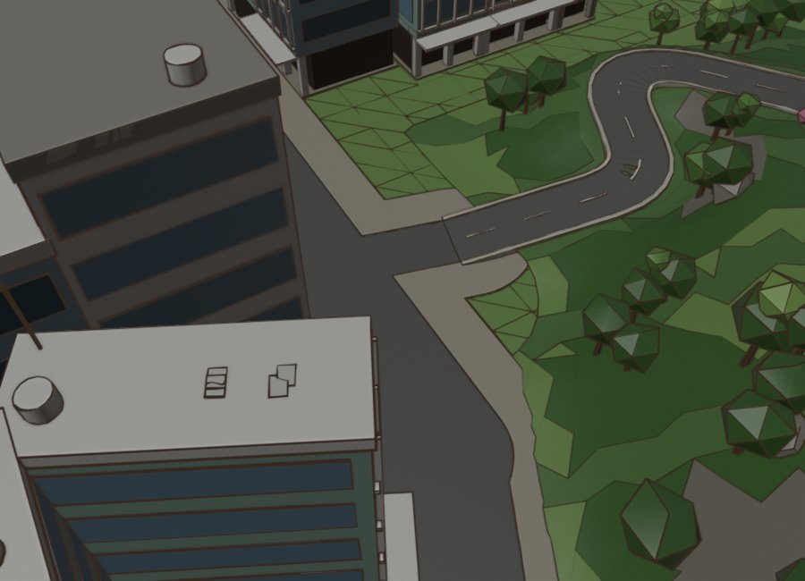
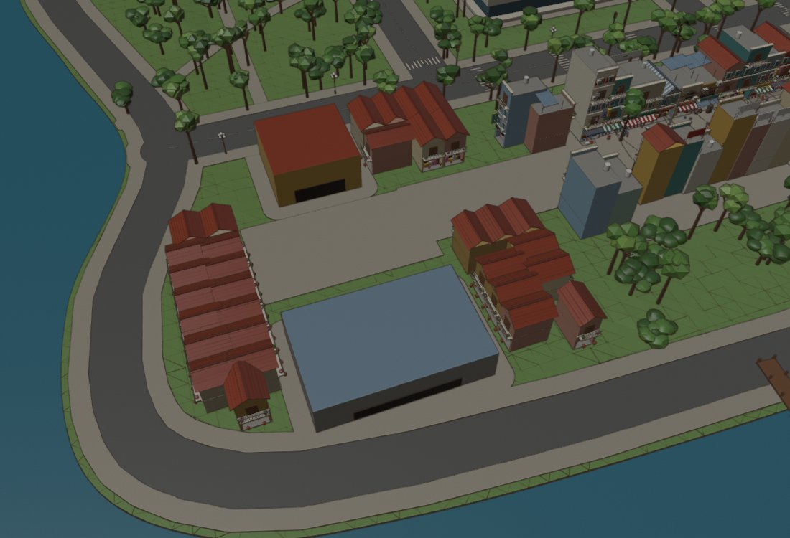
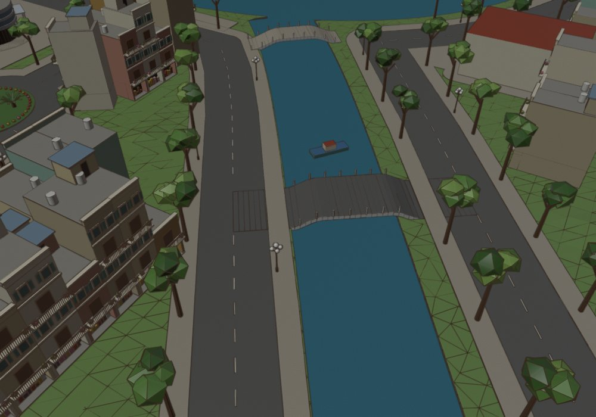
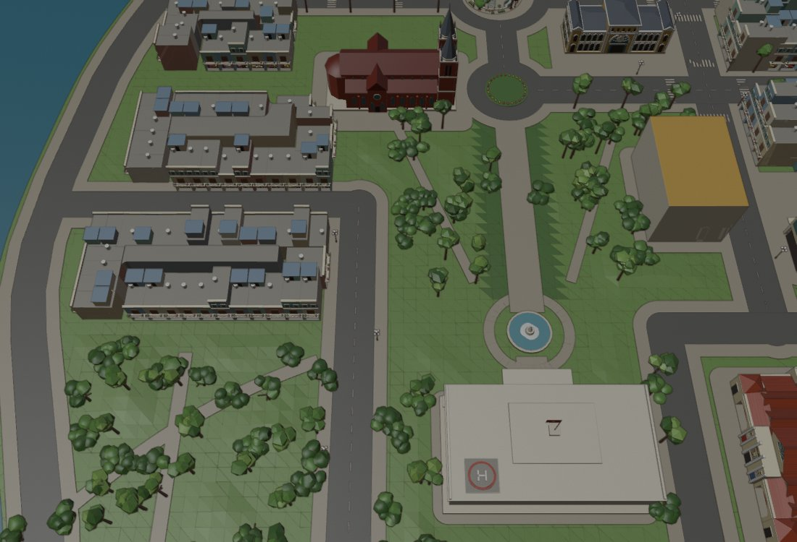
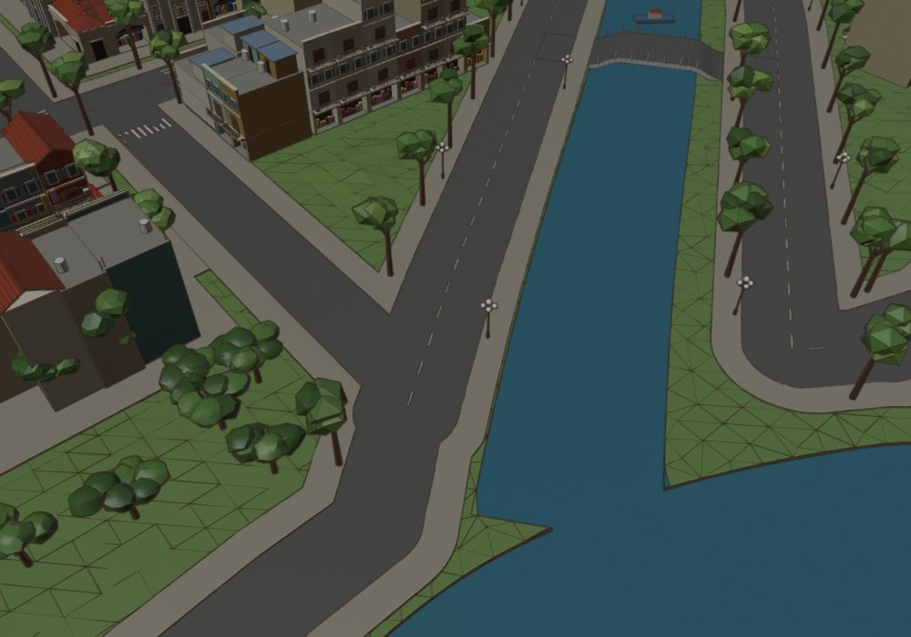

Dựng lại map chính từ v8: 315 căn nhà, 1,04 triệu tam giác, GLB 3,0 MB (gzip 1,0 MB), đã thử nạp bằng three.js.

## Game chạy trên map v8 (2026-11-12)

- **Model và nav:** `index.html` và `app.ts` nạp `models/saigon_mini.glb` và nav `models/saigon_mini`. Nav nướng lại
  bằng `scripts/blender/bake_nav.py` (profile `MINI`): lưới 1405 × 1308 ô 0,35 m, khoảng 117.000 m² đi được. Cả năm cây
  cầu và đường lên hải đăng đều đi qua được, mọi chỗ đi được đều nối với chỗ xuất hiện.
  - Mặt cầu và núi Nhỏ là "mặt che": bên dưới chúng không có sàn. Trước đây nav lấy mặt nước dưới cầu và mặt đất
    dưới núi, nên không qua được sông và người chơi đi xuyên vào lòng núi.
  - Vài khối được dựng lộn mặt (mặt cầu Ba Son, đường và lối đi trên núi). Lúc nướng, chúng được lật lại cho đúng.
    Model không đổi.
- **Nội dung** (`scripts/map/move_game_content_v8.py`, giữ nguyên id nên quest không phải sửa):
  - 19 địa điểm, 5 NPC và 3 chỗ xuất hiện được dời sang map mới.
  - "Bãi biển" giờ là cả mặt biển Vũng Tàu: Bãi Trước, đường Hạ Long quanh chân núi, rồi Bãi Sau. Đường chạy trên phần
    cát khô.
  - Bùng binh Quách Thị Trang có tầm 18 m, tính cả vòng xoay và vỉa hè.
- **Server:**
  - Server nhúng nav mới; test dùng tên file mới.
  - Migration `0008_map_v8.sql` xoá chỗ đứng đã lưu của mọi nhân vật, vì toạ độ trên đảo cũ không còn nghĩa. Lần sau
    vào, nhân vật xuất hiện ở nhà theo vai. Trình duyệt cũng bỏ chỗ đứng cũ (`sg.pose.v2`).
- **Camera:**
  - Map rộng gấp đôi nên bóng nắng đi theo chỗ đang nhìn: 160 m quanh người chơi, tới 340 m khi nhìn cả map.
  - Các điểm dừng của bản đồ nhìn dọc con đường dẫn tới công trình: Lê Lợi tới Nhà hát, Đồng Khởi tới Nhà thờ, Phạm
    Ngọc Thạch tới Hồ Con Rùa.
- **Điện thoại:** bản đồ vẽ đất, sông, kênh và mọi con đường lấy từ layout (`src/game/phone/mapLand.json`).
- **Đã thử** trong Chromium:
  - nạp map và 8 điểm dừng;
  - vào game, đi qua cầu đi bộ, cầu Ba Son, cầu Mống, cầu Thủ Thiêm 3, lên núi Nhỏ;
  - `tsc`, `i18n:check`, và test Go của content, nav, world, quest, directions, protocol đều qua. Store, ws, web chưa
    chạy được ở máy cloud vì thiếu module.

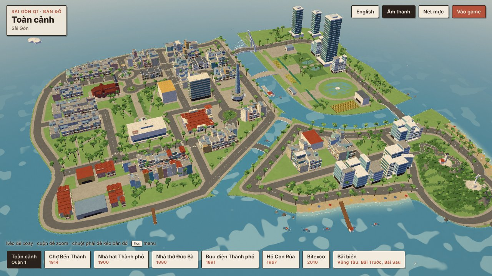
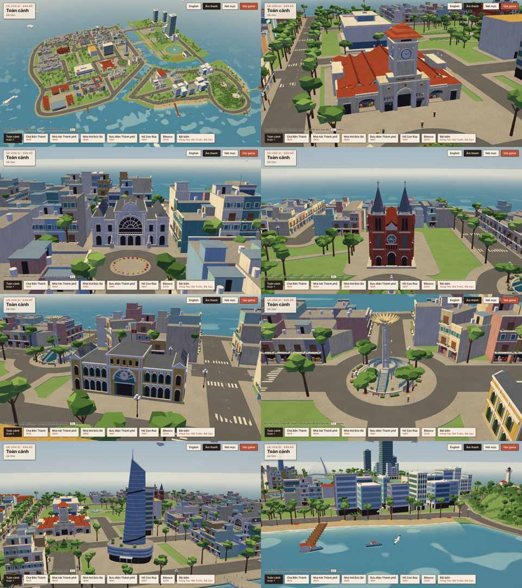
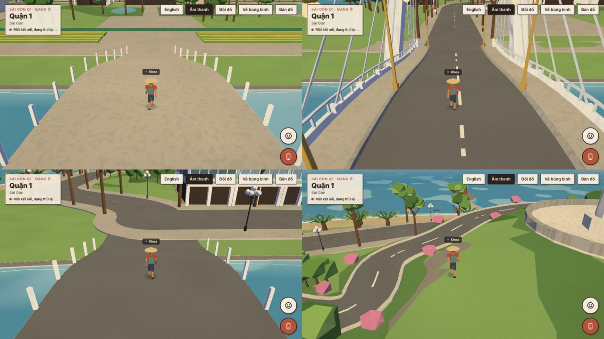
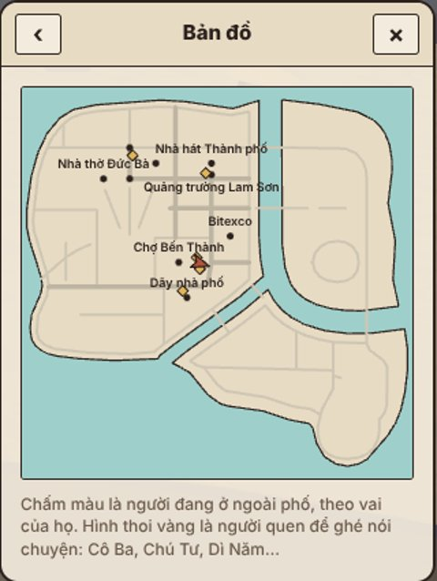

## Vòng soát toàn bản đồ (2026-11-12, sau khi chuyển game sang v8)

Khoa: mặt đường, chỗ nhà giáp đường còn nhiều chỗ chưa hợp lý, chơi còn lỗi; soát cả bản đồ, mỗi vòng tìm chỗ chưa
đẹp, so với cách người ta làm, sửa, chụp lại. Mỗi vòng có ảnh chụp trong game (góc người chơi và flycam) và một máy
đi thử 600 lộ trình ngẫu nhiên bằng chính code di chuyển của game.

**Khối nhà và mặt phố**
- Nhà xây sát mép vỉa hè, kín block, 2–4 tầng, tầng trệt bán hàng. Trước đây có những dải đất trống giữa nhà và đường.
- Nhà góc có mặt tiền ra cả hai đường.
- Hẻm xuyên qua block, hai bên là nhà nhỏ.
- Tường hông và tường sau lộ ra có cửa sổ, cục máy lạnh, cửa, chữ quảng cáo sơn trên tường; không còn mảng tường trơn.
- Sân thượng có vườn, mái tôn hoặc dây phơi đồ.
- Cà phê vỉa hè (ghế nhựa, bàn thấp, dù) trước khoảng 1/5 số nhà. Không đặt ở chỗ NPC đứng hay chỗ người chơi xuất
  hiện, và không có cây đường mọc giữa quán.
- Block nào không đặt được nhà thì bỏ. Trước đây nó thành một mảng gạch trơn, như dải bên sông ở Thủ Thiêm.

**Mặt đường**
- Đầu đường đâm vào hông đường khác thì cắt phẳng; đầu tròn trước đây lồi qua mép bên kia.
- Vạch qua đường:
  - Đặt ngay ngoài ngã tư, không nằm trong lòng giao lộ, hai nhánh không chồng lên nhau.
  - Đèn giữa block chỉ có một vạch, ngay chỗ đèn.
- Vạch giữa đường dừng trước ngã tư và trước vạch qua đường.
- Vạch sơn không còn bị mặt nhựa che từng khúc: hiệu ứng nét vẽ tay trước đây làm nhấp nhô cả mặt đường lẫn vạch.
- Đảo giao thông và dải phân cách hình nêm là bãi cỏ có cây, thay cho mảng gạch trơn.

**Công trình mới thay khối thô**
- UBND, Chung cư 42, Bến Bạch Đằng, Bến Nhà Rồng, chùa Bà Thiên Hậu, Bến xe Chợ Lớn, Công viên Sáng Tạo, Nhà thờ
  Thủ Thiêm, bến buýt đường sông.
- Bến xe: mỗi sân đỗ có mái che riêng trên một hàng cột.

**Cây, hoa, nước**
- Vườn hoa Thủ Thiêm làm theo đường hoa Nguyễn Huệ: bồn hoa xây cao 0,6 m, mỗi bồn một màu, lối đi lát gạch giữa và
  cắt ngang các bồn. Trước đây là những cục hoa rời rạc; người chơi bước lên thì nhấp nhô và kẹt.
- Bùng binh: luống hoa vòng cung nhiều màu sau một viền cây cắt xén, thay cho những cục hoa rời trông như kẹo.
- Thêm cây đường: đường lớn mỗi 13 m, đường nhỏ mỗi 21 m.
- Bãi biển có dải cát khô phía trên, cát ướt sát nước.

**Chợ Lớn**
- Đoạn phố đi bộ phía tây phố Bùi Viện, giữa hai dãy nhà người Hoa, trước đây là 40 m gạch trống.
- Nay có dây lồng đèn đỏ giăng ngang như phố lồng đèn Lương Nhữ Học, treo vào mặt tiền, chỗ không có nhà thì có cột.

**Lỗi khi chơi**
- Cầu Thủ Thiêm 3, cầu đi bộ, cầu Mống có lan can liền. Trước đây giữa các cột lan can bị hở, người chơi bước khỏi mép
  dốc cầu rồi không lên lại được.
- Cầu Mống: đầu cầu có lối lát gạch nối vào vỉa hè, không đáp xuống bãi cỏ.
- Camera: khi sau lưng người chơi là nhà, camera nâng lên nhìn qua mái thay vì dí sát vào lưng (`followCamera.ts`).
- Kiểm tra nav:
  - Mọi NPC, mọi điểm xuất hiện và các điểm thử đều tới được từ chỗ xuất hiện.
  - 600 lộ trình ngẫu nhiên: 596 tới nơi.
  - 4 lộ trình còn lại kẹt ở mép bậc trên lối núi Nhỏ và gờ bồn phun nước trước Dinh Thống Nhất, vì máy đi thử cứ ủi thẳng vào; người chơi tự lách được.

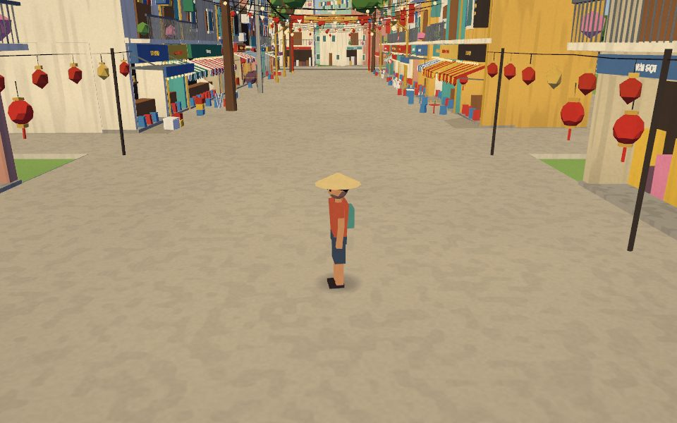
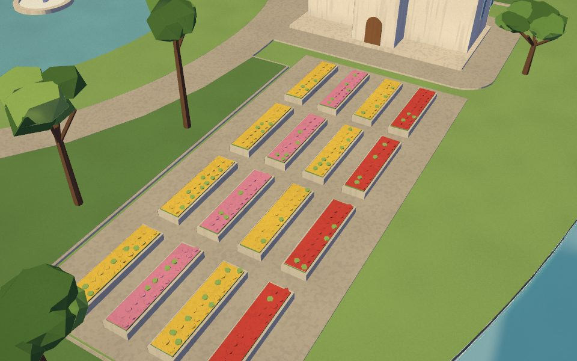
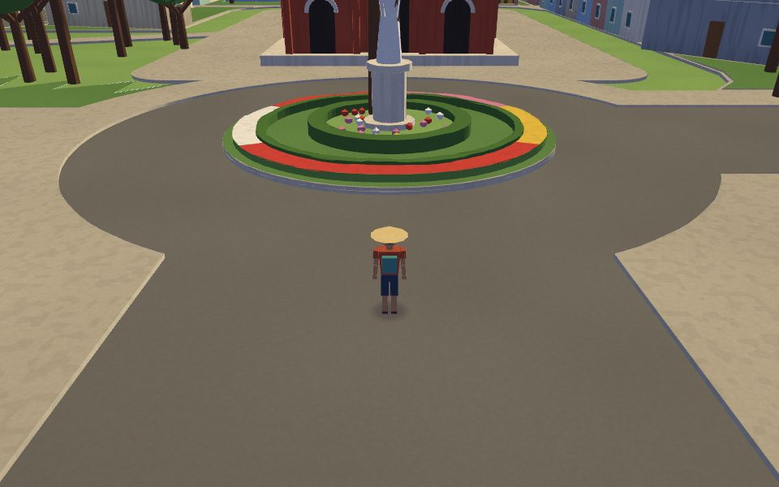
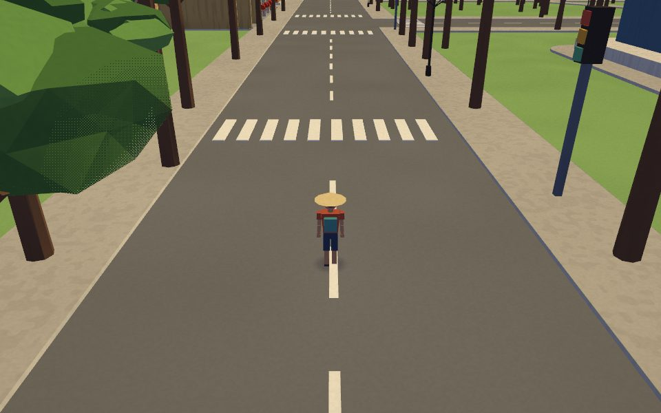
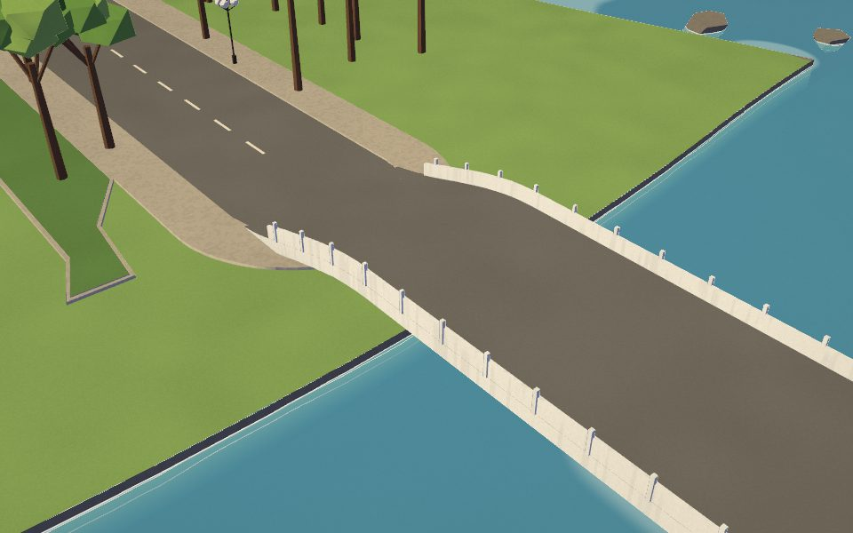
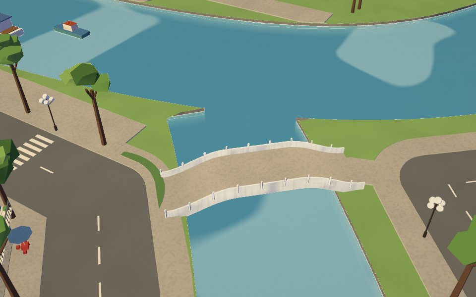

Map sau vòng này: 337 căn nhà, 1,26 triệu tam giác, GLB 3,7 MB (gzip 1,3 MB).

## Địa điểm và HUD theo map v8 (2026-11-13)

Trước đây chỉ có 19 địa điểm, hầu hết ở Quận 1. Ra ngoài Quận 1 (hay đứng giữa hai địa điểm), HUD vẫn ghi "Quận 1".

- **Loại địa điểm mới `district`:** mỗi khu là một vùng: Quận 1 (thêm dải bờ kênh Bến Nghé), Chợ Lớn, Thủ Thiêm,
  Khánh Hội, Vũng Tàu. Vùng khu xếp sau công trình, đường và khu nhỏ (công viên, bãi biển).
  - Vì vậy không chiếm chỗ của địa điểm nào sẵn có. Bãi biển và Công viên 23/9 vẫn đủ phạm vi cho nhiệm vụ.
  - Server (`content.go`, `world/observe.go`) và game (`places.ts`) xếp hạng giống nhau.
  - Gần như mọi chỗ đi được trên map đều có tên; chỉ còn hai mẩu nhỏ ở mép đảo.
- **11 công trình mới** (14 lúc đầu, bớt 3 cái bị xoá khi duyệt, xem mục dưới):
  - Quận 1: Chung cư 42, Dinh Độc Lập, Bến Bạch Đằng, cầu Ba Son, cầu đi bộ lá dừa nước.
  - Chợ Lớn: bến xe Chợ Lớn.
  - Thủ Thiêm: nhà thờ, bến buýt đường sông.
  - Khánh Hội: Bến Nhà Rồng.
  - Vũng Tàu: hải đăng, tượng Chúa Kitô Vua.
  - Công trình nào cũng có thẻ giới thiệu khi tới lần đầu, có trong Cẩm nang, trong danh sách điểm đến của Crab và
    trong mục hỏi đường.
- **Khu nhỏ và đường mới:**
  - Công viên 30/4, Tao Đàn, vườn hoa Thủ Thiêm, núi Nhỏ.
  - Phố đi bộ Bùi Viện, phố lồng đèn.
  - Cầu Mống, cầu Ông Lãnh, cầu Thủ Thiêm 3.
- **Bản đồ:** thêm điểm dừng Chung cư 42 (trên phố đi bộ Nguyễn Huệ), nhà thờ Thủ Thiêm (qua vườn hoa), phố lồng đèn
  Chợ Lớn, Bến Nhà Rồng, hải đăng Vũng Tàu.
- **Chữ:**
  - Menu và tiêu đề: "Sài Gòn mini". Lời giới thiệu tả cả map mới.
  - HUD: "Sài Gòn mini · đang ở"; chỗ không tên ghi "Sài Gòn · TP. Hồ Chí Minh".
  - "Người đang ở Sài Gòn", bản đồ điện thoại, Cẩm nang và câu dẫn chọn vai cũng đổi theo.
  - Câu chuyện của du khách và tài xế vẫn bắt đầu ở Quận 1, như cũ.

## Duyệt 9 công trình mới (2026-11-13)

Khoa duyệt trên trang ảnh trước/sau (artifact "Duyệt công trình v8").

- **Giữ:** Bến Bạch Đằng, bến buýt đường sông, nhà thờ Thủ Thiêm, bến xe Chợ Lớn.
- **Xoá:** UBND Thành phố, chùa Bà Thiên Hậu, sân khấu Công viên Sáng tạo. Model lẫn địa điểm đều bỏ.
  - Lô UBND thành nhà phố.
  - Chỗ chùa Bà để lại quảng trường Chợ Lớn ở cuối phố lồng đèn.
  - Chỗ sân khấu thành sân lát gạch của Thủ Thiêm.
- **Dời Chung cư 42** về phía bắc phố đi bộ Nguyễn Huệ, gần đầu bờ sông (số 42 ở dãy số chẵn). Mặt có ban công quay
  thẳng ra phố, sát mép phố; tầng trệt là quán.
- **Dời Bến Nhà Rồng** ra mũi đất Khánh Hội, chỗ kênh Bến Nghé gặp sông Sài Gòn, mặt tiền nhìn ra nước. Sân trước nối
  với chân cầu Mống.
  - Đường Nguyễn Tất Thành không vòng qua mũi đất nữa, mà chạy thẳng vào Bến Vân Đồn phía sau bến.
  - `check_layout.py` báo 0 lỗi.
- **Kiểm tra:**
  - Mọi NPC, mọi chỗ xuất hiện và các điểm thử đều tới được.
  - 400 lộ trình ngẫu nhiên: 399 tới nơi.
  - Test Go của content, world, quest, directions, nav đều qua.
- Map: 353 căn nhà, GLB 3,76 MB (gzip 1,35 MB). Bản đồ điện thoại (`mapLand.json`) dựng lại theo đường mới.

## Chưa làm

- Model thật cho cầu Thủ Thiêm 3, cầu Ông Lãnh, cầu Mống (hiện là mặt cầu thô có lan can) và tháp Thủ Thiêm.
- Văn phòng bến xe Chợ Lớn còn là khối trơn mái bằng; dãy nhà Bùi Viện (model cũ) có vài căn cao, hẹp, tường hông trơn.

## Nguồn

- [The Image of the Open World Game (Wellesley)](https://cs.wellesley.edu/~pmwh/mvmap/papers/open_world_elements/open_world_elements.html)
- [Level Layout, Disneyland Style: wienies](https://www.above-the-garage.com/wienies/)
- [What Mario learned from Mickey Mouse, phần 3: weenies (Game Developer)](https://gamedeveloper.com/design/what-mario-learned-from-mickey-mouse---part-3-decision-making-and-weenies)
- [Crafting a Tiny Open World: A Short Hike postmortem (GDC Vault)](https://gdcvault.com/play/1026613/Independent-Games-Summit-Crafting-A), [tóm tắt trên 80.lv](https://80.lv/articles/gdc-a-short-hike-postmortem)
- [Sable: cấu trúc thế giới hình quả chanh (Game Developer)](https://www.gamedeveloper.com/design/using-a-lemon-shaped-structure-to-create-the-sanguine-open-world-of-i-sable-i-)
- [Messenger, game trình duyệt của abeto (Aftermath)](https://aftermath.site/messenger-browser-game-abeto)
- [Thủ Thiêm, bãi bồi trong khúc sông Sài Gòn (Wikipedia)](https://www.wikiwand.com/en/articles/Thu_Thiem_New_Urban_Area)
- [Cầu đi bộ qua sông Sài Gòn hình lá dừa nước (SGGP)](https://www.sggp.org.vn/cau-di-bo-qua-song-sai-gon-hinh-la-dua-nuoc-post709248.html)
- [Tứ giác vàng di sản Sài Gòn xưa (Doanh Nhân Plus)](https://doanhnhanplus.vn/tu-giac-vang-di-san-sai-gon-xua-482016.html)
- [Phố lồng đèn Lương Nhữ Học, Chợ Lớn (Tuổi Trẻ)](https://tuoitre.vn/pho-long-den-khong-gian-trung-thu-ruc-ro-giua-long-cho-lon-chinh-thuc-khai-hoi-20250924181317253.htm)
